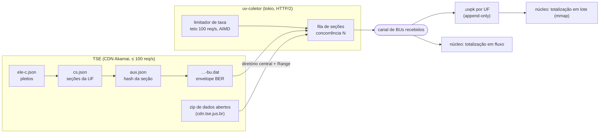
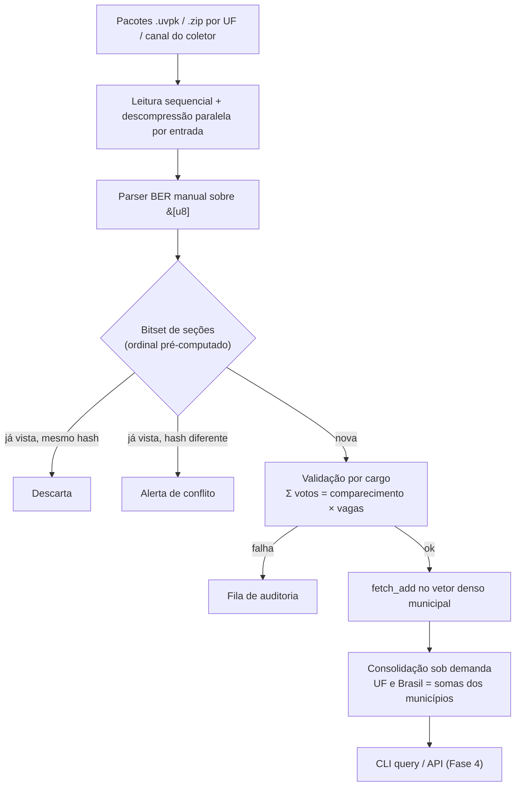
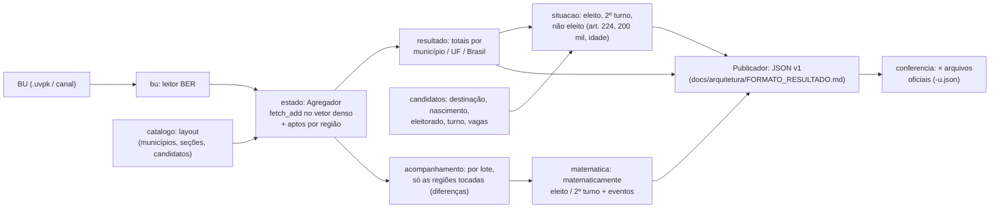
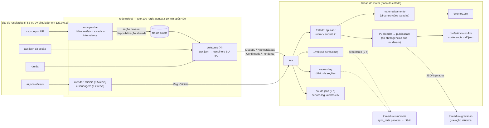

# 🏗️ Arquitetura do Sistema: Urna Velox

Este documento descreve o pipeline de processamento, o modelo de concorrência e as estruturas de dados em memória do **Urna Velox**. As decisões e suas alternativas estão registradas em [docs/arquitetura/ARCHITECTURE_DECISIONS.md](docs/arquitetura/ARCHITECTURE_DECISIONS.md) (referenciadas aqui como ADR-NNN); os números de memória e tempo vêm de [docs/arquitetura/ESTIMATIVAS_MEMORIA_E_TEMPO.md](docs/arquitetura/ESTIMATIVAS_MEMORIA_E_TEMPO.md). Termos técnicos: [docs/arquitetura/GLOSSARIO.md](docs/arquitetura/GLOSSARIO.md).

---

## 1. Princípios Arquiteturais

1. **Estado calculável antes da eleição.** Candidatos, municípios e seções são públicos antes do pleito. O motor pré-computa um layout denso e sabe, antes de ler o primeiro BU, exatamente quanta memória vai usar (ADR-002).
2. **Parsing sem alocação.** O caminho rápido lê o BER diretamente da fatia de bytes `&[u8]` e entrega cada voto ao agregador sem criar objetos intermediários (ADR-007).
3. **Uma escrita por voto.** Cada voto incrementa um único contador municipal com `fetch_add` atômico relaxado. UF e Brasil são somas derivadas, não propagadas a cada voto (ADR-003, ADR-004).
4. **Idempotência com auditoria.** Cada seção é contada uma única vez; um BU repetido com conteúdo diferente vira alerta, nunca descarte silencioso (ADR-006).
5. **Validação por cargo.** Cada BU é conferido cargo a cargo contra `comparecimento × vagas` (ADR-008).

---

## 2. Pipeline de Processamento de Dados

### 2.0. Aquisição dos BUs (ADR-013 a ADR-018)

Antes do núcleo vem a **aquisição** (`aquisicao/`, binário `uv-coletor`), que busca os BUs brutos publicados pelo TSE e os entrega ao núcleo. Detalhes e medições: [docs/arquitetura/AQUISICAO.md](docs/arquitetura/AQUISICAO.md).



* **Lista de trabalho:** `cs.json` de cada UF (517.179 seções no 1º turno de 2026). Na noite da eleição, o modo `acompanhar` relê esses arquivos com `If-None-Match` e só coleta seções novas ou alteradas.
* **Por seção:** `aux.json` (escolhe o último conjunto "Totalizado") e depois o BU. Duas requisições; ~0,5 s cada quando o arquivo não está no cache do CDN. A coleta é **limitada por latência**: vazão ≈ requisições em andamento ÷ latência, até o teto de 100 req/s (~50 seções/s).
* **Entrega:** canal em memória para o núcleo e pacote `.uvpk` (um arquivo por UF, BU intocado, retomável). O tempo da eleição inteira é dominado pela rede, não pela totalização.

### 2.1. Pipeline do núcleo



### 2.2. Ingestão de I/O (ADR-010)
- Lê os BUs **de dentro dos pacotes compactados**, sem extrair 500 mil arquivos para disco (no NTFS, abrir arquivos soltos com antivírus ativo domina o tempo total).
- Descompressão paralela por entrada; `memmap2` é opcional e as páginas mapeadas não contam no orçamento de memória do motor.
- Modo `watch` (Fase 3): `notify` síncrono alimenta a mesma fila de trabalho.

### 2.3. Camada de Parsing ASN.1/BER (ADR-007, ADR-017)
- Leitor TLV escrito à mão: lê tag e comprimento (formas curta e longa) e percorre só os campos usados: identificação da seção, comparecimento por cargo e lista de votáveis `(tipo, quantidade, partido, código)`.
- O BU real é um `EntidadeEnvelopeGenerico` cujo `conteudo` contém o `EntidadeBoletimUrna`; campos irmãos `SEQUENCE` são distinguidos pela posição. Como os bytes vêm da rede, todo acesso é verificado (erro, nunca pânico). Implementação atual: `motor/src/bu.rs` (até a v0.0.22, `aquisicao/src/bu.rs`), conferida total a total com `asn1tools` + `bu.asn1` oficial e, desde a v0.0.24, por fixtures de BUs reais (`motor/tests/fixtures`).
- Esquema ASN.1 oficial do TSE compilado com `rasn` como **decodificador de referência**; todo *fixture* é decodificado pelos dois e os resultados precisam coincidir.
- Diferenças de esquema entre eleições (2022, 2024, 2026) ficam isoladas em módulos por versão.

### 2.4. Deduplicação e Idempotência (ADR-006)
Chave do BU: `(pleito, turno, município, zona, seção)` → **ordinal da seção**, conhecido a partir do catálogo de seções.

- Bitset de 500 mil bits (61 KB) com `fetch_or` atômico.
- Hash curto (8 bytes) do BU aceito, para distinguir reenvio idêntico de conflito.
- Seções fora do catálogo previsto geram alerta.

### 2.5. O motor: crate `urna-velox` (etapa 1, v0.1.0)

Desde a v0.0.23 o núcleo é um crate próprio, **`urna-velox`** (`motor/`, biblioteca `urna_velox` + binário
`uv-motor`), num workspace Cargo com a aquisição (`aquisicao/`, crate `uv-aquisicao`, binário `uv-coletor`, que
depende do motor). O motor não faz rede.



| módulo | papel |
|---|---|
| `bu` | leitor BER do BU (`-bu.dat`, `-busa.dat`; 2024 e 2026), sem alocação e sem pânico |
| `pacote` | `.uvpk` (escrita só de acréscimo, leitura mapeada em memória) |
| `catalogo` | layout do estado: UFs, municípios, seções, cargos, candidatos por UF ou por município |
| `estado` | vetor denso de `AtomicU32`, aptos e seções por região, agregador, totalização em lote |
| `resultado` | totais por abrangência e o `Publicador` do formato JSON |
| `candidatos` | o que a situação precisa e não está nos BUs, por circunscrição (Brasil, UF ou município), com o sistema (maioria absoluta sobre aptos ou nominal; simples com `k` vagas) e o art. 224 (todo cargo majoritário desde a `1.0.35`, B-070) |
| `situacao` | situação final dos candidatos |
| `matematica` | matematicamente eleito / 2º turno com o eleitorado restante (`R`), empate pela idade |
| `acompanhamento` | reavaliação por lote só das circunscrições tocadas, somando a diferença dos contadores; eventos com sequência e horário |
| `noite` | reprodução da noite em ordem de chegada; antecedência sobre a totalização do TSE |
| `metricas`, `oficial`, `conferencia` | métricas da coleta (anuladas, não instaladas, horários), arquivos oficiais e conferência (estado e publicações) |

Binário: `uv-motor totalizar | conferir | conferir-publicacao | noite | inspecionar`. Testes: unidade (tabelas de
situação e de "matematicamente", força bruta), fixtures (`cargo test -p urna-velox`) e as conferências completas com
os dados locais (`UV_DADOS=… cargo test -p urna-velox -- --ignored`).

Desde a `v0.2.2` o estado também **retira** um BU (`Estado::retirar`/`substituir`, o mesmo agregador com `fetch_sub`;
ADR-019): é o que permite trocar o BU de uma seção reenviada e anular uma seção depois de totalizada.

### 2.6. O serviço da noite: `uv-servico` e o site simulado `uv-simulador` (etapa 3, v0.2.2)

`uv-servico` (crate `uv-aquisicao`, `aquisicao/src/servico.rs`) roda a noite inteira sozinho. A rede roda em tarefas
`tokio`; o motor roda numa **thread nativa**, única dona do estado, do diário e dos pacotes, que recebe as mensagens por
canal (`crossbeam`) — o motor continua sem rede e sem `tokio` (ADR-012/014). Operação: [docs/operacao/OPERACAO.md](docs/operacao/OPERACAO.md).



* **Qual BU vale em cada seção** é decidido pelo diário (`secoes.log`, só de acréscimo): `aplicado`, `substituido`
  (reenvio com conteúdo diferente), `anulado` (seção anulada depois de totalizada, ou desfeita), `reenvio_identico`
  (hash novo, mesmo SHA-256), `nao_instalada`, `agregada`, `confirmado`, `pendente`. O BU é gravado no `.uvpk` (e
  entregue ao sistema operacional) **antes** da linha do diário que o cita; na retomada, o serviço aplica o BU que o
  diário manda, lido do pacote, e guarda os BUs do pacote sem linha no diário (queda entre os dois) como cache: nenhum
  BU perdido, nenhum contado duas vezes.
* **Rede**: as mesmas peças do `uv-coletor` (`coletor.rs`: limitador GCRA, novas tentativas). `Rede::para` impõe, para
  qualquer host que não seja `127.0.0.1`/`localhost`/`::1`, teto de 100 req/s e **pausa global** ≥ 600 s depois de
  qualquer 429 (nenhuma requisição, nem as que já esperavam a vez); só o site simulado aceita aceleração, e então a rede
  recusa qualquer outra URL. Seção sem disponibilização no `cs.json` não gera requisição, salvo a sondagem limitada do
  fim da noite (não instaladas; [docs/operacao/OPERACAO.md](docs/operacao/OPERACAO.md) §3).
* **Fim da apuração**: todas as abrangências publicadas com as seções esperadas totalizadas (BUs + não instaladas),
  fila vazia e toda seção publicada resolvida — ou `CONFERIR`/`--conferir-a-cada`. Esperadas = o total do catálogo
  (listadas no `cs.json` menos as agregadas, as do `candidatos.json` e as descobertas na noite; o mesmo da página e,
  em 2024 e 2026, igual ao `s.ts` oficial final em todas as abrangências), com o `s.ts` pré-apuração só como piso
  (desde a 0.9.2, B-051: antes valia só o `s.ts`, que desatualizado encerrava a apuração cedo). Publica a situação
  final e confere com os oficiais. Um BU que chegue depois reabre a publicação.
* **Fora da thread do motor** (para que nada lento atrase o BU seguinte): a gravação dos arquivos da publicação
  (thread `uv-gravacao`, desde a v0.2.4; junta versões acumuladas do mesmo arquivo) e o `sync_data` dos pacotes e do
  diário a cada 2 s (thread `uv-sincronia`, desde a v0.2.6, com cópias dos descritores; antes ficava na thread do motor e
  era a maior parte do p99 de BU → publicação — [RELATORIO_0.3.0.md](docs/relatorios/RELATORIO_0.3.0.md) §4). O motor só entrega os
  dados ao sistema operacional, o que já basta contra `kill -9`.

`uv-simulador` (`aquisicao/src/simulador.rs`, ADR-020) serve em `127.0.0.1` os mesmos caminhos do site real a partir
dos dados locais (pacotes, `cs.json`, métricas da coleta, oficiais), com relógio acelerado e falhas por parâmetro, e
registra cada requisição em `simulador.log`. É contra ele que os critérios da etapa 3 e os testes
`aquisicao/tests/servico.rs` rodam — o mesmo binário e o mesmo código da noite, só com `--base http://127.0.0.1:<porta>`.

### 2.7. Difusão em tempo real: WebSocket e REST no `uv-servico` (etapa 4, v0.3.2, ADR-026)

Com `--http <end:porta>`, o resultado sai do serviço para os clientes sem passar pelo disco e sem que a totalização
espere ninguém ([docs/arquitetura/PROTOCOLO_WS.md](docs/arquitetura/PROTOCOLO_WS.md)):

```
thread uv-motor ── JSON por abrangência×cargo ──▶ thread uv-gravacao ──┬─▶ arquivo publicado (gravação atômica)
                                                (String → Bytes, sem    │
                                                 cópia; entrega ANTES   └─▶ canal sem limite ──▶ thread uv-difusao
                                                 de gravar)                                       │ monta a mensagem do
eventos (eventos.csv) e estado (saude) ───────────────────────────────────────────────────────▶ │ tópico UMA vez
                                                                                                  ▼
                                                              tokio::sync::watch por tópico (só o último valor)
                                                                                                  │
                          runtime uv-http (--http-threads): axum, uma tarefa por conexão (StreamMap dos watch
                          inscritos) ──▶ mesma mensagem (Utf8Bytes, contagem de referência) para todos os inscritos
```

* O motor continua sem rede e sem `tokio`; a difusão está toda no `uv-aquisicao` (`aquisicao/src/difusao.rs`).
* Cliente lento não acumula fila: o `watch` junta as versões e a conexão recebe a mais recente (`aviso seq_pulado`);
  30 s sem conseguir escrever, a conexão cai. A mensagem de resultado carrega os bytes do arquivo publicado
  intactos; REST com `ETag` = `seq` e 304, só leitura, pela tabela de tópicos.
* Limites (clientes, tópicos, taxa e tamanho das mensagens recebidas, *handshake*) e medidas em `saude.json` →
  `difusao`; operação em [docs/operacao/OPERACAO.md](docs/operacao/OPERACAO.md) §7; cliente de carga e conferência `uv-carga`.

### 2.8. Página de resultados e marcos da noite (etapa 5, v0.4.1, ADR-027)

```text
thread do motor ── lote ──> marcos.rs (primeira seção, seção decisiva, faltam = 0 no evento) ─┐
            └─ verificação 1 s ──> faltam_para_mat (motor/matematica.rs), viradas, % seções ────┤──> marcos.csv
                                                                                                └──> uv-difusao ──> "marco" (op: marcos), GET /api/v1/marcos
candidatos.json (nomes de UFs, municípios, partidos, vices) ──> GET /api/v1/nomes
site/dist/ (include_bytes!, aquisicao/src/pagina.rs) ──> GET /  e  /static/<arquivo>  (CSP 'self')
```

* A página (`site/`) é estática, embutida no binário, e só usa o protocolo público; redesenha no máximo uma vez por
  quadro e anima só por `transform`/`opacity` (CLS = 0). Regras e build em [site/README.md](site/README.md).
* Os marcos que dependem de qual seção entrou no lote ou da conta do "matematicamente" são calculados na thread do motor
  (p50 de ~0,002 ms por lote); o resto (primeiro eleito por cargo, disputas, comparecimento) a página calcula.

---

## 3. Modelo de Dados e Estruturas em Memória

### 3.1. Layout denso (ADR-002)

```rust
/// Chave lógica do BU (não é usada no caminho quente; vira um ordinal)
pub struct SectionKey { pub pleito: u16, pub turno: u8, pub municipio: u32, pub zona: u16, pub secao: u16 }

/// Códigos de cargo do TSE
#[repr(u8)]
pub enum CargoKind {
    Presidente = 1, Governador = 3, Senador = 5, DeputadoFederal = 6,
    DeputadoEstadual = 7, DeputadoDistrital = 8, Prefeito = 11, Vereador = 13,
}

/// Configuração do pleito: cargos, vagas por cargo (Senador = 2 em 2026), códigos
pub struct Pleito { pub cargos: Vec<CargoKind>, pub vagas: [u8; 16], /* ... */ }

/// Layout pré-computado a partir dos dados de candidatura
pub struct Layout {
    pub base: Vec<u32>,            // [municipio * n_cargos + cargo] -> 1º slot da região
    pub n_cand: Vec<u32>,          // [municipio * n_cargos + cargo] -> candidatos da UF/cargo
    pub cand_index: Vec<CandMap>,  // [uf * n_cargos + cargo] -> número do candidato -> índice
    pub secao_ordinal: SecaoMap,   // (município, zona, seção) -> 0..n_secoes
}

/// Estado vivo da totalização
pub struct ElectoralState {
    pub tally: Vec<AtomicU32>,     // todas as regiões (município, cargo), contíguas
    pub secoes: Vec<AtomicU64>,    // bitset de deduplicação
    pub hash_bu: Vec<AtomicU64>,   // hash curto do BU aceito por seção
    pub epoca: AtomicU64,          // ADR-005 (modo contínuo)
}
```

Região de cada par (município, cargo):

| deslocamento | conteúdo |
|---|---|
| `0 .. n_cand` | votos nominais, um contador por candidato da UF/cargo (Prefeito, Vereador e consultas: do município) |
| `n_cand .. n_cand+100` | votos de legenda (partido 0–99) |
| `n_cand+100` | brancos |
| `n_cand+101` | nulos (inclui os votos de seção anulada pela Junta) |
| `n_cand+102` | comparecimento |
| `n_cand+103` | votos em cargo sem candidato |
| `n_cand+104` (`OFF_VNT`) | nulos técnicos: votos nominais em número sem candidato no catálogo (com alerta em `Estado::lista_alertas_vnt`) |

*(Layout implementado em `motor/src/catalogo.rs`, `EXTRA` = 105 slots além dos candidatos; a tabela acima foi
atualizada na v0.1.0 e na v0.1.7 (`OFF_VNT`, desde a v0.1.4). Fora do vetor, o estado
guarda por região os eleitores aptos das seções totalizadas — para o "matematicamente" — e por município as seções
totalizadas.)*

`u32` basta por município; UF e Brasil são somados em `u64`.

### 3.2. Concorrência (ADR-003)
- **Lote:** uma thread por núcleo lógico; cada thread pega blocos de 64 BUs de um contador atômico e aplica `fetch_add(Relaxed)` no vetor. Nenhum lock, nenhuma cópia por thread.
- **Contínuo (Fase 3, ADR-005):** parsers em paralelo, uma thread agregadora aplica deltas em lote e publica uma época; consultas usam o padrão *seqlock* e devolvem a época, ou seja, quantos BUs a resposta contém.

### 3.3. Consolidação (ADR-004)
UF e Brasil são somas das regiões municipais. Para a eleição geral inteira: ~6 ms numa thread.

---

## 4. Pegada de Memória

Eleição geral de referência (ADR-000): 500 mil seções, 5.570 municípios, ~27,4 mil candidatos.

| Componente | Cálculo | Memória |
|---|---|---|
| Vetor de totais | 27.855 regiões, Σ(n_cand + 34) = 9,35 M contadores × 4 B | **35,7 MB** |
| Bitset de seções | 500.000 bits | 0,06 MB |
| Hash curto por seção | 500.000 × 8 B | 3,8 MB |
| Layout (`base`, `n_cand`) | 27.855 × 8 B | 0,2 MB |
| Índice de candidatos | 27 UFs × 5 cargos, tabelas diretas por número | < 2 MB |
| Nomes e metadados | ~27 mil candidatos + 5.570 municípios | < 5 MB |
| Buffers de descompressão | 28 threads × ~100 KB | ~3 MB |
| **Total do motor (Rust)** | | **~50 MB** (medido: ~39 MB de pico, sem o corpus) |

Eleição municipal: 0,94 M contadores (3,6 MB), mas ~557 mil candidatos a vereador elevam os nomes e metadados para ~30–40 MB.

**Retenção por seção** (opcional, ADR-009): +0,35 a 0,65 GB.

Para comparação, o desenho da versão 1 (`DashMap` aninhado) usava 0,6 GB numa máquina de 16 threads e ~1,05 GB numa de 28–32 threads, só para o estado.

---

## 5. Integridade, Auditoria e Consistência

1. **Hash e assinaturas (ADR-011):** `audit` calcula o SHA-512 de cada BU e verifica as assinaturas digitais da Justiça Eleitoral. É etapa separada porque custa ~7 × o parsing.
2. **Consistência matemática (ADR-008):** para cada cargo, `nominais + legenda + brancos + nulos = comparecimento × vagas`. BUs que falham vão para a fila de auditoria sem parar a ingestão.
3. **Consultas durante a ingestão (ADR-005):** toda resposta informa a época e o número de BUs contabilizados, para que ninguém confunda um total parcial com o final.

---

## 6. Evolução Futura: Módulo de Escalabilidade Segura (federação na `0.6.0`; borda, quórum e Wasm na `1.x`; antes "v2.0.0")

Documentado em detalhe em [docs/arquitetura/ESCALABILIDADE_SEGURA.md](docs/arquitetura/ESCALABILIDADE_SEGURA.md) e nos registros [ADR-021 a ADR-024](docs/arquitetura/ARCHITECTURE_DECISIONS.md#adr-021--distribuição-massiva-via-static-file-edge-broadcast-sem-push-central), o módulo de escalabilidade segura endereça a operação pós-`1.0.0`:

- **Transmissão estática via CDN (*Static-File Edge Broadcast*):** Elimina gargalo de conexões ativas no servidor único;
- **Federação dinâmica de coletores via *Rendezvous Hashing*:** Balanceamento resiliente e independente de fusos horários/regiões;
- **Zero-Trust com quórum no cliente (Ed25519):** Imunidade a nós adulterados baseada nas assinaturas oficiais da urna eletrônica;
- **WebAssembly (Wasm):** Auditoria e recálculo instantâneo executados diretamente no navegador/dispositivo do cidadão.

