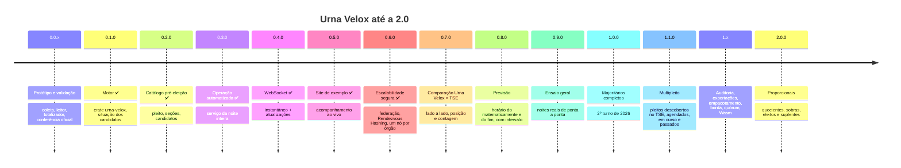

# 🗺️ Roadmap de Engenharia: Urna Velox

Plano de desenvolvimento por **versão**. Regras de numeração em [docs/VERSIONAMENTO.md](docs/VERSIONAMENTO.md); histórico em [CHANGELOG.md](CHANGELOG.md).

* **`1.0.0` — sistema completo para os cargos majoritários:** funcionando de ponta a ponta e **automatizado** (descobre o pleito, acompanha o site do TSE, coleta, totaliza, calcula a situação de cada candidato), publicando o resultado por **WebSocket**, com um **site de exemplo** para acompanhar a totalização pelo Urna Velox, a **federação de nós coletores** (etapa 6), a **comparação lado a lado com o site de resultados do TSE** (etapa 7) e a **previsão do matematicamente e do fim da apuração** (etapa 8). Meta: pronto para a noite do **2º turno de 2026 (25/10/2026)**.
* **`2.0.0` — cargos proporcionais:** Deputados e Vereadores, com a distribuição das vagas (quociente eleitoral, quociente partidário, sobras, eleitos e suplentes idênticos ao oficial).
* **Renumeração de 15/10/2026** (decisão do Luciano): a escalabilidade segura, antes prevista para a `2.0.0`, foi adiantada para a **etapa 6 (`0.6.0`)**; o ensaio geral passou da `0.6.0` para a **`0.7.0`**; os proporcionais passaram da `3.0.0` para a **`2.0.0`**. As versões `2.0.0-alpha.1` a `2.0.0-alpha.14` (branch `feature/2.0-escalabilidade`) são o trabalho da `0.6.0`. Mapa completo logo abaixo da tabela de situação.
* **Renumeração de 16/10/2026** (decisão do Luciano): entraram antes da `1.0.0` duas etapas de usabilidade, a **comparação Urna Velox × TSE** (etapa 7, `0.7.0`) e a **previsão do matematicamente e do fim da apuração** (etapa 8, `0.8.0`); o ensaio geral passou da `0.7.0` para a **etapa 9 (`0.9.0`)**, para ensaiar a noite já com as telas novas. `docs/HANDOFF_0.7.0.md` (ensaio) → [docs/HANDOFF_0.9.0.md](docs/HANDOFF_0.9.0.md); handoffs novos [docs/HANDOFF_0.7.0.md](docs/HANDOFF_0.7.0.md) e [docs/HANDOFF_0.8.0.md](docs/HANDOFF_0.8.0.md).
* Usar o sistema numa eleição real (como o 2º turno de 2026) **não muda a versão**: a versão mede o que o sistema faz, não onde foi usado.

**Legenda:** ✅ feito · 🟡 parcial (existe no protótipo `aquisicao/`, falta o entregável da etapa) · ⬜ pendente. Entre parênteses, a versão em que foi atingido.

---

## 📍 Situação em 16/10/2026 — série `0.6.x`

| etapa | versão | entrega | data-alvo | situação |
|---|---|---|---|---|
| 0 · Protótipo e validação | `0.0.x` | coletor, leitor de BU, totalizador e conferências sobre eleições reais | — | ✅ concluída: 1º turno de 2026 (83 abrangências), 1º e 2º turnos de Prefeito de 2024 (5.569 e 51 municípios) idênticos ao oficial |
| 1 · Motor | `0.1.0` | crate `urna-velox` com leitor, catálogo, estado, agregador e **situação dos candidatos** (incl. matematicamente eleito / 2º turno) | 14/10 | ✅ concluída em 12/10 (`v0.1.0`): conferências da etapa 0 em testes automatizados, situação e matematicamente no motor, formato JSON |
| 2 · Catálogo pré-eleição | `0.2.0` | pleito, seções, eleitorado e candidatos montados **antes** do primeiro BU, a partir do site do TSE | 16/10 | ✅ concluída em 12/10 (`v0.2.0`): `uv-coletor preparar` → `candidatos.json`; 2024 e 2026 1º turno conferidos; 3221 pronto, faltando só os `cs.json` de SE e TO (404) |
| 3 · Operação automatizada | `0.3.0` | um serviço que roda a noite inteira sozinho: acompanha, coleta (≤ 100 req/s), totaliza em fluxo, retoma, confere no fim | 19/10 | ✅ concluída em 13/10 (`v0.3.0`, por decisão do Luciano, sem a validação independente prevista): `uv-servico` + `uv-simulador`; critérios A, B, C e teste real do 3221 no [relatório](docs/RELATORIO_0.3.0.md); `--painel` e dois ritmos de `cs.json` |
| 4 · Publicação em tempo real | `0.4.0` | servidor HTTP + **WebSocket** com protocolo documentado (instantâneo + atualizações) | 21/10 | ✅ concluída em 13/10 (`v0.4.0`, por decisão do Luciano, sem a validação independente prevista): `uv-servico --http` ([protocolo](docs/PROTOCOLO_WS.md)) + `uv-carga`; BU → cliente p99 7,7 ms com 1.000 clientes a 60× (até 10.000: 35,6 ms); D1–D4 e limites no [relatório](docs/RELATORIO_0.4.0.md) |
| 5 · Site de exemplo | `0.5.0` | página elegante que acompanha a totalização ao vivo pelo WebSocket, com marcos e curiosidades da noite | 22/10 | ✅ concluída em 15/10 (`v0.5.0`, por decisão do Luciano, sem a validação independente prevista): página embutida no `uv-servico`, tela × oficial 83/83 e 51/51, CLS 0, marcos sem divergência ([relatório](docs/RELATORIO_0.5.0.md)); hodômetro girando num sentido só; na `v0.5.1`, medições do fechamento sem regressão e E2 com o código atual |
| 6 · Escalabilidade segura | `0.6.0` | **federação de nós coletores** (um por órgão, cada um no seu IP e nos seus 100 req/s): partição das seções por *Rendezvous Hashing*, troca direta de BUs entre os nós, tolerância a falhas e implantação | 15/10 | ✅ concluída em 15/10 (`v0.6.0`, por decisão do Luciano, sem a validação independente prevista): federação no `uv-servico --federacao`, ensaios reduzidos 6/6 no simulador, dois nós na OCI e o 1º simulado contra o pleito 3220 ([relatório preliminar](docs/RELATORIO_SIMULADO_1T_2026.md)); pendentes o critério A completo e a conferência do simulado com o oficial; borda, quórum e Wasm foram para a `1.x` |
| 7 · Comparação Urna Velox × TSE | `0.7.0` | na página, a totalização do Urna Velox e a do site de resultados do TSE lado a lado (posição e contagem de cada candidato, seções de cada fonte), com um controle "Urna Velox · Ambos · TSE"; o servidor busca só o arquivo da tela, no máximo a cada 30–60 s | 19/10 | ✅ `0.7.0` em 17/10 ([relatório](docs/RELATORIO_0.7.0.md)) |
| 8 · Previsão | `0.8.0` | estimativa, com intervalo, do horário do matematicamente (eleito / 2º turno) e do fim da apuração, pela velocidade de chegada dos BUs e pela tendência dos votos por estrato | 21/10 | ✅ concluída em 17/10 (`v0.8.0`, por decisão do Luciano, sem a validação independente prevista; `0.7.6`–`0.7.8`): motor, serviço, protocolo e cartão na página; backtest calibrado em 2024 (82–85 %, erro ≤ 8 min a partir de 50 %), 2026 1º turno fora da meta por causa da parada da chegada dos BUs, agora detectada ao vivo com a previsão suspensa e adiada (`0.7.8`); municípios pequenos pendentes para 2028 ([relatório](docs/RELATORIO_0.8.0.md)) |
| 9 · Ensaio geral | `0.9.0` | noites reais reproduzidas de ponta a ponta pelo WebSocket, carga, runbook, testes, com a federação e as telas das etapas 7 e 8 | 23/10 | 🟡 simulação da noite feita para o 2º turno de 2024 (`v0.0.19`); simulado do 3220 na ordem do TSE feito na OCI (`v0.6.8`: votos idênticos, atraso p50 1 s; encerramento com seções sem BU corrigido na `v0.6.10`); operação sem a porta 22 (`v0.6.5`, `v0.6.6`); [handoff](docs/HANDOFF_0.9.0.md) pronto |
| **1.0** | **`1.0.0`** | **sistema completo para cargos majoritários** | **23/10** | ⬜ |
| 1.1 · Multipleito | `1.1.0` | o serviço descobre sozinho os pleitos no `ele-c.json` do TSE, sem configurar o pleito: futuros como agendados, em curso totalizados, passados com o resultado completo (a totalização do Urna Velox, se houver, comparada com a do TSE; senão, o resultado final do TSE) | depois da eleição | ⬜ pedido do Luciano em 16/10 |
| 1.x | `1.2.0` … | auditoria criptográfica, exportações, empacotamento, desempenho com descompressão; publicação na borda, quórum Ed25519 e motor em Wasm (vindos da antiga 2.0) | depois da eleição | ⬜ |
| **2.0** | **`2.0.0`** | **cargos proporcionais**, com distribuição de vagas | — | 🟡 votos de Deputados e Vereadores já totalizados, sem conferência |

**Plano das duas semanas (13/10 a 25/10).** Uma etapa por vez, cada uma fechada com conferência contra os arquivos oficiais (regra do [CLAUDE.md](CLAUDE.md)) e bump de MINOR. 24/10 fica livre para o último ensaio com o pleito 3221 já publicado no `ele-c.json` (Presidente 6258, Governador 6260 em 5 UFs, suplementares de Prefeito e consultas de MT e PR). Na noite de 25/10, rodar só o que estiver combinado (o [CLAUDE.md](CLAUDE.md) pede acordo para coletar durante uma apuração); a busca dos arquivos de resultado do TSE pela comparação (etapa 7) já está combinada, nos termos do [handoff](docs/HANDOFF_0.7.0.md). Ordem a partir de 16/10: comparação (19/10) → previsão (21/10) → ensaio geral (23/10, com as telas novas) → `1.0.0`; os itens do ensaio que não dependem das telas (critério A da federação, simulado na ordem do TSE, runbook, falhas provocadas) andam em paralelo, mas o `0.9.0` só sai depois do `0.8.0`.

**Mapa das fases antigas** (citadas em ADRs e documentos anteriores à `0.0.20`): Fase 0 → etapa 0; Fase 1 (fundação ASN.1) → `0.1.0`; Fase 2 (agregação e majoritários) → `0.1.0` a `0.3.0`; Fase 3 (proporcionais) → `2.0.0`; Fase 4 (tempo real) → `0.3.0`/`0.4.0` e, a vazão com descompressão, `1.x`; Fase 5 (API, auditoria, distribuição) → `0.4.0`, `0.5.0` e `1.x`.

**Mapa da renumeração de 15/10/2026** (para ler ADRs, handoffs, relatórios e entradas do CHANGELOG anteriores à `0.6.0`): "2.0" / "módulo de escalabilidade segura" / `2.0.0-alpha.N` → etapa 6, `0.6.0` (federação) e `1.x` (publicação na borda, quórum Ed25519, Wasm/SPA); "etapa 6 · ensaio geral" / `0.6.0` → etapa 7, `0.7.0`; "3.0" / `3.0.0` (proporcionais) → `2.0.0`; "2.1.0" (operação do 2º turno, citada só no handoff do merge) não é versão: usar o sistema numa eleição não muda a versão. Arquivos renomeados: `docs/HANDOFF_2.0.0.md` → [docs/HANDOFF_0.6.0.md](docs/HANDOFF_0.6.0.md); o antigo `docs/HANDOFF_0.6.0.md` (ensaio geral) → `docs/HANDOFF_0.7.0.md` (e, em 16/10, → [docs/HANDOFF_0.9.0.md](docs/HANDOFF_0.9.0.md)).

**Mapa da renumeração de 16/10/2026** (para documentos e entradas do CHANGELOG anteriores à `0.6.7`): "etapa 7 · ensaio geral" / `0.7.0` (ensaio) → etapa 9, `0.9.0`; a etapa 7 (`0.7.0`) passou a ser a comparação Urna Velox × TSE e a etapa 8 (`0.8.0`), a previsão. Arquivo renomeado: `docs/HANDOFF_0.7.0.md` (ensaio) → [docs/HANDOFF_0.9.0.md](docs/HANDOFF_0.9.0.md); o nome `docs/HANDOFF_0.7.0.md` agora é o [handoff da comparação](docs/HANDOFF_0.7.0.md).

---

## 🗳️ Cobertura de cargos

| cargo (código no BU) | sistema | eleição | totalizado | conferido com o oficial | situação dos candidatos | versão de entrega |
|---|---|---|---|---|---|---|
| Presidente (1) | majoritário, maioria absoluta, 2 turnos | geral (2026) | ✅ `v0.0.10` | ✅ 1º turno, BR + 27 UFs + ZZ (`v0.0.10`) | ✅ no motor, 348 situações idênticas (`v0.0.25`) | `1.0.0` |
| Governador (3) | majoritário, maioria absoluta, 2 turnos | geral (2026) | ✅ `v0.0.10` | ✅ 1º turno, 27 UFs (`v0.0.10`) | ✅ no motor, 183 situações idênticas (`v0.0.25`) | `1.0.0` |
| Senador (5) | majoritário, maioria simples, 1 ou 2 vagas | geral (2026: 2 vagas) | ✅ `v0.0.10` | ✅ 1º turno, 27 UFs (`v0.0.13`) | ✅ no motor, 54 eleitos e 301 situações idênticos (`v0.0.25`) | `1.0.0` |
| Prefeito (11) | majoritário; 2º turno só acima de 200 mil eleitores | municipal (2024) | ✅ por município (`v0.0.18`) | ✅ 1º turno 5.569/5.569 (`v0.0.18`); 2º turno 51/51 (`v0.0.19`) | ✅ no motor, 15.032 + 102 situações idênticas (`v0.0.25`) | `1.0.0` |
| Consultas populares (2024: 51–55; 2026: 25–27) | por opção | junto com o pleito | ✅ por município (`v0.0.18`) | ✅ 1º turno de 2024, 5/5 (`v0.0.18`) | ✅ opção vencedora, no motor (`v0.0.25`) | `1.0.0` |
| Deputado Federal (6) | proporcional | geral | ✅ nominais e legenda (`v0.0.10`) | ⬜ | ⬜ | `2.0.0` |
| Deputado Estadual (7) | proporcional | geral | ✅ nominais e legenda (`v0.0.10`) | ⬜ | ⬜ | `2.0.0` |
| Deputado Distrital (8) | proporcional (DF) | geral | ✅ nominais e legenda (`v0.0.10`) | ⬜ | ⬜ | `2.0.0` |
| Vereador (13) | proporcional | municipal (2024) | ✅ nominais e legenda por município (`v0.0.18`) | ⬜ | ⬜ | `2.0.0` |

---

## 🧪 Etapa 0 — Protótipo e validação (`0.0.x`) ✅

> Coletar os BUs do TSE sem passar de 100 req/s, ler o BU real, totalizar e provar, contra os arquivos oficiais, que os números estão certos. Código em `aquisicao/` (`uv-coletor`); detalhes em [docs/AQUISICAO.md](docs/AQUISICAO.md).

- ✅ API de resultados mapeada (`ele-c.json` → `cs.json` → `aux.json` → BU) e zip de dados abertos (Range e completo). *(v0.0.5)*
- ✅ Coletor HTTP/2 com teto de 100 req/s em código, AIMD, disjuntor de 429, retomada sem as seções sem BU; `--so-aux` para só o horário de recebimento. *(v0.0.5, v0.0.10, v0.0.18)*
- ✅ Pacote `.uvpk` e canal em memória para totalização em fluxo. *(v0.0.5)*
- ✅ Leitor BER manual do BU de 2024 e 2026 (inclui `-busa.dat`), conferido com `asn1tools`. *(v0.0.5, v0.0.10, v0.0.16)*
- ✅ Totalizador denso por (município, cargo), candidatos por UF ou por município, seções anuladas. *(v0.0.5, v0.0.16, v0.0.18)*
- ✅ Conferências com a divulgação oficial: 1º turno de 2026 (Presidente, Governador, Senador; 83 abrangências, 794 situações), Prefeito de 2024 (5.569 + 51 municípios, 15.134 situações), consultas (5). *(v0.0.10, v0.0.13, v0.0.18, v0.0.19)*
- ✅ Replay da noite e simulação de aquisição; 2º turno de 2024: **matematicamente eleito com mediana de 26 min antes da totalização do TSE**. *(v0.0.9, v0.0.10, v0.0.19)*
- ✅ Desempenho: 2,3 µs por BU numa thread (2026), 499.207 BUs em 0,125–0,167 s com 28 threads, estado de 34 MB. *(v0.0.10)*

Pendências do protótipo que **não** bloqueiam a `1.0` foram para a `1.x` (verificação do `.vsc`, formato de 2022, acervo versionado).

---

## ⚙️ Etapa 1 — Motor (`0.1.0`, alvo 14/10) ✅

> Tirar o núcleo do protótipo e colocá-lo num crate próprio, tipado e testado, que os serviços das próximas etapas usam. Plano detalhado: [docs/HANDOFF_0.1.0.md](docs/HANDOFF_0.1.0.md).

- ✅ Workspace Cargo com o crate **`urna-velox`** (biblioteca + binário, em `motor/`); o `uv-coletor` passa a depender dele. *(v0.0.23)*
- ✅ Leitor de BU (`bu.rs`), pacote `.uvpk`, catálogo (UF e município), estado denso e agregador movidos para o crate, sem mudar o resultado (conferência de 2026 e 2024 idêntica antes e depois, mesmos checksums e mesmos `catalogo.txt`/totais byte a byte). *(v0.0.23)*
- ✅ **Situação dos candidatos no motor** (antes só nos scripts de conferência): eleito, 2º turno, não eleito; maioria absoluta / simples / 2 vagas; regra dos 200 mil eleitores; anulados e art. 224 (ninguém eleito); desempate pelo mais idoso; 1º e 2º turnos. Conferida em 832 + 15.042 + 102 situações. *(v0.0.25)*
- ✅ **Matematicamente eleito e matematicamente 2º turno** calculados a cada atualização, com o eleitorado ainda não apurado; nenhuma revogação e sempre igual ao oficial nas noites reproduzidas (2026, 2024 1º e 2º turnos); 2º turno de 2024 refeito com o motor: mediana de 26 min antes do TSE. *(v0.0.26)*
- ✅ Resultado por abrangência num formato próprio, documentado (JSON, [docs/FORMATO_RESULTADO.md](docs/FORMATO_RESULTADO.md)), com os campos conferidos (`vap`, `vb`, `vn`, `vnt`, comparecimento, seções, situação); usado pelo replay e pelo `uv-motor totalizar`, conferido com o oficial nos três conjuntos. *(v0.0.27)*
- ✅ Testes: fixtures de BUs reais versionadas (2024 e 2026, incluindo `busa` e seção anulada; 2,3 MB) e a conferência oficial como teste de integração reproduzível (`UV_DADOS=… cargo test -p urna-velox -- --ignored`): totais *(v0.0.24)*, situação *(v0.0.25)*, matematicamente *(v0.0.26)*, publicações JSON *(v0.0.27)*. Cobertura do motor: 84,3 % das linhas (90 % sem o binário). *(v0.1.0)*

**Critério:** o crate reproduz, em teste automatizado, as conferências da etapa 0 (83 abrangências de 2026, 5.569 + 51 municípios de 2024) com a situação de cada candidato calculada pelo motor; < 10 µs por BU numa thread. ✅ *(v0.1.0: 83/83, 5.574/5.574 e 51/51 arquivos; 832 + 15.042 + 102 situações; 2,1 µs por BU numa thread em lote e 3,1–3,3 µs com o matematicamente recalculado por lote; 0,12 s com 28 threads.)*

---

## 📋 Etapa 2 — Catálogo pré-eleição (`0.2.0`, alvo 16/10)

> Na noite da eleição o catálogo precisa existir antes do primeiro BU. Plano detalhado: [docs/HANDOFF_0.2.0.md](docs/HANDOFF_0.2.0.md).

- ✅ Descoberta do pleito e das eleições no `ele-c.json` (ex.: 3221 = 2º turno de 2026, com suplementares e consultas no mesmo pleito). *(v0.1.5)*
- ✅ Seções a partir dos `cs.json`, municípios de cada eleição a partir do `cm.json`, eleitorado e abrangências publicadas (Brasil, UF, município) a partir dos `-u.json` pré-apuração; uma circunscrição por cargo. *(v0.1.7)*
- ✅ Candidatos, números, destinação e datas de nascimento a partir dos arquivos da divulgação publicados antes da apuração, consolidados no formato `candidatos.json` pelo `uv-coletor preparar` (baixa com cache, ≤ 5 req/s). Os `-u.json` pré-apuração não trazem destinação: presumida "Válido" (premissa em [docs/FORMATO_CANDIDATOS.md](docs/FORMATO_CANDIDATOS.md)). *(v0.1.7)*
- ✅ Votável desconhecido num BU vira alerta consultável e nulo técnico (`OFF_VNT`), sem erro silencioso. *(v0.1.4)*

**Critério:** catálogo do 2º turno de 2024 e do 1º turno de 2026 montado só com dados anteriores à apuração, com a mesma conferência da etapa 1. ✅ *(v0.2.0, revalidado em [docs/VALIDACAO_0.2.0.md](docs/VALIDACAO_0.2.0.md) §6: votos idênticos nos três conjuntos; com a destinação presumida, só as 33 situações de candidatos cassados/indeferidos de 2024 divergem.)*

---

## 🛰️ Etapa 3 — Operação automatizada (`0.3.0`, alvo 19/10) ✅

> Um comando roda a noite inteira sem intervenção. Plano detalhado: [docs/HANDOFF_0.3.0.md](docs/HANDOFF_0.3.0.md).

- ✅ Serviço **`uv-servico --pleito … --candidatos …`** (crate `uv-aquisicao`; o motor continua sem rede): `candidatos.json` → acompanhamento dos `cs.json` (`If-None-Match`; seção sem disponibilização não gera requisição) → coleta das seções novas ou alteradas (`aux.json` → BU; teto de 100 req/s contra o TSE, padrão 95, pausa global ≥ 10 min depois de qualquer 429, validados pelo host no código) → totalização em fluxo → matematicamente a cada lote → publicação só das abrangências que mudaram. *(v0.2.2)*
- ✅ Motor: retirar e substituir um BU (`Estado::retirar`/`substituir`, mesmo agregador com `fetch_sub`; ADR-019); aplicar → retirar volta ao estado zero, inclusive o checksum. *(v0.2.2)*
- ✅ Persistência e retomada: BUs em `.uvpk` só de acréscimo e **diário de seções** (`secoes.log`) que decide qual BU vale em cada seção; `kill -9` e reinício sem perder nem duplicar BU; reenvio idêntico e diferente com alerta. *(v0.2.2)*
- ✅ Seções anuladas (inclusive depois de totalizadas), não instaladas e reenvios tratados como no oficial, a partir do `aux.json`. *(v0.2.2)*
- ✅ Saúde e métricas em arquivo (`saude.json` a cada 2 s: seções por UF, fila, req/s, latências, 429 e pausa, último BU, BU → publicação, alertas, memória e CPU) e log estruturado (`servico.log`). *(v0.2.2)*
- ✅ Conferência automática com os arquivos oficiais ao fim da apuração, por arquivo-sinal `CONFERIR` ou periódica. *(v0.2.2)*
- ✅ Site simulado **`uv-simulador`** (ADR-020): os caminhos do site real em `127.0.0.1`, relógio acelerado, falhas por parâmetro (429, 5xx, latência, reenvio, anulação, queda). *(v0.2.2)*

**Critério (reescrito na `v0.2.2`: os BUs de 2024 e 2026 não podem ser baixados de novo):** com o site simulado, o serviço reproduz sozinho o 2º turno de 2024 do início ao fim a 10× (51/51 municípios e 102/102 situações idênticos, pela conferência automática do próprio serviço, 0 HTTP 429, 0 duplicados, nenhuma revogação) e o 1º turno de 2026 a 60× (83/83 e 832/832, 3 eventos de Presidente, BU → publicação < 1 ms no p50); `kill -9`, rajada de 429, reenvio, anulação depois de publicada e queda do site sem perda nem duplicação; e roda ≥ 30 min contra o site real no pleito 3221 antes da eleição (só `cs.json`, 0 HTTP 429). Critérios executados com o binário da `v0.2.6` (seções pendentes pedidas de novo depois de queda do site, `fsync` fora da thread do motor: BU → publicação p50 0,68 ms e p99 4,3 ms no B). Relatório em [docs/RELATORIO_0.3.0.md](docs/RELATORIO_0.3.0.md). ✅ *(v0.3.0, 13/10: concluída por decisão do Luciano sem a validação independente prevista no handoff; os critérios foram executados e medidos pela mesma sessão que fez as correções da `v0.2.6`.)*

---

## 📡 Etapa 4 — Publicação em tempo real (`0.4.0`, alvo 21/10) — ✅ concluída em 13/10 (`v0.4.0`)

> O resultado sai do motor por WebSocket, para qualquer cliente. Plano detalhado: [docs/HANDOFF_0.4.0.md](docs/HANDOFF_0.4.0.md).

- ✅ Servidor HTTP + **WebSocket** (`axum`, isolado do motor por canais — ADR-012; no `uv-servico --http`, runtime próprio, último valor por tópico — ADR-026). *(v0.3.2)*
- ✅ Protocolo documentado ([docs/PROTOCOLO_WS.md](docs/PROTOCOLO_WS.md)): inscrição por abrangência e cargo; **instantâneo** na conexão e **atualizações** a cada lote; campos do formato da etapa 1 (os bytes do arquivo publicado); número de sequência e seções apuradas em cada mensagem (consultas consistentes, ADR-005). *(v0.3.2)*
- ✅ Eventos de situação: **matematicamente eleito**, **matematicamente 2º turno**, apuração encerrada. *(v0.3.2)*
- ✅ REST mínimo: estado do serviço e último resultado de cada abrangência (para quem chega depois ou não usa WebSocket), com `ETag`/304. *(v0.3.2)*
- ✅ Carga: muitos clientes conectados sem atrasar a totalização (cliente lento nunca segura o motor: último valor por tópico; `uv-carga` com conferência byte a byte; até 10.000 clientes testados). *(v0.3.4)*

**Critério:** latência do BU recebido à mensagem no cliente < 50 ms no p99 com a noite de 2026 acelerada 60× e 1.000 clientes conectados. **Medido na `v0.3.3`/`v0.3.4`: 7,7 ms no p99** (3.000: 11,7 ms; 6.000: 21,3 ms; 10.000: 35,6 ms), 0 conexões perdidas, últimas mensagens idênticas ao arquivo publicado; D2–D4 e limites em [docs/RELATORIO_0.4.0.md](docs/RELATORIO_0.4.0.md). *(Concluída na `v0.4.0` por decisão do Luciano, sem a validação independente prevista no handoff.)*

---

## 🖥️ Etapa 5 — Site de exemplo (`0.5.0`, alvo 22/10) — ✅ concluída em 15/10 (`v0.5.0`)

> Uma página de resultados elegante, dinâmica, com as curiosidades da eleição fáceis de ler, para acompanhar a totalização pelo Urna Velox e servir de modelo para quem quiser integrar. Plano detalhado: [docs/HANDOFF_0.5.0.md](docs/HANDOFF_0.5.0.md).

- ✅ (`v0.4.1`) Página estática servida pelo próprio binário, só com o WebSocket público da etapa 4 (o que faltar entra no protocolo por acréscimo: nomes de municípios e partidos, mensagem `marco`).
- ✅ (`v0.4.1`) Brasil, UF e município; Presidente, Governador, Senador, Prefeito e consultas; votos, percentuais, brancos, nulos, comparecimento, % de seções apuradas, horário do último BU.
- ✅ (`v0.4.1`) Destaque de **matematicamente eleito** / 2º turno, com o horário em que aconteceu.
- ✅ (`v0.4.1`) Funciona no celular; mostra quando a conexão cai e volta.
- ✅ (`v0.4.1`) **Design moderno:** glassmorfismo "tátil" (cartões translúcidos com desfoque, resposta ao toque) e **glow nos destaques com variação de cor em arco-íris** (como no app do Gemini e no "modo IA" do Google).
- ✅ (`v0.4.1`) **Gráficos suaves**, com transições dinâmicas elegantes (valores interpolados, sem redesenhar do zero).
- ✅ (`v0.4.1`) **Nenhum pulo na tela:** toda transição por transformações de CSS (`transform`/`opacity`), inclusive a troca de posição dos candidatos; **números animados como hodômetro**; tamanhos reservados (CLS = 0).
- ✅ (`v0.4.1`) **Marcos e curiosidades** num feed que passa na tela e persiste em qualquer tela: **primeira seção totalizada** (número, zona, município, UF); **a seção que determinou o matematicamente eleito / 2º turno**; **quantos eleitores faltam apurar para o matematicamente** (número decrescente ao longo da noite); **primeiro governador, senador e prefeito matematicamente eleitos**; e outros (viradas de liderança, marcos de % apurado, primeira UF 100 %, disputa mais apertada, comparecimento…).

**Critério:** o site acompanha um replay da noite sem recarregar a página e mostra os mesmos números da conferência oficial ao final; CLS = 0 a noite inteira, todo número muda animado; os marcos batem com o diário de seções e o `eventos.csv`. — **Medido na `v0.4.1`** ([RELATORIO_0.5.0.md](docs/RELATORIO_0.5.0.md)): tela × oficial 83/83 (2026 a 60×, 1.000 clientes + 10 abas, BU → cliente p99 8,8 ms) e 51/51 (2024 a 10× com `kill -9`, reconexão sem recarregar); CLS 0; marcos 0 divergências. Na `v0.4.2`, no Chrome do Windows com GPU: CLS 0 (escuro e claro, desktop e celular), ~54 fps (o teto da tela da sessão), cor do partido nos candidatos. Na `v0.5.0`, hodômetros girando num sentido só (os
regressivos no oposto), com teste automatizado. *(Concluída na `v0.5.0` por decisão do Luciano, sem a validação
independente prevista no handoff; fechamento no [relatório](docs/RELATORIO_0.5.0.md) §10.)*

---

## 🌐 Etapa 6 — Escalabilidade segura (`0.6.0`) — ✅ concluída em 15/10 (`v0.6.0`)

> Vários nós coletores, **um por órgão**, dividem as seções entre si e trocam os BUs diretamente, para que a coleta acompanhe o pico de chegada dos BUs na noite. O teto de requisições ao TSE é **por órgão** (100 req/s, no IP do órgão; acima disso a borda do TSE responde HTTP 429), então a coleta da federação cresce com o número de órgãos participantes (K × 100 req/s), como diz o [CLAUDE.md](CLAUDE.md). O limite é contado por **IP de saída** (o que a CDN do TSE vê): cada nó publica o seu e conhece o dos outros, e nós que saem pelo mesmo IP dividem os 100 req/s. Pelo benchmark (simulação com os horários de recebimento dos `aux.json` de 04/10), com 2 órgãos (~190 req/s) o atraso fica abaixo de 1 min no p90; com 3, a coleta acompanha o pico de chegada sem fila. Especificação em [docs/ESCALABILIDADE_SEGURA.md](docs/ESCALABILIDADE_SEGURA.md) (REQ-ESC-01 a 17, ADR-021 a ADR-030); plano detalhado em [docs/HANDOFF_0.6.0.md](docs/HANDOFF_0.6.0.md) (escrito como "handoff da 2.0"). Desenvolvida na branch `feature/2.0-escalabilidade`, com as versões `2.0.0-alpha.1` a `2.0.0-alpha.14`, e trazida para a `main` na `0.6.0` (renumeração de 15/10).

- ✅ Federação de nós: *heartbeat* e BUs trocados diretamente entre os nós (sem storage compartilhado) e partição das seções por *Rendezvous Hashing* (REQ-ESC-05 a 08). *(`2.0.0-alpha.3`: ADR-028; módulo `aquisicao/src/federacao/` com `federacao.json` (um nó por órgão), HRW ponderado só com inteiros, grupos por IP de saída, pausa por 429 e storage local, com testes. `2.0.0-alpha.4`: `uv-servico --federacao` (seções delegadas, IP de saída medido, cota por IP, republicação depois de `kill -9`) e `uv-simulador --limite-ip-rps`; ensaios reduzidos 5/5, cada nó 2/2 idêntico ao oficial. `2.0.0-alpha.5`: **sem storage compartilhado** — cada nó serve o seu diretório aos pares e puxa deles (direto ou por repasse); ensaios 6/6. `2.0.0-alpha.11`: o critério A completo achou três defeitos (nó que volta repedia seções, falsas mortes no pico, repasse/carência), corrigidos; reduzidos 6/6 e nó único 9/9.)*
- ✅ Direção da entrega pública e do modelo de clientes: cada nó é a origem dos próprios arquivos e uma CDN só faz cache, sem storage (ADR-030); clientes da infraestrutura do operador em federação, cada um com máquina e IP exclusivos (ADR-029). *(`2.0.0-alpha.8`)*
- ✅ Implantação: compilação cruzada local para aarch64, deploy só de binários (sem código-fonte) e dois nós federados na OCI, com nó que só recebe (`coleta: false`); roteiros em `deploy/oci/` e [docs/HANDOFF_IMPLANTACAO_OCI.md](docs/HANDOFF_IMPLANTACAO_OCI.md). *(`2.0.0-alpha.7`, `2.0.0-alpha.10`)*
- 🟡 1º simulado contra o pleito 3220 (15/10, dois nós na OCI, 95 req/s, 499.207 seções, 0 HTTP 429), no [relatório](docs/RELATORIO_SIMULADO_1T_2026.md). **Preliminar:** a soma dos votos por candidato não fecha com os válidos informados e não houve conferência com os arquivos oficiais (ver a nota no relatório). *(`2.0.0-alpha.13`, `2.0.0-alpha.14`)*
- 🟡 **Pendência:** o critério A completo (2026 a 60× com 3 nós) com a `alpha.11` ainda não rodou até o fim (faltou disco nesta máquina); fica para o ensaio geral (etapa 9). *(`2.0.0-alpha.12`)*
- ➡️ Publicação estática na borda (REQ-ESC-01 a 04), feeds assinados com Ed25519 e quórum no cliente (REQ-ESC-09 a 13) e motor em Wasm com SPA/PWA (REQ-ESC-14 a 17) passaram para a `1.x`.

**Critério:** o da etapa A do handoff (federação no simulador: ensaios reduzidos sem divergência, cada nó dentro dos 100 req/s do seu órgão, `kill -9` e retorno sem repetir seções). ✅ nos ensaios reduzidos *(concluída na `v0.6.0` por decisão do Luciano, sem a validação independente prevista e com o critério A completo pendente)*.

---

## ⚖️ Etapa 7 — Comparação Urna Velox × TSE (`0.7.0`, alvo 19/10)

> Na página de resultados, ver lado a lado a totalização do Urna Velox e a do site de resultados do TSE, para a mesma abrangência e cargo: posição e contagem de cada candidato em cada uma, seções totalizadas por cada fonte e a idade do último arquivo do TSE. Decisão do Luciano em 16/10/2026. Plano detalhado: [docs/HANDOFF_0.7.0.md](docs/HANDOFF_0.7.0.md).

- ✅ `0.6.13` **Controle de três posições** na tela de resultados: **só Urna Velox** (padrão), **ambos** ou **só TSE**; escolha lembrada no navegador e aceita na URL (`?comparar=ambos`).
- ✅ `0.6.13` **Ambos:** votos, % dos válidos e posição de cada candidato nas duas fontes, com a diferença; linha destacada quando a ordem diverge; % de seções de cada fonte e "TSE: arquivo das hh:mm:ss (há N s)" no cabeçalho, porque o Urna Velox à frente é o normal.
- ✅ `0.6.11` **Busca no servidor, não no navegador:** o `uv-servico` busca o `-u.json` da abrangência e cargo **que estão na tela** de pelo menos um cliente com a comparação ligada, **no máximo a cada 30–60 s** (cache compartilhado entre os clientes, `If-None-Match`), **nada em segundo plano**, dentro dos 100 req/s do órgão e com a regra do 429. Combinado com o Luciano em 16/10 como exceção à regra de não coletar durante a apuração ([CLAUDE.md](CLAUDE.md)).
- ✅ `0.6.11` Protocolo por acréscimo: tópico `tse:<tópico>` e mensagem `tse` (votos, posição, seções, horário do arquivo e da busca, estado `ok`/`desatualizado`/`indisponivel`/`pausado`) na [PROTOCOLO_WS.md](docs/PROTOCOLO_WS.md); bloco `tse_resultados` na `saude.json`.
- ✅ `0.6.13` Marco no feed: "TSE confirmou o matematicamente às hh:mm — Urna Velox às hh:mm, N min antes".
- ✅ `0.6.12` `uv-simulador` com `-u.json` progressivos (um "TSE simulado" com atraso de divulgação sorteado), igual ao oficial no fim da noite.
- ✅ `0.6.24` Mesmas regras de tela da etapa 5: CLS 0, hodômetro, celular (CLS 0 nas 10 abas do 2026-1T a 60× depois do selo de posição com largura fixa).

**Critério:** no simulador, 2º turno de 2024 a 10× e 1º turno de 2026 a 60× com 10 abas em modos variados: no fim, TSE = oficial = Urna Velox (51/51 e 83/83), CLS 0; ≤ 1 busca por (abrangência, cargo) inscrita por intervalo, 0 buscas sem ninguém com a comparação ligada, 0 HTTP 429, BU → publicação sem regressão; ≥ 30 min contra o site real (3220 final e 3221 pré-apuração) com números idênticos aos arquivos.

✅ **Critério atingido na `0.6.24`** ([RELATORIO_0.7.0.md](docs/RELATORIO_0.7.0.md)): 2024-2T 10/10 telas e 51/51, 2026-1T 10/10 e 83/83, CLS 0; `fora_do_intervalo` 0, 0 HTTP 429; site real 3220 e 3221 por 40 min cada, 3/3 telas iguais aos arquivos; marcos 18/18 com o `eventos.csv`. Etapa concluída na `0.7.0` (17/10).

---

## 🔮 Etapa 8 — Previsão do matematicamente e do fim da apuração (`0.8.0`, alvo 21/10)

> Estimar, pela velocidade com que os BUs chegam e pela tendência dos votos, **a que horas sai o matematicamente** (eleito / 2º turno) de cada abrangência e cargo e **a que horas termina a apuração**, sempre **com intervalo** e rotulado como **estimativa**. Decisão do Luciano em 16/10/2026. Plano detalhado: [docs/HANDOFF_0.8.0.md](docs/HANDOFF_0.8.0.md).

- ✅ **Velocidade** *(0.7.6)*: média móvel exponencial de **eleitores aptos apurados por minuto** (não seções), com a dispersão da janela recente alimentando o intervalo.
- ✅ **Tendência estratificada** *(0.7.6)*: o restante de cada estrato (UF no Brasil, município na UF) segue as proporções já apuradas nele, com encolhimento para as da circunscrição quando há poucos votos, porque a ordem de chegada tem viés regional. No município, um estrato só: zona ficou pendente, porque o estado não tem contadores por zona.
- ✅ **Horário do matematicamente** *(0.7.6)*: projeção dos votos no tempo com a mesma regra do motor (`matematica::avaliar`); Monte Carlo com semente fixa para P10, P50, P90 e a probabilidade de definir antes do fim.
- ✅ **Fim da apuração (99 % e 100 %)** *(0.7.6)*: curva corrente ajustada aos gabaritos das noites de 2024 e 2026, misturada com a velocidade, porque a cauda é lenta e ritmo constante subestima. São 14 gabaritos embutidos no motor.
- ✅ Módulo `previsao` no motor (puro, determinístico) e backtest `uv-motor previsao` *(0.7.6)*; rodado pelo `uv-servico` a cada 30 s fora da thread do motor, mensagem `previsao` no protocolo (§4.7) e cartão "Previsão (estimativa)" na página, com a faixa evoluindo na noite e o horário real ao lado do previsto depois da definição *(0.7.7)*.
- ✅ Salvaguardas *(0.7.6)*: só com ≥ 5 % dos aptos apurados e ≥ 10 min de série; faixa maior que 3 h aparece como "ainda incerto".

**Critério:** backtest nas três noites (2026 1º turno, 2024 1º e 2º turnos), só com o que se sabia em cada instante: com ≥ 20 % apurado, o horário real dentro do P10–P90 em 70–90 % dos casos (meta 80 %); erro mediano do P50 relatado por faixa de apuração (meta ≤ 10 min a partir de 50 %); rodada < 50 ms no 3221 e < 1 s nos 5.569 municípios de 2024; CLS 0 com o cartão.
🟡 *(0.7.7, [relatório](docs/RELATORIO_0.8.0.md))*:
- **Calibração:** 2024 2º turno 85 %, 2024 1º turno 82 %; 2026 1º turno 53–68 %, porque a chegada dos BUs parou das 19h30 às 20h50.
- **Erro do P50 a partir de 50 %:** 8 e 7,8 min em 2024; 19–68 min em 2026.
- **Custo:** 27 ms com 24 threads e 69 ms com 4 em 16.982 tópicos; 224 ms em 5.569 municípios.
- **Site:** CLS 0, com 45 de 47 previsões confirmadas no replay a 60×.

- ✅ **Parada da chegada dos BUs detectada ao vivo** *(0.7.8, decisão do Luciano em 17/10)*: com o ritmo nacional dos últimos 5 min abaixo de 10 % do dos 30 min anteriores, a previsão fica **suspensa** e a última faixa é **adiada** pelo tempo parado; a página diz "chegada de BUs parada desde hh:mm — previsão adiada". Em 2026 pegou a parada das 19h31 às 20h00; não muda o acerto do relógio, que uma parada não deixa prever (relatório §4.1).
- ⬜ **Pendência para 2028: municípios pequenos** (< 20 mil eleitores) com 74 % de cobertura no 1º turno de 2024, abaixo da meta de 80 %. Não afeta o 2º turno de 2026 (sem Prefeito); a resolver antes da eleição municipal de 2028 (relatório §9.2). *(decisão do Luciano em 17/10)*

✅ **Etapa concluída em 17/10/2026 (`v0.8.0`), por decisão do Luciano, sem a validação independente prevista**: aceita a calibração de 2024 dentro da meta, o 1º turno de 2026 fora dela por causa da parada da chegada dos BUs (agora mostrada na tela) e os municípios pequenos como pendência para 2028. Binários `0.8.0` instalados nos dois nós da OCI em 17/10 (`50_atualizar.sh --sem-compilar`): o B roda a `0.8.0`. O A ficou **parado**, porque já estava num laço de falta de memória na retomada do simulado do 3220 desde a tarde de 17/10, ainda na `0.7.3`: ~12 GB logo depois da partição, morto pelo kernel a cada ~4 min, 30 reinícios. A `0.8.0` repete o laço. Corrigido nas `0.8.1`–`0.8.2` (etapa 9, abaixo).

---

## 🎬 Etapa 9 — Ensaio geral (`0.9.0`, alvo 23/10)

> Tudo junto, de ponta a ponta, sem intervenção, e a operação do 2º turno de 2026 pronta, com a federação e as telas das etapas 7 e 8. Plano detalhado: [docs/HANDOFF_0.9.0.md](docs/HANDOFF_0.9.0.md) (escrito como "handoff da etapa 6" e, até 16/10, `HANDOFF_0.7.0.md`). Os itens que não dependem das telas novas andam em paralelo com as etapas 7 e 8; o `0.9.0` só sai depois do `0.8.0`.

- ⬜ Ensaios completos com a **comparação ligada** (modos variados) e a **previsão visível**: as duas telas novas na noite inteira, sem regressão da latência nem do CLS.
- ⬜ Critério A completo da federação (pendência da etapa 6): 1º turno de 2026 a 60× com 3 nós, sem divergência e cada nó idêntico ao oficial.
- ✅ **Falta de memória (OOM) na retomada da federação corrigida** *(v0.8.1)*: no reinício de um nó com histórico acumulado, `republicar()` carregava o `secoes.log` inteiro (132 MB / 499.207 BUs) na memória (`f.saida`), e `gravar_lote()` tentava codificar tudo num lote único de ~7,65 GB. Combinado a ~8,5 GB em `f.saida`, estourava os 12 GB de RAM da OCI (~11,75 GB RSS) e o kernel matava o `uv-servico` com SIGKILL 4–5 s após a partição. Corrigido em duas versões:
  - `0.8.1`: lotes de até 500 registros.
  - `0.8.2`: republicação em fluxo, sem teto e sem perda, gravada em lotes à medida que o diário é lido. Diário e storage de execuções diferentes (o caso do nó A) não são republicados e geram o alerta `federacao_diario_desalinhado`.

  Medido no nó A com o estado real: **pico de 480 MB** (antes ~11,75 GB), sem reinício. Pendências:
  - O `no.env` do nó A ainda aponta para o TSE no pleito 3220: na validação ele coletou ~8 min sem combinar (~88 req/s, ~12 mil BUs baixados de novo por *hashes* novos no `cs.json`) e foi parado. Decidir com o Luciano.
  - Usar os BUs dos pacotes locais antes de baixar de novo quando só o *hash* muda.
- ✅ Simulado do 3220 na OCI **na ordem de recebimento no TSE** (`deploy/oci/60_simulado.sh`, 16/10, 07:18–10:16, binário `0.6.5`): fila do serviço ordenada pelo `recebido_tse` dos `aux.json` (`uv-servico --ordem`, `v0.6.1`); 499.207 BUs a 95 req/s, 0 HTTP 429; atraso no recebimento p50 1 s, p99 291 s; deslocamento p50 6, p99 25 (no de 15/10, em ordem alfabética: atraso p50 244.842 s, deslocamento p50 158.050); conferência 81/83, com os votos e as 832 situações idênticos — as 2 diferenças são só o número de seções totalizadas em BR e ZZ (Presidente), pelas 41 seções do item abaixo ([relatório](docs/RELATORIO_SIMULADO_3220_ORDEM.md)). *(v0.6.8)*
- ✅ **Encerramento com seções sem BU** (achado do simulado de 16/10): 41 seções do exterior (ZZ) estão no catálogo, não são agregadas e o TSE nunca publicou BU delas — o `aux.json` de cada uma diz "Nao instalada" (`s.sni` = 41, `e.esni` = 423 no oficial); a sondagem só disparava depois de 30 min sem BU, e o simulado parou antes. Regra do Luciano (16/10): a seção sem BU continua esperada até o TSE marcá-la não instalada; aí sai das que faltam e conta como totalizada, como no oficial, a qualquer hora da noite. Sondagem por UF sem esperar silêncio, sem as agregadas (`nsp`), cada seção de novo a cada 5 min, ≤ 2 req/s; ensaio `nao_instaladas_exterior` (ZZ de 2026 a 300×: 1.310 BUs + 41 não instaladas = 1.351, encerra sozinho, conferência idêntica, nenhum pedido de agregada). *(v0.6.10)*
- 🟡 Operação dos nós da OCI sem a porta 22 (`TRANSPORTE=oci` via Run Command e Object Storage; atualização por pull com manifesto Ed25519; trava manual): `v0.6.5`, `v0.6.6` ([relatório](docs/RELATORIO_DEPLOY_SEM_SSH.md), pendências no §7). Entra no runbook.
- ⬜ Ponta a ponta pelo WebSocket e pelo site: 1º turno de 2026 (replay 60× e um trecho a 1×) e 2º turno de 2024 (pelo site do TSE).
- ⬜ Simulação da noite com "matematicamente eleito" para os cargos de 2026, comparada com a totalização do TSE (como em [PREFEITO_2024_2T.md](aquisicao/results/PREFEITO_2024_2T.md)).
- ⬜ Falhas provocadas: queda de rede, 429, reinício do serviço, BU reenviado, seção anulada.
- ⬜ Runbook da noite (instalação, configuração, comandos, o que fazer em cada alerta) e binário Linux pronto.
- ⬜ Cobertura de testes do motor medida e com as partes críticas cobertas (leitor, agregador, situação).
- ⬜ **Atraso disponibilização → BU aplicado** (achado da `0.4.9`, [RELATORIO_0.5.0.md](docs/RELATORIO_0.5.0.md) §7): nos ensaios contínuos a 60× da etapa 5, os eventos saíam em média 11 min da noite (≈ 11 s reais) depois da disponibilização do BU que os decidiu, até 46 min no pico (Governador de SP: decidido com BUs disponíveis até 19:21, publicado às 20:07). Suspeita: os roteiros usavam `--intervalo-cs 30/aceleração`, dividido de novo pela aceleração dentro do serviço, o que relê os 28 `cs.json` (31 MB) sem parar e disputa a CPU com a coleta. Fazer: medir o atraso (por seção: disponibilização no `cs.json` × hora do site em que o BU foi aplicado, p50/p99) num ensaio a 1× de 1 h no pico e a 60× com `--intervalo-cs` padrão; se passar de 1 intervalo de `cs.json` + alguns segundos, achar o gargalo e corrigir; registrar o atraso na `saude.json` para a noite.
- ✅ **Pendências do fechamento da etapa 5** ([RELATORIO_0.5.0.md](docs/RELATORIO_0.5.0.md) §10), feitas na
  `v0.5.1`: a suspeita de regressão no p99 de BU → publicação não se confirmou (6 rodadas: 10–15 ms nas três versões);
  versões superadas só na retotalização; retotalização da noite inteira 7,7–8,1 s; E2 com o código atual 51/51, CLS 0.

**Critério:** dois ensaios completos seguidos sem intervenção e sem divergência.

---

## 🏁 `1.0.0` — sistema completo para cargos majoritários (alvo 23/10)

Etapas 1 a 9 concluídas: o Urna Velox acompanha sozinho uma eleição majoritária (geral ou municipal), com um ou mais nós federados, publica por WebSocket e tem site de exemplo com a comparação lado a lado com o TSE e a previsão do matematicamente e do fim da apuração, com resultados idênticos aos oficiais e a situação de cada candidato. A operação no 2º turno de 2026 (25/10) usa a `1.0.x`; correções feitas por causa dela são PATCH.

---

## 🗳️ `1.1.0` — Multipleito (depois da eleição)

> Hoje cada nó totaliza **um** pleito, escolhido no `no.env` (`PLEITO=`, `CANDIDATOS=`), e trocar de pleito exige
> parar o serviço e reconfigurar. Pedido do Luciano (16/10/2026): o sistema olha todos os pleitos publicados no site de
> resultados do TSE e trata cada um conforme a situação, sem ninguém setar o pleito.

- ⬜ **Descoberta:** ler o `ele-c.json` (`/oficial/comum/config/ele-c.json`, que já lista pleitos, eleições e datas,
  incluindo suplementares e consultas) e classificar cada pleito: **agendado** (data futura, sem totalização),
  **em curso** (dia da eleição até o fim da apuração) e **encerrado**. Reler no ritmo do `ele-c.json`, sem custo
  extra relevante dentro dos 100 req/s.
- ⬜ **Agendados:** só aparecem na página (data, cargos, abrangência). Catálogo pré-eleição (`uv-coletor preparar`,
  etapa 2) montado automaticamente quando os `cs.json` saírem.
- ⬜ **Em curso:** totalizados como hoje (um ou mais ao mesmo tempo — ex.: geral + suplementares + consultas no mesmo
  dia), cada um com estado, publicação e conferência próprios, dividindo a mesma cota de 100 req/s do órgão. A
  coleta durante a apuração continua sujeita à regra do [CLAUDE.md](CLAUDE.md).
- ⬜ **Encerrados:** se o Urna Velox totalizou, o resultado completo guardado, com a comparação lado a lado da etapa 7
  (Urna Velox × TSE); se não totalizou, só o resultado final do TSE (`-u.json`), baixado uma vez e guardado — sem
  coletar BUs de eleição passada (respeita o acervo: BU já baixado não é baixado de novo).
- ⬜ **Página:** seletor de pleito (agendados, em curso, encerrados), com o pleito em curso como padrão; endereços e
  WebSocket por pleito.
- ⬜ **Operação:** `no.env` sem `PLEITO` obrigatório (fica como filtro opcional); federação por pleito; o simulado
  (`60_simulado.sh`) vira só "totalizar de novo um pleito encerrado".

**Por que depois da eleição:** muda o núcleo do `uv-servico` (estado, publicação e WebSocket por pleito) e a página;
fazer antes de 25/10 disputaria tempo com as etapas 7 a 9 e com a `1.0.0`. Na noite do 2º turno o pleito 3221 é
configurado como hoje. **Critério:** um nó sem `PLEITO` configurado mostra corretamente os pleitos de 2024 e 2026
(passados com resultado idêntico ao oficial), um pleito agendado e um em curso reproduzido pelo simulador.

---

## 🔧 `1.x` — depois da 1.0

- ⬜ Auditoria cívica (ADR-011): verificação do `.vsc` (hash do diretório = SHA-256 do `.vsc`) e das assinaturas; modo `--por-secao` (ADR-009); seções faltantes e comparecimento atípico.
- ⬜ Exportações (JSON, Parquet/Arrow) e consultas por linha de comando com `--format json`.
- ⬜ Empacotamento: binários Windows e macOS, imagem Docker.
- ⬜ Vazão com descompressão (> 100 mil BUs/s lendo os zips), modo *watcher* de diretório, suíte `criterion`.
- ⬜ Formato de BU de 2022; acervo de dados abertos versionado (`aquisicao/acervo/`, com `-busa.dat`).
- ⬜ Cobertura ≥ 80 % das linhas do motor.
- ⬜ Publicação estática na borda (*Static-File Edge Broadcast*), só *pull* com `ETag`/304, cada nó como origem e a CDN só de cache (REQ-ESC-01 a 04, ADR-030). *(vinda da antiga 2.0)*
- ⬜ Feeds assinados com Ed25519, referência aos `.vsc`, amostragem cruzada e quórum no cliente (REQ-ESC-09 a 13). *(vinda da antiga 2.0)*
- ⬜ Motor em Wasm num Web Worker e SPA/PWA (REQ-ESC-14 a 17). *(vinda da antiga 2.0)*
- ⬜ Critério da antiga 2.0 (etapa E do [handoff](docs/HANDOFF_0.6.0.md)): dois ensaios completos sem divergência e o atraso recepção no TSE → navegador comparado com a divulgação oficial, com cada nó dentro dos 100 req/s do seu órgão.

---

## 🏛️ `2.0.0` — cargos proporcionais

> Totalizar Deputado Federal, Estadual, Distrital e Vereador e **distribuir as vagas** como a Justiça Eleitoral.

- 🟡 Votos nominais e de legenda já totalizados (Deputados por UF, `v0.0.10`; Vereador por município, `v0.0.18`); ⬜ agregação por partido e federação a partir dos candidatos.
- ⬜ Conferência dos votos com a divulgação oficial em todas as UFs e municípios.
- ⬜ Vagas por circunscrição como parâmetro do pleito.
- ⬜ Distribuição das vagas pelas regras do ano (Código Eleitoral, arts. 106 a 112, Lei 14.211/2021, decisão do STF de 2024 sobre as sobras): quociente eleitoral e partidário, 10 % do QE, sobras pela maior média com 80 %/20 % do QE, federações como partido, desempates.
- ⬜ Eleitos e suplentes; sub judice como no oficial; regras por ano com testes que reproduzem eleições anteriores.
- ⬜ Publicação das vagas pelo WebSocket, recalculadas a cada lote.

**Critério:** votos e listas de eleitos e suplentes idênticos aos oficiais em 2024 e 2026, com o cálculo das vagas do Brasil em < 1 s.

---

## 📈 Metas de desempenho

| métrica | meta | versão | medido (protótipo) |
|---|---|---|---|
| leitura + totalização por BU, 1 thread | < 10 µs | `0.1.0` | ✅ 2,3 µs (2026), 1,2 µs (2024) |
| eleição geral inteira, BUs em memória | < 1 s em 8+ núcleos | `0.1.0` | ✅ 0,125–0,167 s, 28 threads (`v0.0.10`) |
| memória do motor | < 150 MB | `0.1.0` | ✅ estado de 34 MB; ~135 MB de memória anônima |
| coleta pela API do TSE | ≤ 100 req/s, 0 HTTP 429 | `0.3.0` | ✅ 95 req/s, 0 HTTP 429 (`v0.0.10`, `v0.0.19`) |
| BU recebido → resultado publicado | < 1 ms (motor) | `0.3.0` | 🟡 p50 0,65 ms, p99 1,7 ms no replay do 2º turno de 2024, incluindo a publicação (`v0.0.19`) |
| BU recebido → mensagem no cliente WebSocket | < 50 ms p99 | `0.4.0` | ⬜ |
| comparação: buscas ao site de resultados do TSE | ≤ 1 por (abrangência, cargo) na tela a cada 30–60 s; 0 sem ninguém olhando | `0.7.0` | ✅ `0.6.24` (`fora_do_intervalo` 0) |
| previsão do matematicamente: horário real dentro do P10–P90 (≥ 20 % apurado) | 80 % (aceitável 70–90 %) | `0.8.0` | 🟡 `0.7.7`: 85 % (2024 2º t.), 82 % (2024 1º t.), 53–68 % (2026 1º t., parada da chegada dos BUs) |
| vazão lendo os zips do TSE (com descompressão) | > 100 mil BUs/s | `1.x` | ⬜ |
| distribuição de vagas, Brasil | < 1 s | `2.0.0` | ⬜ |
| cobertura de linhas do motor | ≥ 80 % | `1.x` | 🟡 10,6 % no `uv-coletor` (`v0.0.12`) |

Linha de base do TSE: no 2º turno de 2024, o TSE totalizou cada município, na mediana, 5 min 49 s depois do último BU recebido ([PREFEITO_2024_2T.md](aquisicao/results/PREFEITO_2024_2T.md)).
