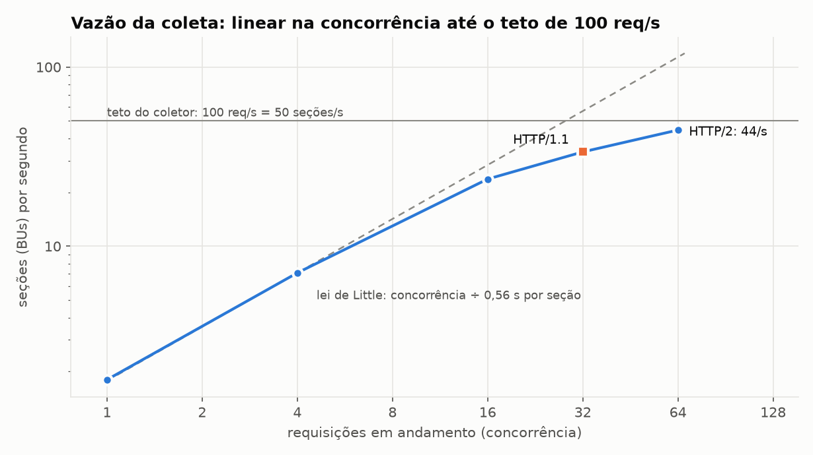
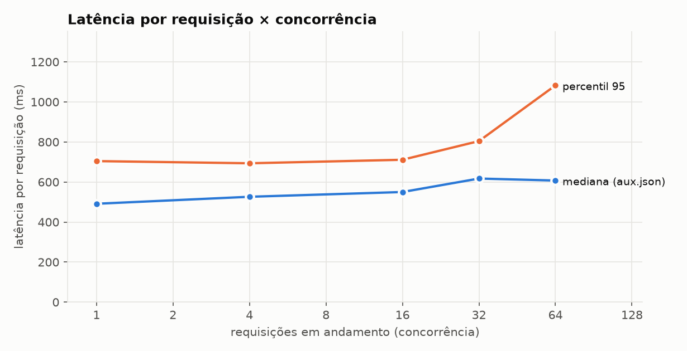
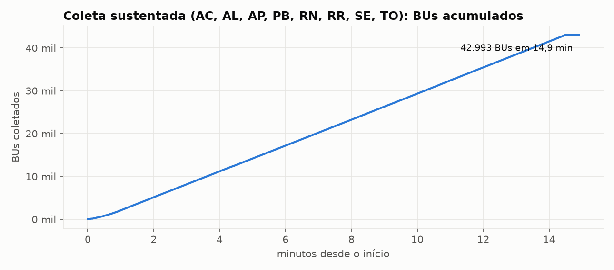
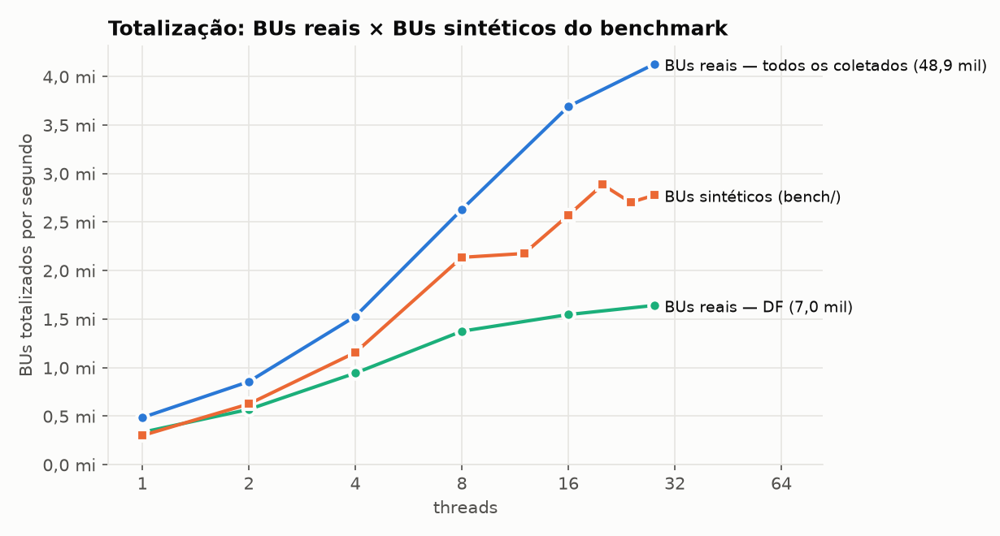

# Aquisição de BUs reais — relatório da última execução

Máquina: Intel(R) Core(TM) i7-14700. Servidor: resultados.tse.jus.br (CDN Akamai). Pleito 3220 (1º turno de 2026), 517.179 seções no Brasil.

## 1. Vazão da coleta pela API (aux.json + bu.dat)

Cada linha é uma amostra diferente de seções de SP, MG, BA e RJ (sem repetir objetos já em cache no CDN). Uma seção custa 2 requisições.

| rótulo | concorrência | conexões | protocolo | seções | seções/s | req/s | MB/s | lat. p50 aux | lat. p50 BU | p95 | p99 | 404 / erros | 429 |
|---|---:|---:|---|---:|---:|---:|---:|---:|---:|---:|---:|---:|---:|
| conc | 1 | 1 | HTTP/2.0 | 40 | 1,8 | 3,7 | 0,02 | 491 ms | 32 ms | 704 ms | 866 ms | 2 | 0 |
| conc | 4 | 1 | HTTP/2.0 | 64 | 7,1 | 14,4 | 0,10 | 526 ms | 39 ms | 693 ms | 766 ms | 1 | 0 |
| conc | 16 | 1 | HTTP/2.0 | 256 | 23,7 | 47,8 | 0,35 | 550 ms | 84 ms | 711 ms | 861 ms | 4 | 0 |
| conc | 32 | 1 | HTTP/2.0 | 512 | 33,6 | 68,0 | 0,50 | 617 ms | 191 ms | 804 ms | 1.101 ms | 10 | 0 |
| conc | 64 | 1 | HTTP/2.0 | 1024 | 44,5 | 90,1 | 0,64 | 607 ms | 510 ms | 1.082 ms | 1.438 ms | 25 | 0 |
| http1 | 32 | 1 | HTTP/1.1 | 512 | 33,6 | 68,3 | 0,49 | 524 ms | 414 ms | 688 ms | 931 ms | 16 | 0 |
| conexoes | 64 | 4 | HTTP/2.0 | 1024 | 47,8 | 96,9 | 0,70 | 524 ms | 40 ms | 688 ms | 905 ms | 26 | 0 |

## 2. Caminhos de aquisição — DF completo

| caminho | BUs | tempo | BUs/s | requisições/s | MB transferidos | observação |
|---|---:|---:|---:|---:|---:|---|
| uf-completa | 6969 | 160,0 s | 44 | 88 | 111,9 | API de resultados (aux.json + bu.dat), gravando o pacote .uvpk |
| zip-faixas | 6969 | 89,4 s | 78 | 78 | 99,3 | zip de dados abertos: diretório central + 1 faixa HTTP Range por BU |
| zip-completo | 6969 | 14,3 s | 487 | 0 | 1.270,3 | zip de dados abertos inteiro + extração local |
| fluxo | 6969 | 160,3 s | 44 | 88 | 111,9 | API com totalização simultânea (objetos já em cache no CDN) |
| acompanhar | 0 | 22,9 s | 0 | 4 | 0,4 | 3 rodadas de cs.json com If-None-Match depois da coleta |

Na coleta em fluxo, a totalização terminou **0.1 ms** depois do último BU recebido.

## 3. Chegada dos BUs ao TSE na noite da eleição (AC, AL, AP, PB, RN, RR, SE, TO)

Do campo de recebimento (`dr`/`hr`) de cada aux.json: 41.938 BUs. Pico: **626 BUs/min** (10,4/s) às 18:23. Vazão sustentada do coletor (teto de 100 req/s): **47 seções/s = 2.814/min**, ou 4,5 × o pico destas UFs.

* 50 % dos BUs recebidos até 18:34
* 90 % dos BUs recebidos até 20:02
* 99 % dos BUs recebidos até 21:10

Estimativa grosseira para o Brasil (amostra AC, AL, AP, PB, RN, RR, SE, TO, DF escalada × 10,3 pelo nº de seções): 99 % dos BUs chegariam até 21:01. Um coletor a 100 req/s (47 seções/s), começando no primeiro BU, fica atrás da chegada no pico, com **atraso máximo de ~33 min**, e alcança a chegada às **19:58**; depois disso, cada BU é coletado quase assim que é publicado.

## 4. Coleta sustentada — AC, AL, AP, PB, RN, RR, SE, TO

41.938 BUs em **14,9 min** (47 seções/s, 95 req/s, 0,43 GB, 0,5 MB/s); concorrência 128, 1 conexões HTTP/2.0; novas tentativas 9, HTTP 429: 0, seções sem BU/erros: 1055. Projeção para o Brasil (517.179 seções) neste ritmo: **3,1 h**.

Requisições iniciadas por segundo na coleta sustentada: máximo **100**, média 95,0 (limite 100).

## 5. Totalização dos BUs reais (BUs já em memória)

| conjunto | threads | BUs | mediana (ms) | BUs/s | µs/BU·thread | consolidação UF (ms) | cargos inválidos | pico RSS (MB) | RSS anônimo (MB) |
|---|---:|---:|---:|---:|---:|---:|---:|---:|---:|
| df | 1 | 6.969 | 20,8 | 334.549 | 2,99 | 0,4 | 0 | 135 | 27 |
| df | 2 | 6.969 | 12,2 | 570.435 | 3,51 | 0,4 | 0 | 135 | 27 |
| df | 4 | 6.969 | 7,4 | 944.053 | 4,24 | 0,4 | 0 | 135 | 27 |
| df | 8 | 6.969 | 5,1 | 1.375.913 | 5,81 | 0,4 | 0 | 135 | 27 |
| df | 16 | 6.969 | 4,5 | 1.547.291 | 10,34 | 0,5 | 0 | 135 | 27 |
| df | 28 | 6.969 | 4,2 | 1.641.696 | 17,06 | 0,5 | 0 | 135 | 28 |
| todas | 1 | 48.907 | 100,6 | 486.346 | 2,06 | 0,4 | 0 | 527 | 30 |
| todas | 2 | 48.907 | 57,1 | 856.260 | 2,34 | 0,5 | 0 | 527 | 30 |
| todas | 4 | 48.907 | 32,0 | 1.529.013 | 2,62 | 0,4 | 0 | 527 | 30 |
| todas | 8 | 48.907 | 18,6 | 2.630.116 | 3,04 | 0,4 | 0 | 527 | 30 |
| todas | 16 | 48.907 | 13,2 | 3.691.094 | 4,33 | 0,5 | 0 | 528 | 30 |
| todas | 28 | 48.907 | 11,8 | 4.128.567 | 6,78 | 0,5 | 0 | 528 | 30 |

## 6. Ponta a ponta (eleição inteira)

* coleta de 517.179 seções por um IP, a ≤ 100 req/s: **3,1 h** (projetado da coleta sustentada, 47 seções/s)
* totalização dos mesmos BUs: **0,13 s** (projetado da melhor taxa medida com BUs reais, 4.128.567 BUs/s; o benchmark sintético mediu 0,17–0,2 s para 500 mil BUs)
* a coleta é **88.029 ×** mais demorada que a totalização: o gargalo é a rede, e a totalização em fluxo termina praticamente junto com o último BU.

## 7. Conferência com decodificador independente

```
referência (asn1tools): 6969 BUs decodificados em 6.1 s (1150 BUs/s); 685 totais comparados; divergências: 0
referência (asn1tools): 48907 BUs decodificados em 29.8 s (1641 BUs/s); 3715 totais comparados; divergências: 0
```

### catalogo.txt

```
catálogo /home/dev/uvreal/dados/catalogo.txt: 28 UFs, 5757 municípios, 517179 seções, 6 cargos, 3244 candidatos (UF×cargo), 647415 contadores = 2.5 MB; 48907 BUs lidos em 0.20 s (0 com erro); total 0.45 s
```

### totalizacao_todas.txt

```
brancos=77934    nulos=39956    mais votados: 50100=92234  44000=50833  13100=50046
  PB:
    Presidente      comp=2683988   brancos=52297    nulos=117854   mais votados: 13=1541127  22=831377  70=73831
    Governador      comp=2677904   brancos=127816   nulos=262876   mais votados: 11=1470252  22=552836  15=252884
    Senador         comp=2677904   brancos=442542   nulos=630504   mais votados: 400=1391994  155=974550  100=895398
    Dep. Federal    comp=2677904   brancos=154973   nulos=117898   mais votados: 2222=267142  1111=180720  1313=163277
    Dep. Estadual   comp=2677904   brancos=139955   nulos=115508   mais votados: 22222=77089  10444=75366  10111=67991
  RN:
    Presidente      comp=2171013   brancos=33172    nulos=65880    mais votados: 13=1237963  22=720493  70=57367
    Governador      comp=2167714   brancos=76524    nulos=102371   mais votados: 44=733809  13=718300  22=530580
    Senador         comp=2167714   brancos=301982   nulos=426640   mais votados: 200=1055000  131=635924  555=630159
    Dep. Federal    comp=2167714   brancos=105390   nulos=94498    mais votados: 1311=215509  2233=185248  4444=171396
    Dep. Estadual   comp=2167714   brancos=103009   nulos=121780   mais votados: 22222=105403  45678=73217  44555=69542
  RR:
    Presidente      comp=332772    brancos=2618     nulos=4595     mais votados: 22=231322  13=74420  70=8579
    Governador      comp=331959    brancos=3677     nulos=8869     mais votados: 22=220809  10=93434  50=4880
    Senador         comp=331959    brancos=21446    nulos=32859    mais votados: 227=138269  155=117270  555=106652
    Dep. Federal    comp=331959    brancos=7649     nulos=5231     mais votados: 1011=22027  1033=20184  2021=19962
    Dep. Estadual   comp=331959    brancos=4476     nulos=5626     mais votados: 22222=11441  10789=10963  44444=10866
  SE:
    Presidente      comp=1439082   brancos=24859    nulos=49970    mais votados: 13=856019  22=417839  70=38895
    Governador      comp=1436609   brancos=54754    nulos=121652   mais votados: 55=727291  10=459908  50=37081
    Senador         comp=1436609   brancos=220770   nulos=319279   mais votados: 131=511142  155=399775  101=378710
    Dep. Federal    comp=1436609   brancos=74513    nulos=64076    mais votados: 4444=115903  4040=105865  1311=88900
    Dep. Estadual   comp=1436609   brancos=73203    nulos=69620    mais votados: 44444=52765  55777=49550  50180=44384
  TO:
    Presidente      comp=965196    brancos=8344     nulos=26377    mais votados: 22=469321  13=404009  70=22434
    Governador      comp=963810    brancos=27085    nulos=87069    mais votados: 44=386260  45=372848  55=69967
    Senador         comp=963810    brancos=93579    nulos=180376   mais votados: 222=450191  153=316786  100=271829
    Dep. Federal    comp=963810    brancos=28980    nulos=27958    mais votados: 1111=99026  4477=93869  1000=85376
    Dep. Estadual   comp=963810    brancos=24028    nulos=23126    mais votados: 10111=35258  10100=35212  22123=26158
```

## Gráficos









