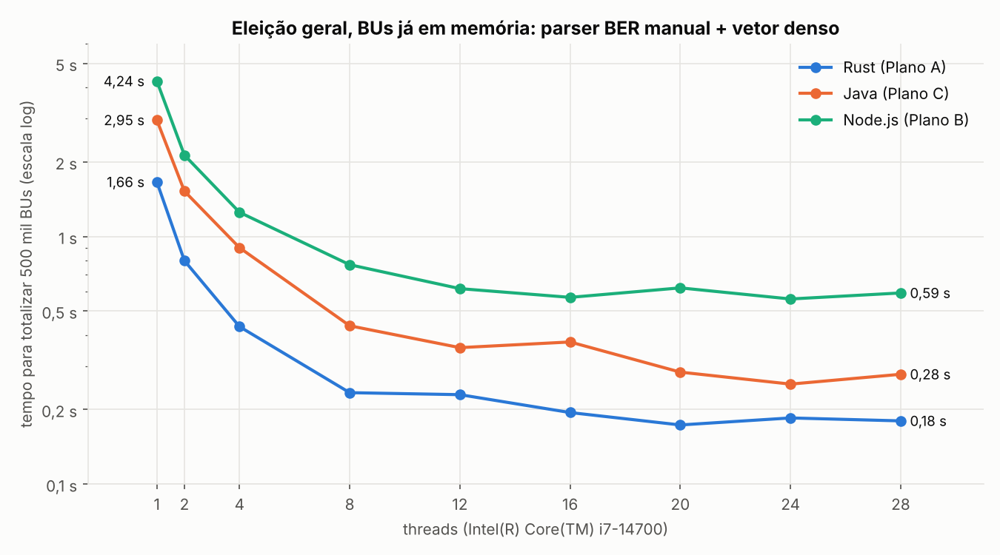
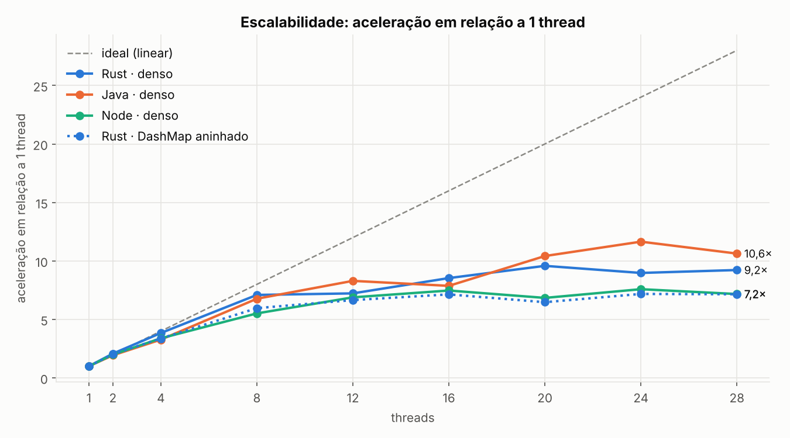
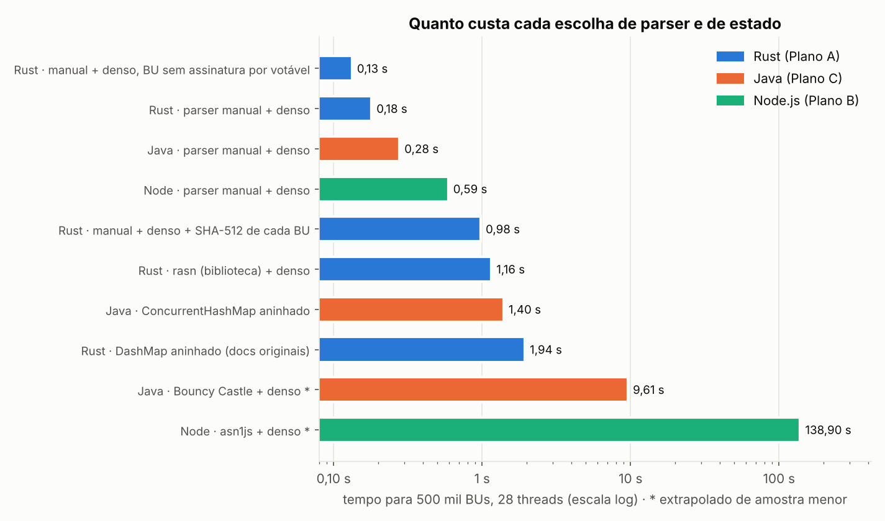
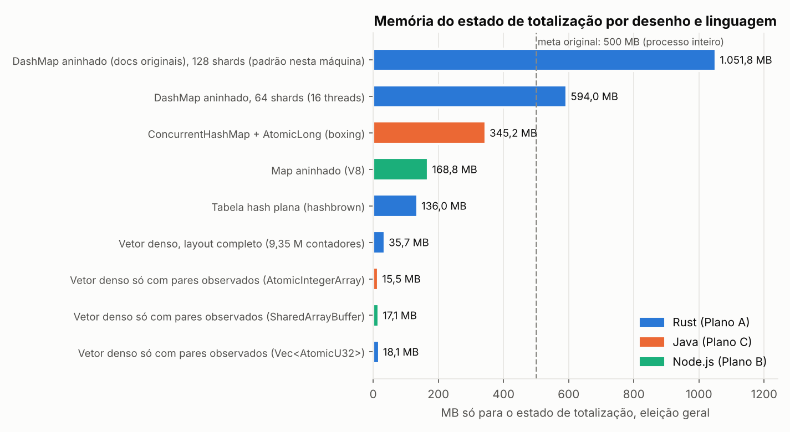
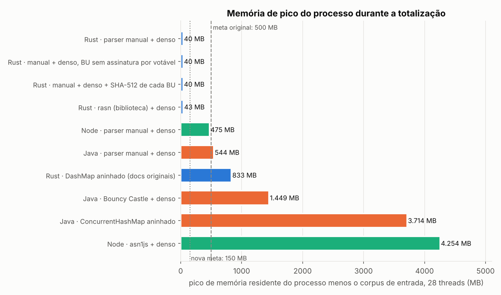

# Relatório do benchmark — 2026-10-11T16:08:18-03:00

Gerado por `bench/scripts/relatorio.py`. Significado dos termos: [docs/arquitetura/GLOSSARIO.md](../../docs/arquitetura/GLOSSARIO.md). Análise completa da execução de referência: [docs/arquitetura/ESTIMATIVAS_MEMORIA_E_TEMPO.md](../../docs/arquitetura/ESTIMATIVAS_MEMORIA_E_TEMPO.md).

## Máquina e parâmetros

```
# 2026-10-11T16:08:18-03:00
CPU(s):                                  28
Model name:                              Intel(R) Core(TM) i7-14700
Thread(s) per core:                      2
Core(s) per socket:                      14
Socket(s):                               1
L3 cache:                                33 MiB (1 instance)
               total        used        free      shared  buff/cache   available
Mem:           15842        2431        9886           4        3770       13410
6.18.33.2-microsoft-standard-WSL2
openjdk version "21.0.12.1" 2026-08-18
node v24.21.0
```

## 1. Resumo — eleição geral, 500 mil BUs, parser manual + vetor denso

|  | Rust (Plano A) | Java (Plano C) | Node.js (Plano B) |
|---|---|---|---|
| 1 thread | 1,660 s | 2,952 s | 4,243 s |
| 8 threads | 0,234 s | 0,436 s | 0,769 s |
| 28 threads | 0,180 s | 0,278 s | 0,591 s |
| Eleição municipal, 28 threads | 0,057 s | 0,089 s | 0,255 s |
| Custo por BU numa thread | 3,3 µs | 5,9 µs | 8,5 µs |
| Pico de memória sem o corpus (28 thr.) | 40 MB | 544 MB | 475 MB |

## 2. Tempo (s) para 500 mil BUs por nº de threads — eleição geral

| Variante | 1 | 2 | 4 | 8 | 12 | 16 | 20 | 24 | 28 |
|---|---|---|---|---|---|---|---|---|---|
| Rust (Plano A) | 1,660 | 0,798 | 0,432 | 0,234 | 0,230 | 0,195 | 0,173 | 0,185 | 0,180 |
| Java (Plano C) | 2,952 | 1,524 | 0,901 | 0,436 | 0,356 | 0,375 | 0,283 | 0,253 | 0,278 |
| Node.js (Plano B) | 4,243 | 2,131 | 1,252 | 0,769 | 0,616 | 0,568 | 0,620 | 0,559 | 0,591 |

## 3. Todas as variantes

| Variante | 1 thread (s) | 28 threads (s) | µs por BU (1 thr.) | Pico − corpus, 28 thr. (MB) |
|---|---|---|---|---|
| Rust · manual + denso, BU sem assinatura por votável | 1,568 | 0,133 | 3,1 | 40 |
| Rust · parser manual + denso | 1,660 | 0,180 | 3,3 | 40 |
| Java · parser manual + denso | 2,952 | 0,278 | 5,9 | 544 |
| Node · parser manual + denso | 4,243 | 0,591 | 8,5 | 475 |
| Rust · manual + denso + SHA-512 de cada BU | 11,8 | 0,979 | 23,5 | 40 |
| Rust · rasn (biblioteca) + denso | 14,5 | 1,156 | 29,0 | 43 |
| Java · ConcurrentHashMap aninhado | 9,713 | 1,396 | 19,4 | 3.714 |
| Rust · DashMap aninhado (docs originais) | 13,9 | 1,940 | 27,8 | 833 |
| Java · Bouncy Castle + denso ¹ | 110,1 | 9,607 | 220,3 | 1.449 |
| Node · asn1js + denso ¹ | 789,7 | 138,9 | 1.579,4 | 4.254 |

¹ medida com menos BUs que as demais (500.000 nesta execução) e extrapolada linearmente para 500 mil.

## 4. Memória só do estado de totalização (eleição geral)

| Desenho | Linguagem | MB |
|---|---|---|
| DashMap aninhado (docs originais), 128 shards (padrão nesta máquina) | Rust (Plano A) | 1.051,8 |
| DashMap aninhado, 64 shards (16 threads) | Rust (Plano A) | 594,0 |
| ConcurrentHashMap + AtomicLong (boxing) | Java (Plano C) | 345,2 |
| Map aninhado (V8) | Node.js (Plano B) | 168,8 |
| Tabela hash plana (hashbrown) | Rust (Plano A) | 136,0 |
| Vetor denso, layout completo (9,35 M contadores) | Rust (Plano A) | 35,7 |
| Vetor denso só com pares observados (AtomicIntegerArray) | Java (Plano C) | 15,5 |
| Vetor denso só com pares observados (SharedArrayBuffer) | Node.js (Plano B) | 17,1 |
| Vetor denso só com pares observados (Vec<AtomicU32>) | Rust (Plano A) | 18,1 |

**BUs inválidos em todas as medições:** 0 (correto)

## 5. Gráficos

### Tempo por nº de threads



### Aceleração



### Todas as variantes



### Memória do estado



### Memória de pico do processo



