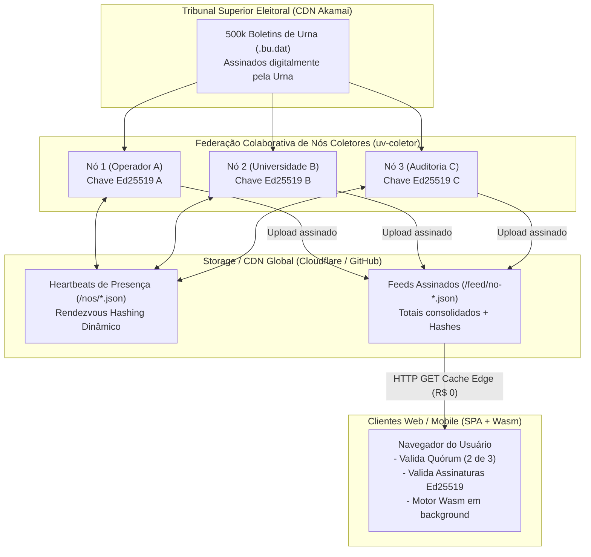
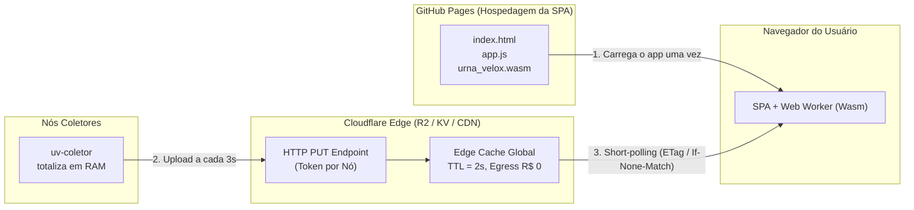

# 🌐 Módulo de Escalabilidade Segura: Federação Colaborativa e Distribuição Massiva

> **Visão e Especificação Técnica do Urna Velox v2.0.0**  
> Planejado para execução após a versão `1.0.0` (Majoritários). Antecede a versão `3.0.0` (Cargos Proporcionais).
>
> **Renumeração de 15/10/2026:** a federação de nós (REQ-ESC-05 a 08) foi entregue na **etapa 6 (`0.6.0`)**, antes da `1.0.0`; a publicação na borda (REQ-ESC-01 a 04), a assinatura e o quórum (REQ-ESC-09 a 13) e o motor em Wasm com SPA/PWA (REQ-ESC-14 a 17) ficaram para a **`1.x`**; os cargos proporcionais passaram a ser a **`2.0.0`**. Neste documento, "v2.0.0" quer dizer esse conjunto (mapa no [ROADMAP](../ROADMAP.md)).

---

## 1. Contexto e Motivação

O **Urna Velox v1.0.0** resolve com excelência a totalização em nó único:
- Motor analítico em Rust com parser ASN.1/BER *zero-copy* e vetor denso de contadores atômicos (~36 MB de RAM nacional).
- Capacidade de processar 500 mil BUs em menos de 1 segundo de CPU local.
- Aquisição respeitando o teto de 100 req/s da CDN do TSE (Akamai).

No entanto, em um cenário de **divulgação massiva e auditoria cívica em escala planetária na noite da eleição**, surgem dois desafios críticos:

1. **Gargalo de Distribuição aos Clientes (Broadcast Massivo):**
   - Manter conexões ativas bidirecionais (WebSockets ou Server-Sent Events) abertas a partir de um único servidor para centenas de milhares de navegadores simultâneos derruba o servidor, estoura o descritor de arquivos (C10K/C100K) e satura a banda de saída (*egress*).
2. **Resiliência e Descentralização da Coleta:**
   - Um servidor único de coleta é um ponto único de falha (*Single Point of Failure* - SPOF).
   - A 100 req/s por IP, um único nó leva de 30 a 90 minutos para varrer o Brasil inteiro se não houver paralelização de nós voluntários.
3. **Confiança e Mitigação de Fraude (Ataques Bizantinos):**
   - Como permitir que múltiplos servidores voluntários colaborem na coleta sem abrir brechas para que um nó malicioso ou adulterado injete dados falsos no placar?

O **Módulo de Escalabilidade Segura (v2.0.0)** resolve esses três problemas com **custo operacional próximo a R$ 0,00**, dispensando clusters complexos de coordenação e eliminando servidores de WebSocket centralizados.

---

## 2. Princípios Arquiteturais do Módulo

1. **Distribuição Invertida (*Static-File Edge Broadcast*):** Elimina-se o *push* ativo do servidor. O resultado da apuração é publicado como pequenos arquivos estáticos que **cada nó serve** e que uma CDN **guarda em cache na borda** (sem storage nem upload; vários nós como origem; ADR-030). Os navegadores (SPAs) fazem *short-polling* na borda.
2. **Zero-Trust com Prova Criptográfica da Urna:** Os nós coletores não geram a verdade; eles apenas transportam o Boletim de Urna assinado digitalmente pelo hardware da urna eletrônica do TSE (ECDSA / ICP-Brasil).
3. **Consenso e Quórum no Cliente (*Client-Side Consensus*):** A aplicação web (SPA) recebe dados de múltiplos operadores independentes identificados por chaves Ed25519 e valida assinaturas e quórum localmente antes de renderizar.
4. **Particionamento Dinâmico sem Coordenação Central (*Rendezvous Hashing*):** A distribuição de seções entre os servidores ajusta-se automaticamente conforme nós entram ou saem da rede através de *heartbeats* trocados diretamente entre os nós (sem storage compartilhado; ADR-028), eliminando gargalos geográficos e fusos horários. Pela mesma sincronização direta, cada nó recebe dos pares os BUs que eles coletaram e totaliza o país inteiro.

---

## 3. Visão Geral da Arquitetura

---

## 4. Componentes e Mecanismos

### 4.1. Distribuição de Clientes via CDN Estática
* A cada ciclo de agregação (2 a 5 segundos), cada nó gera o resumo consolidado de resultados em JSON (ex.: `br-presidente.json` ~15 KB) e o serve como origem, com um `indice.json` do ciclo.
* A CDN, em modo proxy, absorve 99,99% do tráfego: busca no nó só quando a cópia (TTL ~2 s) expira, e pode ter vários nós como origem. *(Revisto em 15/10/2026: sem storage na borda; ADR-030.)*
* As SPAs utilizam cabeçalhos `ETag` / `If-None-Match`. Se os votos não mudaram naquele segundo, a resposta da CDN retorna `304 Not Modified` consumindo zero largura de banda.

### 4.2. Rendezvous Hashing Dinâmico (Balanceamento sem Desbalanceamento Regional)
* Evita os gargalos da divisão geográfica fixa (onde o Sudeste sobrecarrega o nó no início e o Norte no final por fuso horário).
* Cada nó mantém um arquivo de *Heartbeat* na CDN com timestamp atualizado a cada 10s. Nós que não renovam o heartbeat em 30s são considerados mortos.
* Para cada seção eleitoral `s`, o nó responsável é aquele que maximiza:
  $$\text{Vencedor}(s) = \arg\max_{n \in \text{Nós Vivos}} \text{hash}(s.\text{id} \parallel n.\text{id})$$
* **Propriedades:**
  - Balanceamento perfeitamente uniforme de seções de todos os fusos horários e estados entre os nós ativos.
  - Se um nó novo entra, ele absorve apenas uma fatia proporcional das seções.
  - Se um nó cai, suas seções são redistribuídas suavemente entre os sobreviventes, sem reatribuir o restante do país.

### 4.3. Segurança Criptográfica e Blindagem Contra Nós Adulterados
1. **Whitelist de Chaves Públicas:** A SPA conhece antecipadamente as chaves públicas Ed25519 dos nós sentinelas autorizados. Nós desconhecidos são ignorados.
2. **Imutabilidade da Urna:** Todo nó é obrigado a referenciar o SHA-256 do arquivo de assinatura da urna (`.vsc`) e as assinaturas BER. Um nó não pode alterar o voto de uma urna sem invalidar a assinatura oficial do TSE.
3. **Auditoria Cruzada por Amostragem (*Spot-Checking*):** Cada nó vivo audita aleatoriamente 1% das seções coletadas pelos nós parceiros. Divergências geram alertas de fraude instantâneos.
4. **Quórum no Navegador:** A SPA só exibe resultados consolidados após obter confirmação idêntica de ao menos $M$ de $N$ operadores independentes (ex.: 2 de 3).

---

## 5. Topologia de CDN e Storage: GitHub vs. Cloudflare Edge

> **Revisto em 15/10/2026 (ADR-030):** a camada de dados em tempo real **não usa storage com upload** (R2/KV). Cada nó serve os próprios arquivos e a CDN só faz cache na frente; o restante desta seção (por que não GitHub Pages para os dados, cache curto) continua valendo. A SPA pode seguir em GitHub/Cloudflare Pages.

Uma análise técnica detalhada definiu a separação de responsabilidades entre GitHub e Edge Storage/CDN:

| Camada | Papel | Plataforma Escolhida | Justificativa Técnica |
|---|---|---|---|
| **Hospedagem da Aplicação (SPA)** | Servir arquivos estáticos da interface web (HTML, CSS, JS, binário `.wasm`) | **GitHub Pages** (ou Cloudflare Pages) | Arquivos estáticos imutáveis durante a apuração. O GitHub Pages aguenta milhões de leituras na CDN da Fastly com custo R$ 0,00. |
| **Ingestão e Distribuição dos Dados em Tempo Real** | Receber uploads dos nós (a cada 2–5s) e servir os JSONs consolidados aos navegadores | **Edge Object Storage (Cloudflare R2 / Workers KV)** | **Por que NÃO usar GitHub Pages para dados em tempo real:** 1. *Latência de build:* commits no Git demoram de 30s a 2 minutos para propagar no Pages. 2. *Limites de automação:* 1 push a cada 3s (1.200 pushes/hora) estoura os limites secundários da API do GitHub e bloqueia o repositório. 3. *Cache agressivo:* GitHub Pages impõe `Cache-Control: max-age=600` (10 min).  **Vantagens da Edge Cloudflare:** - Atualização global via HTTP PUT em < 50 ms. - Egress (tráfego de saída aos usuários) com **custo R$ 0,00** (sem taxa de transferência). - Cache curto configurável na borda (`max-age=2, stale-while-revalidate=1`). |

---

## 6. Lista de Requisitos de Engenharia (v2.0.0)

A implementação do **Módulo de Escalabilidade Segura** na versão `v2.0.0` é orientada pelos seguintes requisitos funcionais e não-funcionais:

### 6.1. Requisitos de Distribuição e Rede (CDN & Storage)
- **REQ-ESC-01 (Inversão de Push):** O sistema **não** deve manter conexões persistentes bidirecionais (WebSockets ou SSE) de nós servidores para os **leitores do público**. A comunicação com eles deve ser estritamente *pull* (HTTP GET) via CDN, com os nós como origem. *(O WebSocket da ADR-026 continua para poucos consumidores de baixa latência, como painéis e integrações.)*
- **REQ-ESC-02 (Latência de Atualização):** O tempo entre a totalização de um lote de BUs pelo nó e a visibilidade do JSON **através do cache da CDN** deve ser **inferior a 200 ms + TTL** (p99). *(Revisto em 15/10/2026; ADR-030.)*
- **REQ-ESC-03 (Cache e Compressão Eficiente):** As respostas de dados na borda devem usar `Cache-Control: public, max-age=2, stale-while-revalidate=1`, cabeçalhos `ETag` para suporte a `304 Not Modified`, e compressão Brotli/Gzip automática.
- **REQ-ESC-04 (Custo Operacional Zero):** A infraestrutura de entrega aos usuários finais deve operar sob camadas gratuitas de tráfego de saída (*zero egress fees*): CDN em modo proxy com cache dos JSONs por regra, sem storage pago; a SPA em GitHub/Cloudflare Pages. *(Revisto em 15/10/2026; ADR-030.)*

### 6.2. Requisitos de Federação e Coordenação de Nós
- **REQ-ESC-05 (Heartbeat Descentralizado):** Cada nó coletor ativo deve atualizar o seu *heartbeat* a cada **10 segundos** ($\pm 2\text{s}$) e servi-lo aos pares, que o buscam diretamente (ou por repasse de outro par), **sem storage compartilhado**. Um nó cujo *heartbeat* não muda há mais de **30 segundos**, medidos por cada observador no seu relógio, deve ser considerado inativo. Pela mesma sincronização, cada nó obtém dos pares os lotes de BUs que eles coletaram (*Revisto em 14/10/2026; ADR-028.*)
- **REQ-ESC-06 (Rendezvous Hashing Determinístico):** A partição de seções entre os nós ativos deve utilizar *Rendezvous Hashing* ($HRW$) sobre a chave natural da seção `(municipio, zona, secao)` e os identificadores dos nós vivos, garantindo distribuição uniforme em todos os fusos horários.
- **REQ-ESC-07 (Rebalanceamento Suave):** A entrada ou saída de um nó na federação só pode transferir frações proporcionais de seções ($\approx 1/K$ onde $K$ é o número de nós), sem invalidar o trabalho já concluído ou reatribuir seções estáveis.
- **REQ-ESC-08 (Aderência ao Teto do TSE):** Cada nó pertence a um **órgão diferente** (cada um no seu IP) e respeita rigorosamente o limite de **100 req/s** do seu órgão (acima disso, HTTP 429), com controle adaptativo AIMD (ADR-015). O limite é contado por **IP de saída** (o que a CDN vê): cada nó mede e publica o seu no *heartbeat*, conhece o dos outros, e nós que saem pelo mesmo IP formam um grupo que **divide** os 100 req/s (HRW ponderado pela capacidade). Um HTTP 429 pausa só o IP atingido (≥ 10 min), cujas seções passam aos outros. A vazão global da federação escala com o número de órgãos/IPs de saída distintos ($K \times 100\text{ req/s}$). **Na infraestrutura de um operador que hospeda vários órgãos, cada órgão tem máquina e IP público reservado exclusivos** (garantia operacional; a divisão por IP no código é só rede de segurança e gera alerta; ADR-029). *(Revisto em 14/10/2026 com a regra do `CLAUDE.md`; detalhes no handoff da 2.0, `docs/HANDOFF_0.6.0.md`, na branch `feature/2.0-escalabilidade`.)*

### 6.3. Requisitos de Segurança e Quórum (Zero-Trust)
- **REQ-ESC-09 (Assinatura dos Nós com Ed25519):** Todo feed de resultados publicado por um nó deve conter assinatura digital Ed25519 sobre o hash SHA-256 do arquivo consolidado, identificador do nó e timestamp.
- **REQ-ESC-10 (Whitelist Estática no Cliente):** A aplicação cliente (SPA) deve conter a lista fixa de chaves públicas autorizadas dos nós sentinelas. Feeds com chaves não listadas devem ser descartados sem processamento.
- **REQ-ESC-11 (Imutabilidade baseada em ASN.1):** O feed consolidado de cada nó deve referenciar os identificadores e hashes SHA-256 dos arquivos de assinatura original da urna (`.vsc`), permitindo auditoria pontual do BU oficial do TSE.
- **REQ-ESC-12 (Amostragem Cruzada - Spot Checking):** Nós coletores devem baixar e revalidar aleatoriamente **1% das seções** atribuídas a nós pares. Qualquer divergência de contagem de votos deve disparar um evento de alerta de integridade assinado.
- **REQ-ESC-13 (Quórum de Consenso no Navegador):** A SPA deve exigir concordância exata de totais entre uma maioria qualificada (ex.: $M$ de $N$, no mínimo 2 de 3) de nós autorizados antes de exibir o resultado como "Conferido por Quórum".

### 6.4. Requisitos do Motor WebAssembly (Wasm) e Interface Web
- **REQ-ESC-14 (Compilação Wasm Nativa):** A crate `urna-velox` deve compilar para o alvo `wasm32-unknown-unknown` gerando artefato `.wasm` otimizado e compacto (< 2 MB comprimido).
- **REQ-ESC-15 (Execução Fora da Thread Principal):** O motor Wasm deve rodar exclusivamente dentro de um **Web Worker**, comunicando-se com a UI via mensagens estruturadas, garantindo 60/120 fps constantes na interface.
- **REQ-ESC-16 (Memória Linear Contida):** A pegada de memória do Wasm no navegador deve permanecer inferior a **60 MB** para a eleição nacional completa.
- **REQ-ESC-17 (SPA Universal e PWA - Sem App Store):** O cliente móvel deve ser exclusivamente uma SPA/PWA web padrão (ADR-025), com `manifest.json` e Service Worker para instalação opcional na tela inicial, dispensando empacotamento nativo em lojas (Play Store / App Store).

---

## 7. Relação com as Versões do Sistema

| Versão | Escopo Principal | Foco |
|---|---|---|
| **`v1.0.0`** | Majoritários em Nó Único | Concluir o motor completo para Presidente, Governador, Senador e Prefeito; operação automatizada (`uv-servico`); conferência 100% oficial. |
| **`v2.0.0`** | **Escalabilidade Segura** | **Federação colaborativa de nós, Rendezvous Hashing, distribuição estática via CDN para milhões de usuários, Wasm no navegador e segurança criptográfica por quórum (REQs 01 a 17, ADRs 021 a 025).** |
| **`v3.0.0`** | Proporcionais | Cálculo de quociente eleitoral, quociente partidário, distribuição de sobras e definição de eleitos e suplentes para Deputados e Vereadores. |

