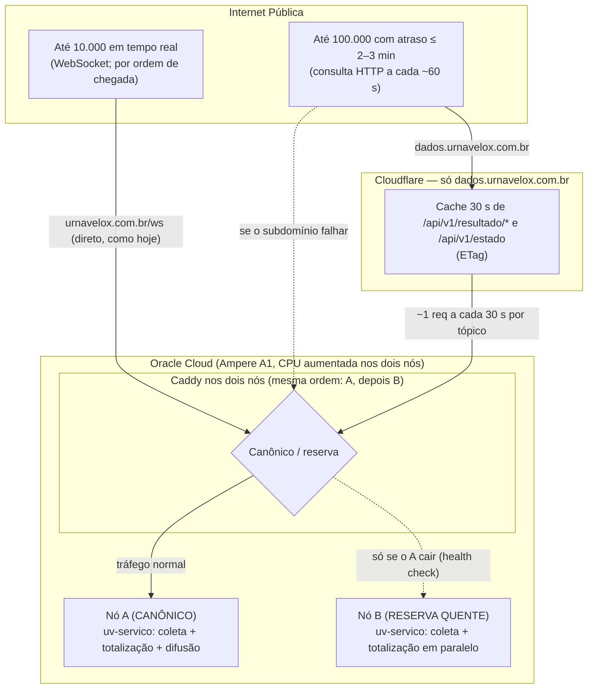

# Handoff — Modelo de Borda, Consistência Canônica e Alta Escala

*Documento de passagem de bastão para a sessão de implementação do modelo de borda e consistência do Urna Velox para o
2º turno de 2026 (25/10/2026). **Revisado em 20/10/2026, 19h20 (Claude), com as metas e decisões do Luciano** (§0),
depois da revisão do teste de carga ([HANDOFF_CARGA_E_ARQUITETURA.md §7](HANDOFF_CARGA_E_ARQUITETURA.md#7-revisão-de-2010-19h-o-que-vale-para-o-2º-turno))
e do painel dos nós do teste das 18h21. O que mudou em relação à versão de 16h está na §5.*

**Como usar este documento: um passo por vez.** Cada passo da §3 tem objetivo, teste primeiro, mudança, critério de
pronto e como desfazer. Só se começa o passo seguinte quando o anterior está pronto (teste verde, suíte inteira verde,
versão nova, commit e push, implantado e conferido) e o Luciano liberou. O que mexe em produção (nós, DNS, Cloudflare,
teste de carga) só com o ok do Luciano na hora. Os passos que corrigem bug seguem a regra do [CLAUDE.md](../CLAUDE.md)
("Bugs"): primeiro o teste vermelho, depois a correção.

---

## 0. Metas e decisões (Luciano, 20/10, 19h20)

**Metas para o 2º turno:**
* **10.000 clientes WebSocket** em tempo real. **Autenticação fica para depois do 2º turno** (§6): no domingo as
  vagas de WebSocket são por ordem de chegada.
* **100.000 clientes por HTTP**, com a apuração na tela **até 2–3 min atrasada**, no máximo.

**Decisões:**
* **Aumentar a CPU dos dois nós** (A1 flexível, pago): o A porque concentra o WebSocket, o B para ser reserva à altura.
* **Cloudflare só num subdomínio do HTTP** (proposta: `dados.urnavelox.com.br`). O domínio principal continua direto
  nos nós como hoje (WebSocket, playlist, painel e IP do visitante sem mudança).

**O orçamento do atraso de 2–3 min:** cache de 30 s na borda + consulta a cada 60 s (±20 %) na página ≈ 100 s no pior
caso, com folga para a totalização. Carga na borda: 100.000 ÷ 60 s ≈ 1.700 req/s (a Cloudflare atende); na origem,
~1 consulta por tópico a cada 30 s.

**Por que mais CPU:** com ~5.000 clientes por nó a CPU foi a 40–50 % dos 2 OCPUs com só ~1 mil mensagens/s no total
(replay de ritmo baixo). Na noite real, 10.000 clientes devem pedir dezenas de milhares de mensagens/s (estimativa a
partir do teste local a 60×, **a medir**), concentradas no nó A pelo modelo canônico.

---

## 1. Contexto

1. **Consistência (visto em produção).** O DNS aponta para os dois nós e o Caddy de cada um ainda balanceia entre os
   dois (`least_conn` no `/ws`, `round_robin` no resto; `deploy/oci/servidor/Caddyfile.template`). Cada nó totaliza
   por conta própria; quem atualiza a página ou reconecta pode ver o percentual "voltar no tempo".
2. **Carga (teste de 20/10).** O corte nas ~10.500 conexões veio do `--max-clientes 5000` por nó (HTTP 503 no `/ws`),
   não de backlog TCP. A totalização não sentiu a carga; a memória tem folga (~130 KB por conexão); **a CPU é o
   limite**. **Quem passa do limite não vê a apuração** (B-026): o `site/src/conexao.js` só tenta reconectar.
3. **Decisão de 20/10:** **não refatorar o núcleo nem quebrar o binário agora.** WebSocket no nó canônico para quem
   cabe; HTTP com cache na borda para o resto.

---

## 2. A Arquitetura do Modelo



### Os pilares
1. **Consistência: nó canônico com outro de reserva.** Todo o tráfego vai ao A; o B só assume se o health check do A
   falhar. A lista de origens fica **na mesma ordem nos dois Caddys** (A, depois B), porque o DNS manda visitantes aos
   dois. *A versão de 16h usava `127.0.0.1:8080 {$IP_OUTRO_NO}:8080` com `lb_policy first`: o Caddy do B preferiria
   o próprio B.* Quando o A recusa com 503 por estar cheio, o Caddy **não** manda o excedente ao B (o A está
   saudável): quem sobra vai para o HTTP. Na volta do B para o A, conferir que a página não mostra número "voltando"
   (o `seq` não é comparável entre nós).
2. **Modo HTTP na página (B-026).** WebSocket recusado ou caindo seguidamente → a página consulta por HTTP a cada
   60 s (±20 %) em `https://dados.urnavelox.com.br`, só o tópico da tela e o estado, com `If-None-Match`; se o
   subdomínio falhar, consulta o próprio domínio. Tenta o WebSocket de novo a cada ~2 min. Aviso discreto: "atualizando
   a cada minuto (muitos acessos)".
3. **Cloudflare só no subdomínio.** O domínio principal fica com a nuvem **cinza** (só DNS, direto nos nós, como hoje);
   só `dados` fica **laranja**. O Caddy atende `dados.urnavelox.com.br` apenas com `GET` das rotas de leitura e põe
   nelas `Cache-Control` de 30 s.
4. **CPU dos nós.** A1 flexível: 4 OCPUs por nó de início (o Always Free cobre 4 no total; o resto é pago), 8 se o
   teste pedir. A memória não precisa subir. Trocar a forma reinicia a instância.
5. **Kernel e descritores: só conferir** `LimitNOFILE` dos serviços e `somaxconn`; não foram o gargalo.

---

## 3. Roteiro: um passo por vez

**Prazo:** passos 1–5 até quinta (22/10). **Sexta e sábado sem mudança de código nem de infraestrutura** (passo 6).
Os passos 2 e 3 são de infraestrutura: o Luciano pode adiantar em paralelo o que só ele faz (conta paga na Oracle,
conta na Cloudflare, servidores DNS no Registro.br), porque a troca de DNS pode levar horas para propagar.

### Passo 1 — Modo HTTP na página (B-026)
* **Objetivo:** toda página mostra a apuração, mesmo quando o `/ws` responde 503 ou cai seguidamente, com no máximo
  2–3 min de atraso.
* **Teste primeiro (vermelho)**, em `site/testes/`: a página com o `/ws` recusando (503 "limite de clientes") e as
  rotas REST respondendo; esperado: o resultado do tópico da tela aparece e é atualizado. Hoje deve falhar (a página
  só reconecta). Registrar nome do teste e saída no `BUGS.md`. Usar no teste um intervalo curto configurável (o real
  é 60 s).
* **Mudança** (`site/src/conexao.js`, `site/src/app.js`):
  - Depois de 2–3 recusas/quedas seguidas, entrar no modo HTTP: a cada 60 s (±20 %), `GET /api/v1/resultado/<tópico
    da tela>` e o estado da apuração, com `If-None-Match`; a resposta vai para o mesmo `aoReceber({ tipo:
    'resultado', topico, seq, txt })` do WebSocket.
  - Base das consultas configurável: `https://dados.urnavelox.com.br` quando existir (passo 3); se falhar, o próprio
    domínio. Até o passo 3, só o próprio domínio.
  - Conferir em [PROTOCOLO_WS.md](PROTOCOLO_WS.md) e no `difusao.rs` quais rotas REST existem para estado, eventos e
    marcos. O que não tiver rota fica de fora no modo HTTP, com aviso; não criar rota nova no servidor neste passo
    sem combinar.
  - Nova tentativa do WebSocket a cada ~2 min (com variação); ao conseguir, sair do modo HTTP.
  - Aviso discreto na tela: "atualizando a cada minuto (muitos acessos)".
* **Pronto quando:** teste verde, suíte do site inteira verde, versão nova (PATCH) com CHANGELOG e `BUGS.md` (antes e
  depois), commit e push. Implantar nos nós só com o ok do Luciano.
* **Desfazer:** voltar a versão anterior do site (a mudança é só da página).

### Passo 2 — Mais CPU nos dois nós
* **Objetivo:** dar ao nó A CPU para 10.000 WebSocket em ritmo de noite real, e ao B a mesma, para ser reserva.
* **Antes:** conta pay-as-you-go na Oracle (Luciano); preço por OCPU-hora conferido na página da Oracle.
* **Como:** trocar a forma das A1 para **4 OCPUs** por nó (mesma memória), **um nó de cada vez, o B primeiro**,
  conferindo depois de cada um: `uv-servico` de pé, federação e painel normais, site atendendo. Se faltar capacidade
  na região ("Out of host capacity", como no `00_criar_oci.sh`), tentar de novo mais tarde; não mudar de região.
  Atualizar `OCI_OCPUS` no `nos.env` e o comentário do `00_criar_oci.sh`.
* **Pronto quando:** os dois nós com 4 OCPUs, sem perda de BUs nem de federação. Se o passo 5 mostrar que não basta,
  repetir para 8.
* **Desfazer:** voltar à forma anterior (outro reinício por nó).

### Passo 3 — Subdomínio `dados` na Cloudflare
* **Objetivo:** 100.000 páginas no modo HTTP sem que a carga chegue aos nós.
* **Teste primeiro**, em `deploy/oci/testes/test_caddyfile.py`: o Caddyfile gerado tem o site
  `dados.urnavelox.com.br` só com `GET`/`HEAD` de `/api/v1/resultado/*` e `/api/v1/estado` (o resto 404), com
  `Cache-Control: public, max-age=30, s-maxage=30` na resposta (`header_down` no `reverse_proxy`, sobrepondo o da
  origem), origens na ordem A, B; e o site principal **sem** mudança.
* **Mudança:** `Caddyfile.template` / `gerar_caddyfile.sh` (o novo site), implantado com o `02_configurar_borda.sh`.
* **Na Cloudflare e no DNS (com o Luciano):**
  1. Conferir onde está a zona hoje. O plano gratuito exige que os **servidores DNS do domínio** passem para a
     Cloudflare (no Registro.br). Antes de trocar, copiar **todos** os registros atuais para a Cloudflare com a nuvem
     **cinza** (só DNS): o site principal continua indo direto aos nós, sem mudança.
  2. Criar `dados` (registros A para os dois nós) com a nuvem **cinza**, deixar o Caddy emitir o certificado e
     conferir `https://dados.urnavelox.com.br/api/v1/estado`.
  3. Só então ligar a nuvem **laranja** em `dados`. TLS em *Full (strict)*. Regra de cache só para o host `dados`:
     "elegível para cache", respeitando o `Cache-Control` da origem.
* **Pronto quando:** pela borda, duas consultas seguidas ao mesmo tópico dão `cf-cache-status: HIT` e o mesmo `ETag`;
  o site principal (página, WebSocket, playlist, painel) idêntico ao de antes; a página do passo 1 apontada para
  `dados` (versão nova).
* **Desfazer:** nuvem cinza em `dados` (a página continua funcionando: cai no próprio domínio).

### Passo 4 — Nó canônico (consistência)
* **Objetivo:** todo visitante vê a mesma versão; o B só atende se o A cair. Depende do passo 2 (o A concentra tudo).
* **Teste primeiro**, em `deploy/oci/testes/test_caddyfile.py`: o Caddyfile **dos dois nós** tem as origens na ordem
  A, B, com `lb_policy first` e health check em `/api/v1/estado`, nas rotas `/ws`, `@controle`, `handle` geral e no
  site `dados`. Hoje deve falhar (`least_conn`/`round_robin`, `127.0.0.1` primeiro).
* **Mudança** (`Caddyfile.template`, `gerar_caddyfile.sh`):
  ```caddy
  reverse_proxy {$IP_NO_A}:8080 {$IP_NO_B}:8080 {
      lb_policy first
      health_uri /api/v1/estado
      health_interval 5s
      health_timeout 2s
      health_status 200
  }
  ```
  (no `/ws`, manter o `flush_interval -1`.)
* **Pronto quando:** teste verde, implantado; pelos dois IPs (`curl --resolve`) o mesmo `seq`; parar o `uv-servico`
  do A leva os clientes ao B em ~10 s, e religar os traz de volta sem número "voltando" na página.
* **Desfazer:** reaplicar o Caddyfile anterior.

### Passo 5 — Teste de carga contra as metas e `max_clientes`
* **Objetivo:** medir as duas metas e fixar o `max_clientes` pela CPU.
* **Preparar o gerador:** `ulimit -n` bem acima de 10.240 no WSL (o teste de 20/10 parou nele) ou o `uv-carga` em
  mais de uma máquina; guardar CPU e RSS dos **nós** por degrau (painel) junto do relatório.
* **WebSocket:** `--max-clientes 10000` no A (e no B), degraus até 10.000 contra o A, com **replay no ritmo de BUs de
  pico de uma noite real** (não ~10–35 BUs/s) e uma **subida rápida** (milhares de conexões em segundos). Meta: 10.000
  conectados, CPU do A abaixo de ~70 %, totalização sem atraso. Se não fechar, 8 OCPUs (passo 2) ou um `max_clientes`
  menor (e o resto no HTTP).
* **HTTP:** não precisa de 100.000 conexões, só da taxa: ~1.700–2.000 req/s em `dados.urnavelox.com.br` (qualquer
  gerador de requisições), conferindo a fração de `HIT` e as req/s que chegam aos nós. E, com o WebSocket cheio,
  páginas acima do limite mostrando a apuração (o modo do passo 1).
* **Atenção:** teste em produção só com o ok do Luciano e nunca durante a coleta de uma eleição real.
* **Pronto quando:** relatório em `docs/` com as duas metas atingidas (ou o que falta) e o `max_clientes` decidido.

### Passo 6 — Congelamento (sexta e sábado)
* Sem mudança de código nem de infraestrutura. Conferências: `disco.sh`, saúde dos nós, playlist apontando para o
  2º turno, `dados` com `HIT`, um teste de carga curto no fim de sexta (fora da coleta) e o roteiro de operação da noite.

---

## 4. Arquivos Envolvidos e Referências

* [`site/src/conexao.js`](../site/src/conexao.js) — cliente WebSocket; onde entra o modo HTTP (passo 1).
* [`site/src/app.js`](../site/src/app.js) — tópicos da tela (`atualizarTopicos`), `aoReceber`.
* [`aquisicao/src/difusao.rs`](../aquisicao/src/difusao.rs) — rotas REST e WebSocket (`rest_resultado`, `ws`,
  `max_clientes`, `ping`).
* [`deploy/oci/servidor/Caddyfile.template`](../deploy/oci/servidor/Caddyfile.template),
  `deploy/oci/servidor/gerar_caddyfile.sh` e [`02_configurar_borda.sh`](../deploy/oci/02_configurar_borda.sh) —
  subdomínio `dados` (passo 3) e nó canônico (passo 4).
* [`deploy/oci/00_criar_oci.sh`](../deploy/oci/00_criar_oci.sh) — forma das instâncias (passo 2).
* [`HANDOFF_CARGA_E_ARQUITETURA.md`](HANDOFF_CARGA_E_ARQUITETURA.md) — medições e revisão (§7).
* [`BUGS.md`](BUGS.md) — B-026.
* [`GUIA_URL_E_BALANCEAMENTO.md`](GUIA_URL_E_BALANCEAMENTO.md) — guia original de DNS e Caddy.

---

## 5. O que mudou em relação à versão de 16h (20/10)

* **Metas e decisões do Luciano** (§0): 10.000 WebSocket, 100.000 HTTP com até 2–3 min de atraso, mais CPU nos
  dois nós, Cloudflare só no subdomínio `dados`.
* O caminho HTTP alternativo era descrito como existente; **não existe** (B-026). Virou o passo 1, com consulta a cada
  60 s (não 2 s).
* A causa do corte aos 12.000 não foi backlog TCP: foi o `max_clientes` (produção) e o `ulimit` do gerador (local).
  O ajuste de kernel saiu do roteiro (só conferir).
* A CPU é o limite real (painel das 18h21): aumentar a CPU virou o passo 2, antes do nó canônico.
* O Caddyfile proposto para o nó canônico preferiria o próprio nó no B; corrigido para a mesma ordem (A, B) nos dois.
* A Cloudflare deixou de ir na frente do domínio inteiro (risco no WebSocket, na playlist, no painel e no IP do
  visitante) e ficou só no subdomínio do HTTP, com volta automática ao próprio domínio.
* O `?live=1`/`?vip=1` saiu: sem autenticação, qualquer um usaria (ver §6).

---

## 6. Depois do 2º turno (fora do escopo de domingo)

* **WebSocket autenticado, HTTP com cache para o público** (ideia do Luciano, 20/10): o `/ws` passa a exigir um
  token assinado (Ed25519, na linha da ADR-023), de validade curta, que cada nó confere sozinho; o `max_clientes` vira
  cota reservada para quem tem token; cada token com 1–3 conexões simultâneas. O navegador não põe cabeçalho no
  WebSocket: o token vai em cookie, na URL ou na primeira mensagem.
* Distribuição massiva como na ADR-021/030 (cada nó é origem; a CDN só faz cache).
