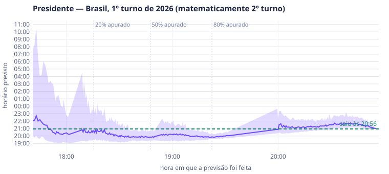
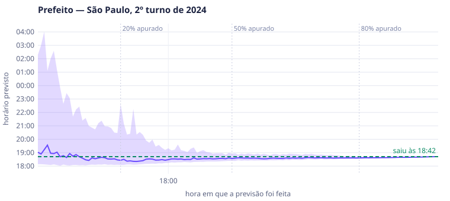

# Relatório da etapa 8 — previsão do matematicamente e do fim da apuração (`0.8.0`)

*17/10/2026. Handoff: [/mnt/d/git/lukeboh/urna-velox/docs/HANDOFF_0.8.0.md](/mnt/d/git/lukeboh/urna-velox/docs/HANDOFF_0.8.0.md).
Código: `/mnt/d/git/lukeboh/urna-velox/motor/src/previsao.rs` (cálculo), `/mnt/d/git/lukeboh/urna-velox/motor/src/backtest.rs`
(`uv-motor previsao`), `/mnt/d/git/lukeboh/urna-velox/aquisicao/src/previsao.rs` (thread do `uv-servico`),
`/mnt/d/git/lukeboh/urna-velox/site/src/previsao.js` (cartão). Protocolo: §4.7 de
[/mnt/d/git/lukeboh/urna-velox/docs/PROTOCOLO_WS.md](/mnt/d/git/lukeboh/urna-velox/docs/PROTOCOLO_WS.md).
Versões `0.7.6` (motor e backtest), `0.7.7` (serviço, protocolo e página) e `0.7.8` (parada detectada ao vivo).
**Etapa fechada na `0.8.0` em 17/10/2026, por decisão do Luciano, sem a validação independente prevista** (§9).*

## 1. Resumo

Para cada tópico, o Urna Velox agora estima **a que horas deve sair o "matematicamente"** (eleito ou 2º turno) e **a
que horas as seções chegam a 99 % e a 100 %**. A estimativa é sempre uma faixa P10–P90, rotulada como estimativa,
recalculada a cada 30 s do relógio do serviço e mostrada na página num cartão de altura fixa (CLS 0).

| critério do handoff | meta | medido | |
|---|---|---|---|
| 1. calibração do matematicamente (≥ 20 % apurado) | 70–90 % dentro do P10–P90 | **2024 1º turno 81,5 %, 2024 2º turno 85,3 %**; 2026 1º turno: Governador 68,1 % (79,5 % na média por UF), Senador 60,2 % (72,1 %), Presidente 53,3 % (uma disputa só) | 🟡 |
| 2. erro mediano do P50 a partir de 50 % | ≤ 10 min | **2024 1º turno 7,8 / 4,1 min** (50 % / 80 %), **2024 2º turno 8,1 / 4,0 min**; 2026 1º turno: 19–68 min | 🟡 |
| 3. custo da rodada | < 50 ms (3221); < 1 s (5.569 municípios) | todos os 16.982 tópicos de uma eleição geral: 27 ms com 24 threads, 69 ms com 4; 5.569 municípios de 2024: 51 ms com 24 threads, 224 ms com 2 | ✅ (< 1 s) / 🟡 (< 50 ms só com ≥ 8 threads) |
| 4. site no replay de 2026 a 60× | CLS 0, marcos batendo | CLS 0 no desktop (1440 px) e no celular (360 px), a noite inteira; em 45 das 47 circunscrições decididas com previsão antes, o horário real caiu na última faixa prevista; nas outras 2, a faixa começava de 12 a 3 s depois | ✅ |

**Onde a previsão funciona e onde não funciona.** Nas duas noites de 2024 a calibração fica na faixa pedida e o erro,
abaixo de 10 min a partir de 50 % apurado. No 1º turno de 2026, a recepção dos BUs **praticamente parou das 19h30 às
20h00 e andou devagar até as 20h50**, seguida de uma rajada (§4). Nenhuma previsão por ritmo de chegada antecipa uma
parada dessas, e ela levou de 20 a 60 min de erro em todas as disputas que se decidiram depois das 19h30. A **fração
apurada em que a disputa se decide** foi prevista com precisão nessa mesma noite (Presidente: erro mediano de 0,06
ponto percentual a partir de 50 %). O que errou foi só o relógio. Nas duas noites de 2024 não houve parada parecida
nos horários de recebimento. Mesmo assim, o caso fica registrado para a sua decisão (§9).

## 2. Método (o que foi implementado)

Segue o handoff, com os desvios marcados com ⚠.

1. **Avanço** em eleitores aptos das seções apuradas, no relógio do serviço (no backtest, o horário de recebimento do
   BU no TSE; no replay, o relógio simulado). Velocidade: média móvel exponencial de aptos/s com meia-vida de 10 min;
   dispersão: P10 e P90 das taxas por minuto dos últimos 30 min.
2. **Restante por estrato:** UF no Brasil e município na UF. Restante = aptos não apurados × votos nominais por apto do
   estrato (encolhido para o da circunscrição com `k_aptos` = 5.000) × proporções do estrato encolhidas
   `(v_e + k·p_c)/(n_e + k)` com `k` = 2.000 votos. O eleitorado do estrato é o publicado quando há (Presidente por
   UF); senão, seções esperadas × aptos por seção observados (encolhidos para a média da circunscrição), com a soma
   reescalada para fechar com o eleitorado da circunscrição.
   * ⚠ **No município, um estrato só** (o handoff pedia zona): o estado do motor guarda contadores por município, não por
     zona. Separar por zona exigiria novos contadores no caminho do BU, e o backtest de 2024 já calibra sem isso.
   * ⚠ **No máximo 24 estratos** no Monte Carlo: ficam os 23 com mais aptos por apurar e o resto vira um só. Minas tem
     853 municípios, e sem o limite a rodada de uma UF grande levava dezenas de ms.
3. **Momento da definição:** o restante de cada estrato chega como `f^γ_e` (γ sorteado: ordem de chegada perturbada
   entre estratos). Uma busca binária em `f` encontra o primeiro ponto em que `matematica::avaliar`, com o eleitorado
   ainda não apurado, deixa de dar "apurando". É a mesma regra do motor: idade no empate, art. 224, 2 vagas.
4. **Intervalo:** Monte Carlo com semente fixa (SplitMix64; semente = parâmetro ⊕ tópico ⊕ instante), 200 sorteios.
   Cada sorteio varia a deriva comum das proporções (σ = 1 ponto), o erro de amostragem por estrato, o comparecimento
   (2 %) e a ordem de chegada (σ = 0,35 em log). A **probabilidade de definir antes do fim** é a fração de sorteios
   em que a disputa se decide com pelo menos 1 % dos aptos ainda por apurar.
5. **Conversão em horário** ⚠ *(mistura, decidida no backtest, §6)*: metade dos sorteios usa o **gabarito** ajustado à
   noite corrente e a outra metade a **velocidade** sorteada da dispersão. No gabarito, deslocamento e escala vêm de
   mínimos quadrados de `t` em `τ(F)` nos últimos 30 min, e a projeção sai ancorada no ponto atual. Por cima, um erro
   relativo log-normal do tempo que falta (σ = 0,4), que cresce quando restam poucas seções:
   `0,4 · (1 + 6/√(restantes + 1))`. Uma ou outra seção atrasada decide o fim de um município pequeno.
6. **Fim da apuração (99 % e 100 % das seções esperadas, sem agregadas e não instaladas):** a mesma conversão, com as
   curvas de seções. Os **gabaritos** são a mediana, ponto a ponto, das curvas `τ(F)` das abrangências de cada classe
   em cada noite: Brasil, UF e municípios por porte (≥ 1 milhão, ≥ 200 mil, ≥ 20 mil, menores). São 14 curvas, 25 KB,
   embutidas no binário (`motor/src/gabaritos.json`). No backtest, a noite prevista **não usa os próprios gabaritos**.
7. **Salvaguardas:** só com ≥ 5 % dos aptos e ≥ 10 min desde o primeiro BU. Faixa com mais de 3 h vira `incerta`
   ("ainda incerto" na tela). Depois da definição a previsão congela, e a mensagem traz a **confirmação**: a última
   faixa, se o real caiu nela e desde quando todas as faixas acertavam. A palavra "resultado" não aparece.

## 3. Calibração e erro (backtest, `uv-motor previsao`, uma previsão a cada 30 s da noite)

Previsões emitidas com ≥ 20 % dos aptos apurados e antes do evento. "Dentro" = o horário real caiu no P10–P90. "Média
por circ." = a cobertura de cada circunscrição, depois a média (cada disputa pesa igual). Erro = |P50 − real| da
primeira previsão de cada circunscrição depois de 20 %, 50 % e 80 % apurado, mediana entre as circunscrições.

### 2024, 2º turno (51 municípios) — a noite mais parecida com 25/10

| alvo | circ. | previsões | dentro | média por circ. | erro P50 20 % / 50 % / 80 % |
|---|---|---|---|---|---|
| matematicamente | 51 | 2.511 | **85,3 %** | 85,8 % | 11,0 / **8,1** / **4,0** min |
| 99 % das seções | 51 | 3.008 | 83,5 % | 84,7 % | 15,0 / 15,2 / 10,1 min |
| 100 % das seções | 51 | 3.155 | 85,6 % | 84,9 % | 20,2 / 19,6 / 11,9 min |

### 2024, 1º turno (Prefeito, 5.569 municípios; 3.537 com previsão do matematicamente)

| alvo | circ. | previsões | dentro | média por circ. | erro P50 20 % / 50 % / 80 % |
|---|---|---|---|---|---|
| matematicamente | 3.537 | 47.348 | **81,5 %** | 74,4 % | 14,7 / **7,8** / **4,1** min |
| 99 % das seções | 3.894 | 62.129 | 81,5 % | 75,9 % | 21,3 / 15,2 / 9,5 min |
| 100 % das seções | 3.894 | 63.091 | 83,1 % | 77,7 % | 22,2 / 16,3 / 10,4 min |

Por porte (matematicamente): ≥ 1 milhão de eleitores 94,5 %, 200 mil–1 milhão 87,6 %, 20–200 mil 84,3 %, menos de 20
mil 74,4 %. Os pequenos, com poucas dezenas de seções, ficam abaixo: o fim depende de uma seção atrasada, e nesses
casos o real cai mais **depois** do P90 (19,9 %) que antes do P10 (5,7 %). A média por circunscrição (74,4 %) é
puxada por eles.

### 2026, 1º turno (Presidente, 27 Governadores, 27 disputas de Senador)

| cargo | alvo | circ. | previsões | dentro | média por circ. | erro P50 20 % / 50 % / 80 % |
|---|---|---|---|---|---|---|
| Presidente | matematicamente (2º turno) | 1 | 259 | 53,3 % | 53,3 % | 13,5 / 68,1 / 62,7 min |
| Presidente | 99 % das seções | 1 | 364 | 59,9 % | 59,9 % | 36,5 / 92,2 / 92,7 min |
| Governador | matematicamente | 27 | 5.006 | 68,1 % | 79,5 % | 33,9 / 24,1 / 24,0 min |
| Governador | 99 % das seções | 27 | 6.998 | 59,0 % | 66,1 % | 59,0 / 63,3 / 54,5 min |
| Senador | matematicamente | 27 | 5.296 | 60,2 % | 72,1 % | 42,1 / 46,3 / 19,0 min |
| Senador | 99 % das seções | 27 | 6.998 | 59,4 % | 66,5 % | 47,0 / 62,1 / 52,1 min |

O 100 % do Brasil não tem como ser previsto: as últimas seções do exterior e de locais remotos chegaram **dias**
depois (2026: 70 h; 2024: 12 dias). O backtest marca erro de ~2.600 min. Na tela, o 100 % do Brasil aparece como
"ainda incerto" (faixa > 3 h). Nas UFs e nos municípios o 100 % se comporta como o 99 %.

## 4. Por que 2026 errou o relógio, não a conta

Erro da **fração apurada** em que a disputa se decide (`apurado_p50` previsto × real) e do **horário**, por faixa de
apuração (`analise.py` sobre o `previsoes.csv`):

| noite, cargo | faixa | erro mediano da fração | erro mediano do horário | dentro |
|---|---|---|---|---|
| 2026 Presidente | 50–80 % | **0,06 p.p.** | 54,9 min (todos adiantados) | 47,6 % |
| 2026 Presidente | ≥ 80 % | 0,02 p.p. | 27,2 min | 50,8 % |
| 2026 Governador | 50–80 % | 0,51 p.p. | 26,6 min | 67,0 % |
| 2024 1º turno Prefeito | 50–80 % | 1,61 p.p. | 6,3 min | 80,4 % |
| 2024 2º turno Prefeito | 50–80 % | 0,84 p.p. | 8,0 min | 83,0 % |



Às 19h17, com 75 % apurado, a previsão dizia que o 2º turno de Presidente ficaria matematicamente definido com
**96,4 %** apurado, por volta das 19h56 (faixa de 19h26 a 20h45). Saiu com **96,36 %**, mas às 20h56: a chegada dos
BUs ao TSE parou das 19h30 às 20h00 (no gráfico não há previsão nova nesse trecho, porque nada mudou) e se arrastou
até as 20h50. Os Governadores que se decidiram depois das 19h30 (MG, RJ, BA) erram
pelo mesmo motivo, e os que se decidiram antes (SP, PR, RS) ficaram dentro da faixa. Nos horários de recebimento das
duas noites de 2024 (os mesmos `aux.json` públicos) não há parada dessa duração.

Outros gráficos: [Governador SP 2026](img/previsao/2026-1t-governador-sp.svg), [Governador MG
2026](img/previsao/2026-1t-governador-mg.svg), [Prefeito de São Paulo 2024, 1º
turno](img/previsao/2024-1t-prefeito-sao-paulo.svg), [Belo Horizonte 2024](img/previsao/2024-1t-prefeito-belo-horizonte.svg),
[São Paulo 2024, 2º turno](img/previsao/2024-2t-prefeito-sao-paulo.svg), [Manaus 2024, 2º turno](img/previsao/2024-2t-prefeito-manaus.svg).



### 4.1. Parada detectada ao vivo: previsão suspensa e adiada (`0.7.8`, decisão do Luciano em 17/10)

Opção (c) do §9.1. O serviço acompanha o ritmo de chegada das seções no país. Entre 5 % e 97 % apurado, se o
ritmo dos últimos 5 min cai abaixo de **10 %** do ritmo dos 30 min anteriores, a previsão fica **suspensa**:
nenhuma previsão nova é calculada, e a última previsão normal de cada tópico é **adiada** pelo tempo parado (cada
P10/P50/P90 andam junto com o relógio). A suspensão termina quando o ritmo volta a **30 %** do de antes, e aí a
previsão é recalculada. Na página, a faixa ganha "(adiada)" e a nota diz "chegada de BUs parada desde hh:mm —
previsão adiada" (protocolo §4.7, `situacao` = `suspensa` e `parada`).

Paradas detectadas no backtest (mesmo `uv-motor previsao`, `ROTULO=parada`):

| noite | paradas detectadas | previsões suspensas |
|---|---|---|
| 2026 1º turno | 18:01–18:09, 18:49–18:55, **19:31–20:00** | 2.012 de 22.589 linhas |
| 2024 1º turno | 17:41–17:49 | 5.201 de 84.621 |
| 2024 2º turno | nenhuma | — |

A parada de 2026 tem duas partes. **Das 19h36 às 20h00 não chegou nenhuma seção** (84,31 % o tempo todo), e é essa
que o detector pega. Depois de uma rajada (86 % → 88 % até 20h06), a chegada **andou a ~0,1 ponto percentual por
minuto até 20h46**, cerca de 10 % do ritmo das 19h, e voltou ao normal às 20h50. Esse trecho lento não é parada: a
velocidade (média móvel) cai e a previsão se ajusta sozinha, aos poucos.

Efeito na calibração (≥ 20 % apurado, `resumo.json`; entre parênteses, sem contar as previsões suspensas):

| noite, alvo | sem detecção (`0.7.7`) | com detecção (`0.7.8`) | erro do P50 a 20 / 50 / 80 %, `0.7.7` → `0.7.8` (min) |
|---|---|---|---|
| 2026 Presidente, matematicamente | 54 % | 49 % (59 %) | 12,7 / 60,0 / 68,8 → 13,5 / 68,1 / 62,7 |
| 2026 Governador, matematicamente | 68 % | 65 % (71 %) | 29,9 / 20,2 / 25,3 → 33,9 / 24,1 / 24,0 |
| 2026 Senador, matematicamente | 60 % | 57 % (64 %) | 40,1 / 45,3 / 19,1 → 42,1 / 46,3 / 19,0 |
| 2026 Presidente, 100 % das seções | 23 % | 21 % | erro de ~66 h → ~44 h (a cauda do exterior) |
| 2024 1º turno, matematicamente | 81 % | 81 % | 14,7 / 7,8 / 4,1 → igual |
| 2024 2º turno, matematicamente | 85 % | 85 % | 12,2 / 7,8 / 3,9 → 11,0 / 8,1 / 4,0 |

A detecção **não melhora o acerto do relógio**, e nem tinha como: enquanto a chegada está parada, ninguém sabe quando
ela volta, e a previsão adiada é, por construção, o horário mais cedo possível. O ganho é de **honestidade na tela**:
em vez de uma faixa que vai ficando para trás sem explicação, a página diz que a chegada parou, desde quando, e que a
previsão está sendo adiada. Fora das suspensões, a cobertura fica entre 59 % e 71 % (números entre parênteses), mas
essa comparação tira justamente os instantes mais difíceis, então não é um ganho do método. Em 2024 nada muda. As
paradas curtas de 2024 (8 min, às 17h41) e de 2026 (18h01, 18h49) são trechos em que o ritmo caiu abaixo de 10 % do
de antes, pelo mesmo critério, e só adiam a previsão por alguns minutos.

## 5. Custo

`uv-motor previsao --todos-topicos` (UFs e municípios de cada cargo também, como no serviço) na noite de 2026, que
tem a geografia do 3221. "Rodada completa" = todos os tópicos de uma vez (às 18h46, com metade das seções); "p95" =
as rodadas da noite, só com os tópicos que mudaram (como no serviço).

| tópicos | threads | rodada completa | p95 das rodadas | máximo |
|---|---|---|---|---|
| 16.982 (Presidente, Governador, Senador × Brasil, UFs e municípios) | 2 | 160 ms | 100 ms | 137 ms |
| 16.982 | 4 | 69 ms | 51 ms | 66 ms |
| 16.982 | 24 | **27 ms** | 18 ms | 24 ms |
| 5.569 municípios (2024 1º turno) | 2 | **224 ms** | 67 ms | 98 ms |
| 55 circunscrições de 2026 | 24 | 15 ms | 15 ms | 19 ms |

O 3221 tem menos tópicos que os 16.982 da medida (Presidente e Governador em 5 UFs), algo como 7 a 8 mil, o que dá
uns 35 ms com 4 threads. O padrão do serviço é `--previsao-threads 4`, numa thread própria (`uv-previsao`) que só lê
os contadores atômicos: o caminho BU → publicação não muda. No replay a 60×, a saúde do serviço (bloco `previsao`)
mostrou 97 ms no p50 por rodada, com 4 threads e a máquina dividida com o simulador e dois navegadores. A previsão
roda a cada 0,5 s de relógio real nessa velocidade, e mesmo assim nenhuma rodada atrasou a seguinte.

## 6. Parâmetros (calibrados no backtest, com cada noite prevista sem os próprios gabaritos)

| variante | 2024 2º t. mat | 2024 1º t. mat | 2026 Governador mat | 2026 Presidente mat |
|---|---|---|---|---|
| só gabarito, erro relativo 0,15 (1ª versão) | 33 % | 27 % | 19 % | 9 % |
| só velocidade | 73 % | 62 % | — | — |
| mista, erro 0,15 | 70 % | 58 % | 54 % | 39 % |
| mista, erro 0,30 | 74 % | 63 % | 61 % | 49 % |
| mista, erro 0,45, deriva 1 p.p. | 82 % | 69 % | 68 % | 58 % |
| **mista, erro 0,40 · (1 + 6/√restantes), deriva 1 p.p. (escolhida)** | **85 %** | **82 %** | **68 %** | **53 %** |

Valores em `urna_velox::previsao::Parametros::default()`: meia-vida 600 s, janela 1.800 s, mínimo 5 % e 600 s,
`k_votos` 2.000, `k_aptos` 5.000, 200 sorteios (100 no fim da apuração da circunscrição, 50 nos demais tópicos),
deriva 0,01, ordem 0,35, erro relativo 0,4, erro com poucas seções 6, faixa máxima 3 h, tempo `Mista`.

## 7. Site e serviço (critério 4)

`aquisicao/scripts/simular_site.sh 60` (1º turno de 2026 a 60×, coleta pelo simulador) com a página aberta pelo
`site/testes/rodar.mjs`, desktop em `#/br/c0001` e celular (360 px) em `#/sp/c0003`, 8 min de relógio real (a noite
das 17h às 0h40, 489 mil dos 499 mil BUs):

* **CLS 0** nos dois, nenhuma queda de conexão, nenhuma requisição fora da origem, 1 tarefa longa (108 ms, na carga).
* O cartão aparece entre "Apuração" e "Curva da apuração" com a faixa ("entre 19:30 e 21:05"), o hodômetro do
  horário mais provável, a chance de sair antes do fim, a fração com que deve sair, a faixa P10–P90 da noite e o fim
  da apuração ("Seções: 99% entre … · 100% ainda incerto").
* Marcos: das 55 circunscrições, 50 se decidiram no trecho acompanhado e 47 tinham previsão antes. **Em 45 o
  horário real caiu na última faixa** (`<saida>/previsoes.csv` do serviço). Nas outras 2, o real ficou de 3 a 12 s
  antes do P10: Senador PI (saiu às 20:57:32, faixa a partir de 20:57:35) e Senador RJ (20:54:55, faixa a partir de
  20:55:07). As 3 sem previsão (Governador PB, RO e RJ) se decidiram na mesma rodada em que haveria a primeira. O
  letreiro mostrou "Previsão confirmada — … dentro da faixa prevista desde hh:mm". O replay do serviço não é o mesmo relógio do backtest: lá conta a chegada ao serviço,
  com a fila de coleta a 60×, e aqui o recebimento no TSE. Por isso as faixas finais não são idênticas às do §3.

## 8. Como reproduzir

```bash
cd /mnt/d/git/lukeboh/urna-velox
bash aquisicao/scripts/compilar_dev.sh
bash scripts/backtest_previsao.sh gabaritos      # gabaritos de cada noite em ~/uvreal/ensaios/etapa8-backtest/gabaritos
ROTULO=final THREADS=24 bash scripts/backtest_previsao.sh backtest   # cada noite sem os próprios gabaritos
bash scripts/backtest_previsao.sh embutir        # junta os gabaritos em motor/src/gabaritos.json
NOITES=2026-1t ROTULO=custo EXTRA=--todos-topicos THREADS=4 bash scripts/backtest_previsao.sh backtest
python3 scripts/graficos_previsao.py ~/uvreal/ensaios/etapa8-backtest/final/2026-1t/previsoes.csv br 1 docs/img/previsao/2026-1t-presidente.svg "Presidente"
```

Saída de cada noite: `previsoes.csv` (cada previsão, com o real ao lado), `resumo.json` e `resumo.md`. Evidências
arquivadas com `scripts/disco.sh arquivar`.

## 9. Pendências e decisões para o Luciano

1. **Meta de 10 min a partir de 50 % não atingida no 1º turno de 2026**, por causa da parada da chegada dos BUs (§4).
   Opções: (a) aceitar, já que nas duas noites de 2024, inclusive no 2º turno, não houve parada parecida; (b)
   acrescentar ao Monte Carlo um **risco de parada** (probabilidade e duração a calibrar), ligado só no 1º turno, o
   que alarga a faixa e piora o P50 das noites sem parada; (c) detectar a parada ao vivo (velocidade perto de zero
   por mais de N min) e trocar a faixa por "apuração parada — previsão suspensa".
   **Decisão do Luciano (17/10): (c), adiando a previsão enquanto a chegada estiver parada.** Implementada na
   `0.7.8` (§4.1). A meta de 10 min continua não atingida em 2026, porque uma parada não é previsível, mas a página
   passa a dizer que a chegada parou.
2. **Municípios pequenos** (< 20 mil eleitores) ficam com 74 % de cobertura (o real cai depois do P90 em 20 %). Não pesam no 2º turno de 2026, que só
   tem Presidente e Governador, mas pesam no 1º turno municipal de 2028.
   **Decisão do Luciano (17/10): pendência registrada no ROADMAP, para resolver antes da eleição municipal de 2028.**
   Caminhos possíveis: um gabarito por faixa de eleitorado mais fina, faixa mínima maior quando faltam poucos BUs, e
   usar a ordem de chegada das seções do próprio município (zona, local de votação).
3. **Estratos por zona** no município (handoff) ficaram de fora. Para fazer, seria preciso guardar no estado contadores
   por zona.
4. O critério de < 50 ms no 3221 vale com ≥ 8 threads. Com as 4 do padrão, a rodada fica em ~35 ms nos ~8 mil tópicos
   do 3221 (estimativa a partir dos 69 ms com 16.982). A confirmar no ensaio geral (etapa 9), com o `candidatos.json`
   do 3221 e todos os municípios publicados.
