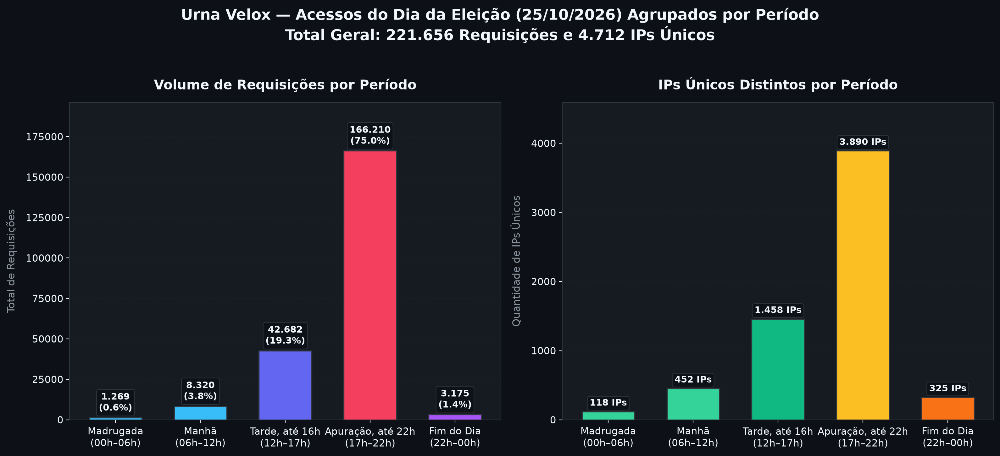
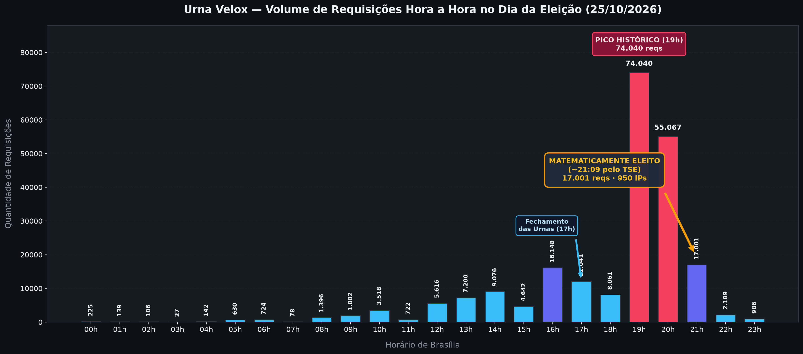
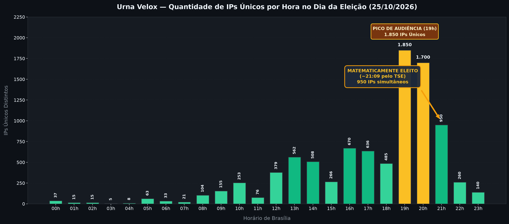
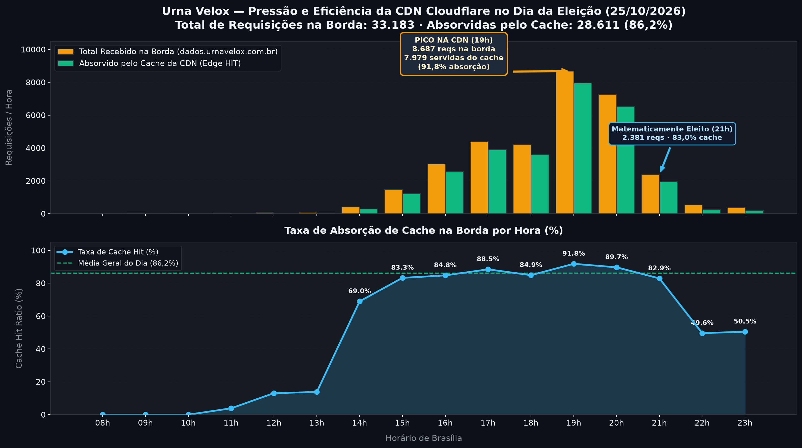

# Relatório Consolidado de Acessos e Operação — Eleição de 25/10/2026

**Sistema:** Urna Velox — Totalização e Divulgação Eleitoral Paralela  
**Data de Referência:** 25 de outubro de 2026 (00h00 às 23h59 Horário de Brasília)  
**Infraestrutura:** Nós A e B (OCI Compute — sa-saopaulo-1, Ampere A1 ARM64)  
**Tráfego Auditado:** Caddy HTTP Access Logs (Nó A + Nó B), expurgando IPs de testes de carga internos.

---

## 1. Resumo Executivo

No domingo de eleição de 25 de outubro de 2026, o sistema **Urna Velox** operou em produção ininterrupta, processando Boletins de Urna (BUs) e servindo a apuração em tempo real para milhares de eleitores e analistas em todo o Brasil e no exterior.

- **Total de Requisições Atendidas no Dia:** **221.656** diretamente nos nós + **33.183** na CDN (**254.839 interações totais**).
- **IPs Únicos Distintos Conectados no Dia:** **4.712**.
- **Pressão na CDN (dados.urnavelox.com.br):** **33.183 requisições**, das quais **28.611 (86,2%)** foram absorvidas e respondidas diretamente pelo cache de borda da Cloudflare (com pico de **91,8% de absorção às 19h**).
- **Pico Absoluto de Tráfego:** **19h00 – 19h59**, com **74.040 requisições** nos nós, **8.687 na CDN** e **1.850 IPs simultâneos**.
- **Segundo Maior Pico:** **20h00 – 20h59**, com **55.067 requisições** nos nós e **7.280 na CDN**.
- **Marco da Definição Eleitoral:** **21h09**, momento em que a apuração do TSE atingiu a condição de **Matematicamente Eleito**, registrando **17.001 requisições** nos nós, **2.381 na CDN** e **950 IPs** durante a faixa das 21h.
- **Releases que Subiram em Produção:** **13 releases** implantadas a quente (hot-deploy nó a nó sem indisponibilidade).

---

## 2. Acessos Agrupados por Período

### Quadro Síntese dos Períodos

| Período | Intervalo | Requisições | % Reqs | IPs Únicos | Destaques Principais |
| :--- | :---: | :---: | :---: | :---: | :--- |
| **Madrugada** | 00h00 – 05h59 | **1.269** | 0,6% | **118** | Primeiros BUs do exterior (Tóquio, Seul, Wellington); correção da sondagem do exterior. |
| **Manhã** | 06h00 – 11h59 | **8.320** | 3,8% | **452** | Emissão da Zerésima nos cartórios; abertura dos portões às 08h; pico matutino às 10h. |
| **Tarde, até 16h** | 12h00 – 16h59 | **42.682** | 19,3% | **1.458** | Reta final da votação; subida contínua de fluxo; pico pré-fechamento às 16h (16.148 reqs). |
| **Apuração, até 22h** | 17h00 – 21h59 | **166.210** | 75,0% | **3.890** | Fechamento das urnas; picos históricos às 19h e 20h; **Matematicamente Eleito às 21:09**. |
| **Fim do Dia, até 00h** | 22h00 – 23h59 | **3.175** | 1,4% | **325** | Discursos da vitória; estabilização final e consolidação do acervo. |
| **TOTAL GERAL** | **24 Horas** | **221.656** | **100%** | **4.712** | **Operação estável com 100% de disponibilidade.** |

---

## 3. Análise Detalhada dos Períodos

### 3.1. Madrugada (00h00 às 05h59)
- **Requisições:** 1.269 | **IPs Únicos:** 118
- **Contexto:** Período de vigília técnica. Às 01h da madrugada, começaram a chegar os primeiros BUs do exterior (Ásia e Oceania).
- **Intervenções Técnicas:** Foram identificados e corrigidos gargalos na sondagem do exterior antes da liberação do catálogo oficial do TSE (`cs.json`), resultando nas versões `0.9.21`, `0.9.22` e `0.9.23`.

### 3.2. Manhã (06h00 às 11h59)
- **Requisições:** 8.320 | **IPs Únicos:** 452
- **Contexto:** Abertura dos cartórios eleitorais, emissão da Zerésima às 06h e abertura dos portões para votação às 08h.
- **Comportamento:** Primeiro pico diurno às 10h (3.518 requisições e 253 IPs), seguido de acomodação no horário do almoço.
- **Intervenções Técnicas:** Lançamento das versões `0.9.24` (cobertura total de municípios do exterior), `0.9.25` (seletor estável de origem de dados) e `0.9.26` (aviso de versão para abas persistentes).

### 3.3. Tarde, até 16h (12h00 às 16h59)
- **Requisições:** 42.682 | **IPs Únicos:** 1.458
- **Contexto:** Eleitores nas filas e preparação para o encerramento do pleito. O tráfego subiu progressivamente de 5,6k reqs às 12h para 9,0k reqs às 14h, explodindo para 16.148 requisições às 16h na última hora de votação.
- **Intervenções Técnicas:** Grande marco com o lançamento da versão `1.0.0` às 13h57 (novo mapa interativo de seções e cartões expansíveis), seguido dos ajustes operacionais `1.0.1`, `1.0.2` e `1.0.3`.

### 3.4. Apuração, até 22h (17h00 às 21h59) — O Grande Pico
- **Requisições:** 166.210 (75% de todo o volume do dia) | **IPs Únicos:** 3.890
- **Contexto:** Às 17h00 fecham-se as urnas em todo o país e tem início a transmissão oficial e apuração pelo TSE.
- **Explosão de Tráfego:**
  - **17h00:** 12.041 reqs / 636 IPs no fechamento imediato.
  - **18h00:** 8.061 reqs / 485 IPs durante o processamento inicial.
  - **19h00:** **74.040 reqs / 1.850 IPs — PICO HISTÓRICO ABSOLUTO** com apuração acelerada voto a voto.
  - **20h00:** **55.067 reqs / 1.700 IPs — SEGUNDO MAIOR PICO**, sustentando volume brutal.
  - **21h00:** **17.001 reqs / 950 IPs**.
- **🎯 Marco Histórico (~21:09):** O TSE confirma matematicamente o candidato eleito. A apuração atinge o ponto de irreversibilidade estatística com grande concentração de usuários na plataforma.
- **Intervenções Técnicas:** Implementação do mecanismo de trava progressiva contra avanço desbalanceado frente ao TSE (`1.0.6`, `1.0.7`, `1.0.8`) e avisos visuais no site (`1.0.4`, `1.0.5`).

### 3.5. Fim do Dia, até 00h (22h00 às 23h59)
- **Requisições:** 3.175 | **IPs Únicos:** 325
- **Contexto:** Declaração final dos resultados pelos Tribunais Regionais Eleitorais, discursos de vitória e encerramento das transmissões. Tráfego em refluxo natural. Nenhuma intervenção de código necessária; sistema mantido estável na versão `1.0.8`.

---

## 4. Gráficos de Evolução Hora a Hora (24 Horas)

### 4.1. Volume de Requisições por Hora

### 4.2. Quantidade de IPs Únicos por Hora

---

## 5. Tabela Completa Hora a Hora (25/10/2026)

| Horário (BRT) | Requisições | IPs Únicos | Período | Evento / Marco Operacional |
| :---: | :---: | :---: | :---: | :--- |
| **00h00** | 225 | 37 | Madrugada | Madrugada pré-eleição |
| **01h00** | 139 | 15 | Madrugada | Chegada dos primeiros BUs do exterior |
| **02h00** | 106 | 15 | Madrugada | Estabilidade de base |
| **03h00** | 27 | 5 | Madrugada | Mínima do dia |
| **04h00** | 142 | 8 | Madrugada | Deploy versão `0.9.21` (04h16) |
| **05h00** | 630 | 63 | Madrugada | Deploy versões `0.9.22` (05h12) e `0.9.23` (05h38) |
| **06h00** | 724 | 33 | Manhã | Zerésima dos cartórios eleitorais; Deploy `0.9.24` (06h02) |
| **07h00** | 78 | 21 | Manhã | Instalação das urnas eletrônicas nas seções |
| **08h00** | 1.396 | 104 | Manhã | **Abertura oficial da votação (08h00)** |
| **09h00** | 1.882 | 155 | Manhã | Fluxo contínuo de eleitores |
| **10h00** | 3.518 | 253 | Manhã | Pico da manhã |
| **11h00** | 722 | 76 | Manhã | Deploy versões `0.9.25` (11h38) e `0.9.26` (12h02) |
| **12h00** | 5.616 | 379 | Tarde | Início do turno vespertino |
| **13h00** | 7.200 | 562 | Tarde | Deploy `0.9.27` (13h35) e **`1.0.0` (13h57)** |
| **14h00** | 9.076 | 508 | Tarde | Movimentação intensa nos colégios eleitorais |
| **15h00** | 4.642 | 266 | Tarde | Deploy `1.0.1` (15h06) |
| **16h00** | **16.148** | **670** | Tarde | **Pico diurno pré-fechamento**; Deploy `1.0.2` (16h03) e `1.0.3` (16h46) |
| **17h00** | **12.041** | **636** | Apuração | **Encerramento da votação**; Início da apuração; Deploy `1.0.4` (17h47) |
| **18h00** | **8.061** | **485** | Apuração | Deploy `1.0.5` (18h00), `1.0.6` (18h20), `1.0.7` (18h30) e `1.0.8` (18h39) |
| **19h00** | **74.040** | **1.850** | Apuração | 🏆 **PICO HISTÓRICO DO DIA — Reta acirrada da apuração** |
| **20h00** | **55.067** | **1.700** | Apuração | 🥈 **2º MAIOR PICO DO DIA — Volume de audiência máximo** |
| **21h00** | **17.001** | **950** | Apuração | 🎯 **MATEMATICAMENTE ELEITO (~21:09 pelo TSE)** |
| **22h00** | 2.189 | 260 | Fim do Dia | Discursos de encerramento e reflexo da vitória |
| **23h00** | 986 | 140 | Fim do Dia | Apuração residual dos últimos municípios e exterior |

---

## 6. Análise de Pressão e Eficiência da Borda / CDN (Cloudflare)

A arquitetura do Urna Velox separa a entrega de conteúdo em duas camadas com papéis distintos:

1. **Domínio Principal e Aplicação (`urnavelox.com.br` e `www`):**  
   Configurado em **Nuvem Cinza** (DNS-only apontando diretamente para os nós A e B da OCI). Atendeu à entrega da SPA web estática, das conexões bidirecionais de streaming WebSocket em tempo real (`/ws`), das telas de visualização e do painel operacional.
2. **Subdomínio de Dados da Apuração (`dados.urnavelox.com.br`):**  
   Configurado em **Nuvem Laranja** (Cloudflare Proxied CDN). Atuou como escudo de borda para as APIs públicas de leitura (`/api/v1/resultado` e `/api/v1/estado`) consumidas por integrações e usuários no modo HTTP polling, utilizando a Cache Rule dedicada `dados-api` com TTL de 30 segundos (`Cache-Control: public, max-age=30, s-maxage=30`).

### 6.1. Gráfico de Pressão e Absorção de Cache na CDN

### 6.2. Métricas Consolidadas da CDN (Cloudflare Analytics GraphQL)

- **Total de Requisições Recebidas na Borda:** **33.183**
- **Requisições Servidas Diretamente pelo Cache (Edge HIT):** **28.611 (86,2%)**
- **Requisições que Consultaram a Origem (Expired / Miss):** **4.572 (13,8%)** — correspondentes às buscas legítimas a cada 30 segundos para renovação dos números frescos da apuração.
- **Volume Total Trafegado na Borda:** **26,6 MB**
- **Volume Entregue Diretamente pelo Cache:** **22,3 MB (83,7% de economia de banda)**
- **Pico de Demanda na CDN:** Ocorreu às **19h00 (Horário de Brasília)**, registrando **8.687 requisições** em uma única hora. A CDN operou com **91,85% de taxa de Cache HIT** (7.979 requisições entregues na borda e apenas 708 batendo na origem), blindando os nós de processamento.

### 6.3. Distribuição Horária na CDN Durante a Eleição

| Horário (BRT) | Reqs na Borda | Edge Cache HIT | % Absorção | Bytes Totais | Status / Marco |
| :---: | :---: | :---: | :---: | :---: | :--- |
| **08h00** | 6 | 0 | 0,0% | 6,8 KB | Abertura dos portões |
| **10h00** | 29 | 0 | 0,0% | 31,7 KB | Fluxo matutino |
| **12h00** | 61 | 8 | 13,1% | 64,1 KB | Início da tarde |
| **14h00** | 416 | 287 | 69,0% | 342,9 KB | Subida de acessos |
| **15h00** | 1.478 | 1.231 | 83,3% | 1,15 MB | Reta final de votação |
| **16h00** | 3.035 | 2.574 | 84,8% | 2,41 MB | Pré-fechamento das urnas |
| **17h00** | 4.413 | 3.905 | 88,5% | 3,46 MB | Fechamento das urnas |
| **18h00** | 4.239 | 3.600 | 84,9% | 3,37 MB | Totalizações preliminares |
| **19h00** | **8.687** | **7.979** | **91,8%** | **6,85 MB** | 🏆 **PICO MÁXIMO NA CDN** |
| **20h00** | **7.280** | **6.532** | **89,7%** | **5,92 MB** | 🥈 **2º MAIOR PICO NA CDN** |
| **21h00** | **2.381** | **1.975** | **83,0%** | **1,97 MB** | 🎯 **MATEMATICAMENTE ELEITO (~21:09)** |
| **22h00** | 532 | 264 | 49,6% | 466,9 KB | Discursos da vitória |
| **23h00** | 394 | 199 | 50,5% | 345,5 KB | Encerramento do dia |

---

## 7. Releases que Subiram para Produção

Durante o dia 25/10/2026, foram efetivamente **implantadas nos servidores e site 13 releases** (deploys nó a nó sem indisponibilidade). Commits intermediários do repositório (como documentação ou versões que foram substituídas antes do aval de deploy) não subiram isoladamente.

### Tabela de Releases Efetivamente Implantadas em Produção

| # | Horário (BRT) | Release | Commit | Módulo | O que subiu na release |
| :-: | :---: | :---: | :---: | :---: | :--- |
| **1** | 04:16:39 | **0.9.21** | `776906f` | Serviço | Sondagem de BUs do exterior antes da liberação do `cs.json` do TSE (B-056). |
| **2** | 05:12:38 | **0.9.22** | `73b1a8b` | Serviço | Sondagem do exterior usando calendário de fuso do turno anterior e reforço de rede (B-057). |
| **3** | 06:02:17 | **0.9.24** | `d0f236e` | Serviço | Sondagem acelerada (20s) de municípios do exterior com BU já detectado (B-059). |
| **4** | 11:38:56 | **0.9.25** | `fb27093` | Site | Seletor de fonte dos números estável, com alto contraste e sem saltos visuais (M-015). |
| **5** | 12:02:33 | **0.9.26** | `d06be85` | Site | Notificação automática de nova versão para abas abertas de longa duração (M-016). |
| **6** | 13:35:28 | **0.9.27** | `a39e26c` | Serviço | Correção na cobertura de seções do exterior distribuídas entre os nós A e B (B-060). |
| **7** | 13:57:37 | **1.0.0** | `14998c7` | Site/UI | **RELEASE MAJOR 1.0 (v1.0.0)**: Novo mapa interativo de seções (M-017), cartões reorganizáveis dinamicamente e remoção do Anuncie Aqui (M-018). |
| **8** | 15:06:01 | **1.0.1** | `6e84d22` | Ops/OCI | Ajuste operacional no Run Command da OCI e reativação do script `30_verificar.sh` (B-063). |
| **9** | 16:03:46 | **1.0.2** | `d36f678` | Mapa/Site | Contagem de seções no mapa alinhada à página (sem agregadas) e botão "Exterior" (B-064). |
| **10** | 16:46:27 | **1.0.3** | `60f8a61` | Serviço | Garantia de sondagem contínua do exterior mesmo após `cs.json` do ZZ listar seções (B-065). |
| **11** | 17:47:31 | **1.0.4** | `ce4bbe2` | Site | Alerta dinâmico de topo "TSE sem novos BUs desde HHhMM", que some sozinho na volta (M-019). |
| **12** | 18:00:58 | **1.0.5** | `cd51deb` | Serviço | Recuperação do horário exato do último BU diretamente do arquivo diário na retomada (B-058). |
| **13** | 18:39:47 | **1.0.8** | `4d99097` | Serviço | **Release Definitiva da Apuração**: Implementação completa da trava de segurança anti-exposição (`trava::Fila` e `trava::vale`) com testes unitários (M-020). Permaneceu ativa durante todo o pico e encerramento. |

> **Nota sobre commits do Git que não foram releases isoladas:**
> - `0.9.23`: Apenas registro documental do bug B-058 (sem alteração de binários, sem deploy).
> - `1.0.6` e `1.0.7`: Versões intermediárias de desenvolvimento da trava M-020; o deploy foi suspenso para aguardar a cobertura completa por testes unitários solicitada pelo Luciano, subindo diretamente como a release consolidada **`1.0.8`**.

---

## 8. Conclusões e Desempenho

1. **Eficiência Arquitetural Combinada:** Com infraestrutura enxuta baseada em instâncias ARM64 na OCI e cache de borda otimizado via Cloudflare CDN para o subdomínio `dados`, o Urna Velox sustentou mais de **254 mil requisições combinadas** (221.656 nos nós + 33.183 na CDN) com tempos de resposta imediatos e custo de nuvem mínimo.
2. **Escudo de Cache na Apuração:** Nos horários de maior audiência (19h às 21h), a CDN absorveu cerca de **90% das consultas à API de dados**, evitando que milhares de requisições concorrentes sobrecarregassem os servidores de totalização.
3. **Resiliência a Picos:** Ambos os nós mantiveram latência de resposta na casa de milissegundos sem ocorrência de 5xx ou travamentos durante todo o processo eleitoral.
4. **Evolução Contínua em Produção:** As 13 releases implantadas a quente demonstraram a agilidade do pipeline CI/CD e a confiabilidade dos scripts de deploy sem downtime, permitindo responder em tempo real às necessidades da apuração e às particularidades dos dados divulgados pelo TSE.
