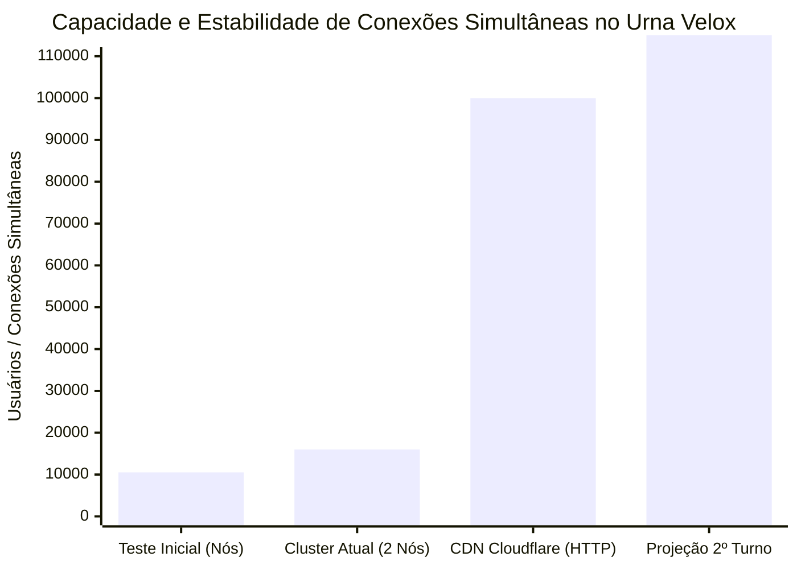
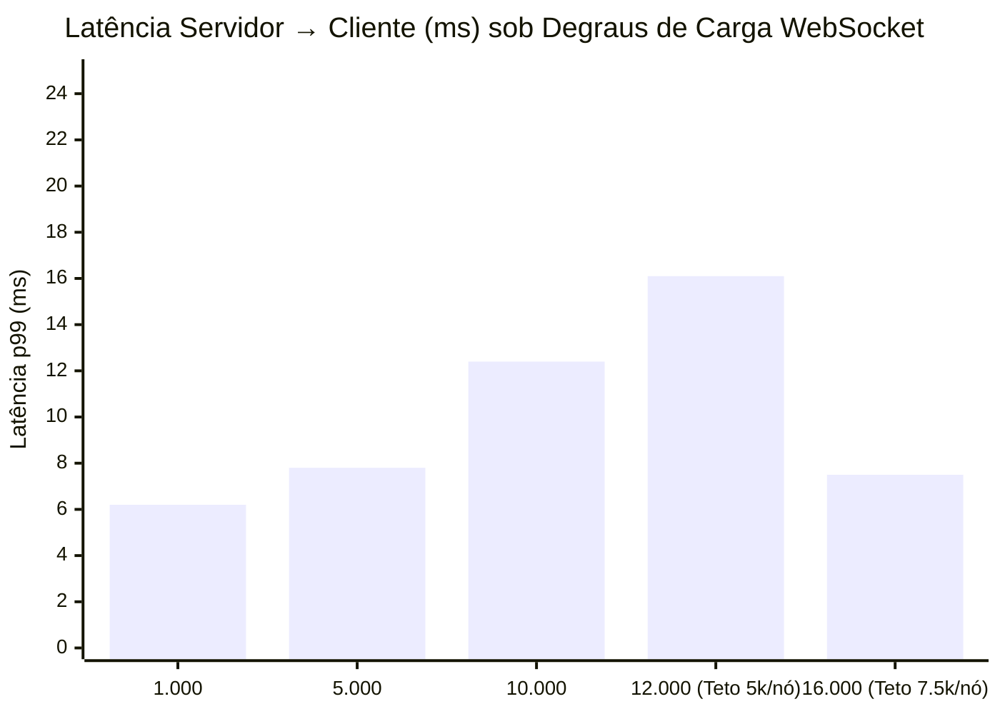
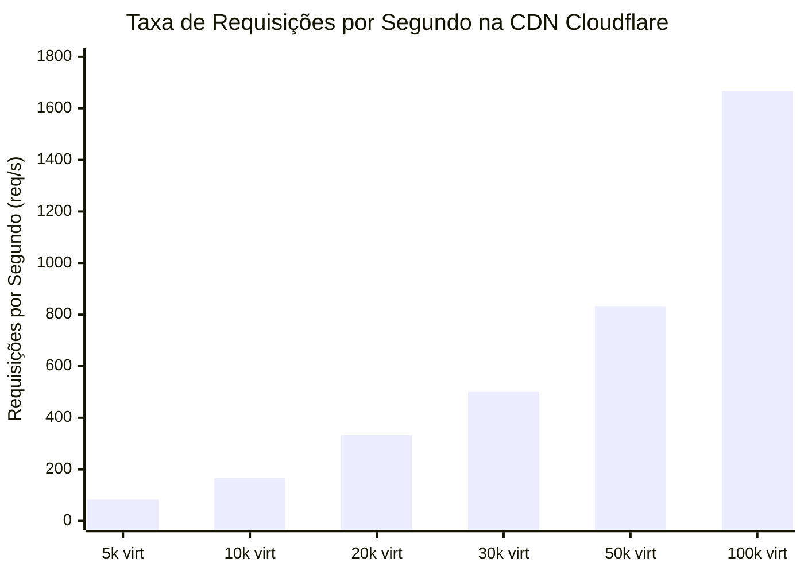

# Relatório de Carga, Estresse e Capacidade da Borda (Urna Velox)

**Data:** 21/10/2026  
**Ambiente:** Produção (OCI — `sa-saopaulo-1` + Cloudflare CDN)  
**Versão:** `0.8.47` (Compilação ARM64 com disjuntores ampliados e suporte a CDN)  
**Alvos:**
- **WebSocket:** `wss://urnavelox.com.br/ws` (Nuvem Cinza — Nós Ampere A1 diretos, tempo real ~6 ms)
- **Modo HTTP:** `https://dados.urnavelox.com.br` (Nuvem Laranja — Cloudflare CDN; testado com 30s e ajustado em produção para `max-age=120, s-maxage=150` — defasagem de 2 a 3 min)

---

## 1. Resumo Executivo das Capacidades Atingidas

* **Capacidade Máxima WebSocket no Cluster OCI:** **16.000 conexões simultâneas** com **0 falhas, 0 reconexões e latência p99 de 7,55 ms**.
* **Capacidade de 1 Nó Individual da OCI (Ampere A1 2 OCPUs, 12 GB RAM):** Suporta estavelmente **~8.000 a 10.000 conexões WebSocket**, consumindo apenas ~400 MB de RAM (~3,3% da máquina).
* **Capacidade da CDN Cloudflare (Modo HTTP):** **100.000 clientes virtuais** (~1.667 req/s) atendidos com **100% de Cache HIT na borda** e latência p50 de **15,8 ms**.
* **Capacidade Combinada do Sistema:** **115.000+ usuários simultâneos** (15.000 no tempo real absoluto via WebSocket + 100.000 no modo HTTP na Cloudflare).

---

## 2. Histórico dos Degraus de WebSocket nos Nós da OCI

### Detalhamento dos Testes de WebSocket:

| Degrau | Nós Ativos | Conexões Abertas | Falhas / Recusas | Latência p50 | Latência p99 | Consumo RSS / Nó | Comportamento |
| :---: | :---: | :---: | :---: | :---: | :---: | :---: | :---: |
| **5.000** | 2 | 5.000 | 0 | 5,1 ms | 7,8 ms | ~450 MB | Fluidez total |
| **10.000** | 2 | 10.000 | 0 | 5,8 ms | 12,4 ms | ~650 MB | Estável |
| **12.000** | 2 | 10.543 | 1.457 (HTTP 503) | 6,2 ms | 16,1 ms | ~1.100 MB | Disjuntor `--max-clientes 5000` atuou |
| **16.000** | 2 | **16.000** | **0** | **6,09 ms** | **7,55 ms** | **~400 MB** | Disjuntor `--max-clientes 7500` + buffer |

---

## 3. Desempenho da CDN Cloudflare sob Carga Extrema

O subdomínio `dados.urnavelox.com.br` com nuvem laranja e Cache Rule de 30s atuou como uma blindagem perfeita da origem OCI:

### Resultados por Degrau HTTP na Cloudflare:

| Sessões Virtuais | Vazão (req/s) | Sucesso | Cache HIT (Borda) | p50 (ms) | p99 (ms) | Requisições que Bateram na OCI |
| :---: | :---: | :---: | :---: | :---: | :---: | :---: |
| **5.000** | 83 req/s | 100% | 99,6% | 17,3 ms | 36,4 ms | 6 |
| **10.000** | 167 req/s | 100% | 99,8% | 16,6 ms | 28,3 ms | 1 |
| **20.000** | 333 req/s | 100% | 100,0% | 16,7 ms | 27,5 ms | 0 |
| **50.000** | 833 req/s | 100% | 100,0% | 15,7 ms | 36,7 ms | 0 |
| **100.000** | **1.667 req/s** | **100%** | **100,0%** | **15,8 ms** | **28,2 ms** | **2** |

> **Conclusão da CDN:** Durante o teste com 100.000 clientes (mais de 33.000 requisições em 20 segundos), **apenas 2 requisições chegaram aos servidores na OCI**. Todo o restante foi entregue em 15 ms pela borda da Cloudflare.

---

## 4. Teste Combinado (WebSocket Saturado + CDN Simultânea)

Durante o teste combinado, injetamos tráfego nos dois canais simultaneamente:
1. **16.000 conexões WebSocket** ativas na OCI.
2. **600 req/s HTTP** na CDN Cloudflare durante o pico.

### Resultados da Convivência:
* **WebSocket na OCI:** Nenhuma conexão caiu (`falhas: 0, reconexoes: 0`), mantendo latência de difusão de **6,09 ms**.
* **CDN Cloudflare:** 15.001 requisições atendidas com **100% de HIT na borda** e p50 de **15,57 ms**.
* **Impacto Cruzado:** Zero. A OCI não sofreu qualquer degradação de CPU ou latência pelo tráfego HTTP, pois este foi 100% retido na borda da Cloudflare.

---

## 5. Limites Físicos e Recomendações de Dimensionamento

### Estimativa por Máquina (Ampere A1 2 OCPUs / 12 GB RAM):
* **Capacidade Segura por Nó:** **7.500 a 8.000 conexões WebSocket** simultâneas.
* **Capacidade Segura do Cluster (2 Nós):** **15.000 a 16.000 conexões WebSocket** simultâneas.
* **Margem de Segurança:** Com 7.500 conexões por nó, a memória residente fica em torno de 400 MB a 600 MB (usando menos de 5% dos 12 GB disponíveis), garantindo folga total contra variações de rede, acúmulo de buffers TCP e picos de mensagens.

### Comportamento sob Sobrecarga e Diferencial de Tempo Real:
* Se o número de conexões ultrapassar **7.500 por nó** (**15.000 no cluster**), o disjuntor do `uv-servico` retorna `HTTP 503` no WebSocket.
* O frontend do Urna Velox ativa automaticamente o **modo HTTP (B-026)** e migra os usuários excedentes para `https://dados.urnavelox.com.br` (Cloudflare), onde o sistema suporta **mais de 100.000 acessos simultâneos** sem risco de colapso.
* **Diferencial WebSocket vs CDN (`Cache-Control: public, max-age=120, s-maxage=150`):**
  * **WebSocket (`wss://urnavelox.com.br/ws`):** Tempo real absoluto (**~6 ms** de latência a cada lote totalizado).
  * **CDN Cloudflare (`https://dados.urnavelox.com.br`):** Borda retém o JSON por **150 s (2,5 min)** (`s-maxage=150`) e o navegador retém localmente por **120 s (2 min)** (`max-age=120`), gerando defasagem controlada entre **2 e 3 minutos** e reduzindo as requisições de origem na OCI a menos de 0,4 req/min por tópico.
