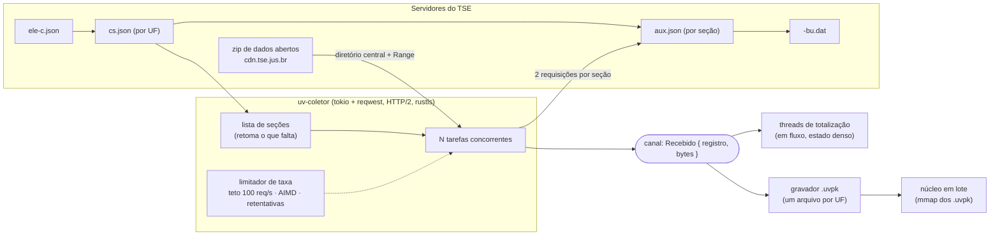
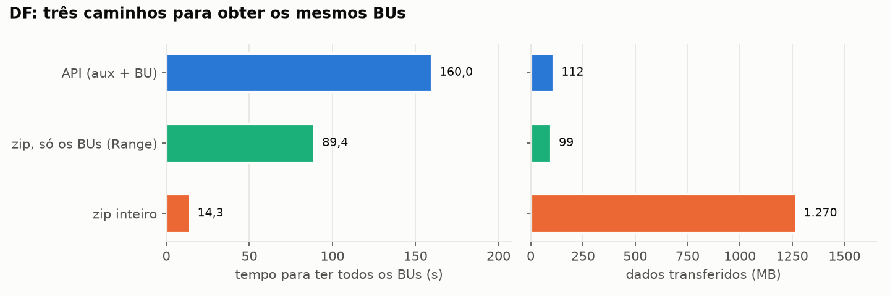
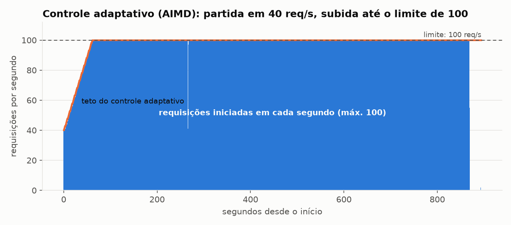
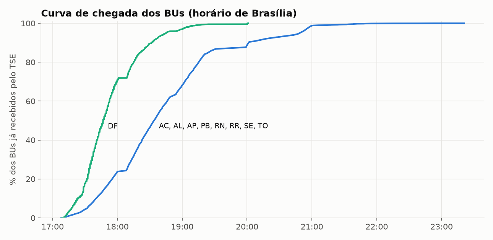
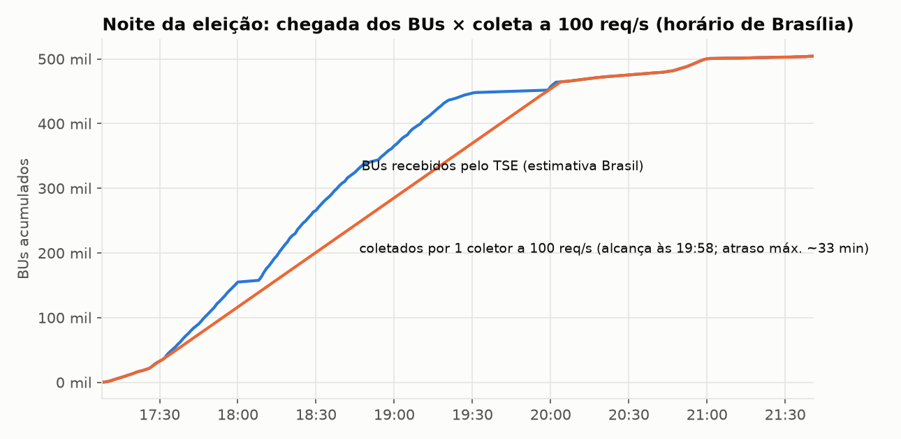
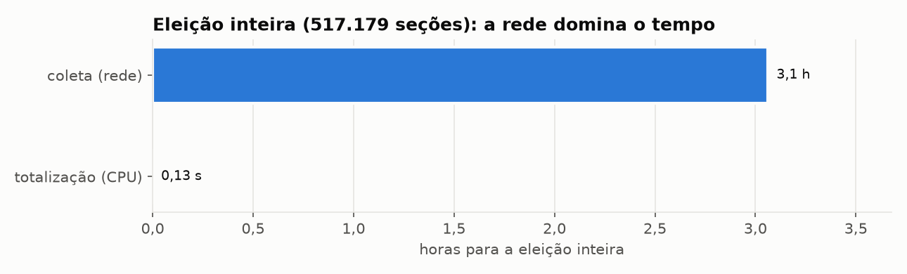

# Fase de aquisição: como o Urna Velox obtém os BUs

Este documento descreve a **fase de aquisição**: como receber ou recuperar os Boletins de Urna (BUs) **brutos** publicados pelo TSE e entregá-los ao núcleo de totalização. Também registra a arquitetura e a configuração do coletor, o que foi medido contra os servidores reais e os tempos obtidos. O código está em [`aquisicao/`](../../aquisicao) (binário `uv-coletor`), e as decisões estão nos ADR-013 a ADR-018 de [ARCHITECTURE_DECISIONS.md](ARCHITECTURE_DECISIONS.md). Termos técnicos: [GLOSSARIO.md §11](GLOSSARIO.md#11-rede-e-aquisição).

* **Escopo:** só o BU bruto. Os arquivos de resultado já totalizados que o TSE publica no fim **não** são usados: o propósito do projeto é totalizar a partir dos BUs.
* **Execução de referência:** 11/10/2026, i7-14700 (28 threads), WSL2, rede institucional com IP de saída compartilhado. Pleito 3220 (1º turno de 2026, eleições federal 6257 e estadual 6259), **517.179 seções** listadas em 28 "UFs" (27 + ZZ, exterior).
* **Para repetir:** `./aquisicao/teste-real.sh` (Linux/WSL2) ou `.\aquisicao\teste-real.ps1` (Windows). Resultados brutos e relatório em [`aquisicao/results/`](../../aquisicao/results/RELATORIO.md).
* **Limite de uso:** **no máximo 100 requisições por segundo** aos servidores do TSE, imposto no código (`TETO_RPS`).

---

## 1. Onde estão os BUs

### 1.1. Site de resultados (noite da eleição)

A aplicação oficial ([resultados.tse.jus.br/oficial/app](https://resultados.tse.jus.br/oficial/app/index.html#/eleicao/resultados)) é uma página estática que lê arquivos JSON e binários de um CDN. Para o BU bruto, o caminho é:

| Passo | Arquivo | Conteúdo | Tamanho |
|---|---|---|---|
| 1 | `/oficial/comum/config/ele-c.json` | pleitos e eleições publicados (2024 a 2026, incluindo suplementares e consultas) | 25 KB |
| 2 | `/oficial/ele2026/arquivo-urna/3220/config/<uf>/<uf>-p003220-cs.json` | municípios, zonas e seções da UF, com data/hora de disponibilização | 0,1–6 MB por UF; 31,5 MB o Brasil |
| 3 | `…/arquivo-urna/3220/dados/<uf>/<mun>/<zona>/<secao>/p003220-<uf>-m<mun>-z<zona>-s<secao>-aux.json` | situação da seção e lista de conjuntos de arquivos (`hash`, recebido em `dr`/`hr`, situação `st`, arquivos `bu`, `rdv`, `log`, `vota`) | ~0,7 KB |
| 4 | `…/<secao>/<hash>/o03220<uf><mun><zona><secao>-bu.dat` | o BU (envelope BER) | ~16 KB |

Descobertas que importam para o coletor:

* **Um BU por seção, com todas as eleições do pleito.** O BU da seção 0300 da zona 15 de Brasília traz a eleição 6257 (Presidente) e a 6259 (Deputado Federal, Deputado Distrital, Senador com 2 vagas, Governador). Por isso a coleta é por **pleito**, não por eleição.
* **O `<hash>` do diretório é o SHA-256 do arquivo de assinaturas `…-vota.vsc`**, codificado em base64 e depois escrito em hexadecimal. Conferido: `35307a47…` → `50zGL28I…=` → `e74cc62f…` = SHA-256 do `.vsc`. O coletor guarda esse hash junto do BU, para a auditoria de assinaturas (ADR-011).
* **Escolha do conjunto de arquivos.** Uma seção pode ter mais de um `hash` (reenvio). Regra: o último com situação "Totalizado"; se não houver, o último que tenha BU.
* **Seções sem BU.** 81 das 7.050 seções listadas no DF (1,1 %) respondem 404 no aux.json: são seções agregadas ou sem votação. O mesmo acontece no zip de dados abertos (6.969 BUs). Isso não é erro de coleta. No Brasil (coleta de 12/10/2026): 517.179 seções listadas, 17.931 com aux.json 404, 41 "Não instalada" (exterior, sem BU e sem voto, mas contadas como totalizadas em `s.st`) e **499.207 BUs**.
* **BU do Sistema de Apuração (`busa`).** Quando a urna falha e a seção é apurada pelo Sistema de Apuração, o aux.json não tem `-bu.dat`: traz `…-busa.dat` (tipo `busa`), assinado em `…-sa.vsc`, com `-logsa.jez`. O formato é o mesmo `EntidadeBoletimUrna`. Foram **31 seções** no 1º turno de 2026 (2 em MG, 29 no exterior), com votos (ex.: 1.287 votos nominais para Presidente). O coletor aceita `bu` e `busa` (prefere `bu`), e o leitor de zip também.
* **Formato do BU.** É um `EntidadeEnvelopeGenerico` (`IMPLICIT TAGS`) cujo campo `conteudo` (OCTET STRING) contém o `EntidadeBoletimUrna` da especificação `bu.asn1`. A especificação vem no pacote oficial ["formato dos arquivos de BU, RDV e assinatura digital"](https://www.tse.jus.br/eleicoes/eleicoes-2026-content/arquivos/formato-arquivos-de-bu-rdv-e-assinatura-digital), copiado em [`aquisicao/spec/bu.asn1`](../../aquisicao/spec/bu.asn1).

### 1.1.1. Eleições municipais de 2024 (levantado em 12/10/2026)

O mesmo site publica as eleições de 2024 no ciclo `ele2024`, com a mesma hierarquia de arquivos de 2026. Levantamento feito com poucas requisições (1 req/s):

| item | 2024 |
|---|---|
| pleitos (`ele-c.json`) | **452** = 1º turno (06/10/2024); **453** = 2º turno (27/10/2024); suplementares de 2024 a 2026 em pleitos próprios (467, 3040…3240) |
| eleições do pleito 452 | **619** = ordinária municipal (cargos **11 Prefeito** e **13 Vereador**, `cdt2` = 620); **consultas populares**, cada uma uma eleição com um único município: 633 São Luiz/RR (cargo 55), 634 Belo Horizonte/MG (53), 635 São Luís/MA (51), 636 Governador Edison Lobão/MA (54), 637 Dois Lajeados/RS (52) |
| eleição do pleito 453 | **620** = 2º turno de Prefeito, em 20 UFs |
| UFs | 26 (sem DF, que não tem municípios, e sem exterior); 5.569 municípios em `619/config/mun-e000619-cm.json` |
| seções e BU | `arquivo-urna/452/config/<uf>/<uf>-p000452-cs.json` → `…/p000452-<uf>-m<mun>-z<zona>-s<seção>-aux.json` → `o00452<uf><mun><zona><seção>-bu.dat`, como em 2026 |
| `bu.asn1` | **estruturalmente igual** ao de 2026 (cópia em `D:\dados\tse-arquivos-urna\documentacao\2024\spec`): só mudam comentários e dois nomes de enumeração (`urnaChegouAposInicioVotacao` → `urnaEncerradaComEleitoresNaFila`; `reservaSecao` → `contingenciaSecao`) e 2026 acrescenta `envelopeZeresimaImpressa`. O leitor de 2026 lê os BUs de 2024 sem mudança |
| resultado oficial | **por município**: `<ciclo>/<eleição>/dados/<uf>/<uf><mun:05>-c<cargo:04>-e<eleição:06>-u.json` (`tpabr = "mu"`), mesmo formato de 2026. Nas consultas, `perg[0].resp` traz as opções (`n` 1 = SIM, 2 = NÃO; `st` "Eleito" na opção vencedora) em vez de `carg`. `dados-simplificados/…-r.json` responde 404 |

**Aquisição do 1º turno de 2024 (12/10/2026).** Eleição encerrada, então os BUs vieram dos **zips de dados abertos** para o acervo local (`gerenciar_acervo.py`, uma requisição por UF; o AC já estava no acervo), e só os `aux.json` vieram da API, para ter o horário de recebimento de cada BU (`uv-coletor baixar --so-aux`):

| etapa | volume | tempo | ritmo |
|---|---|---:|---|
| zips originais das 25 UFs (`D:\dados\tse-arquivos-urna\originais\2024\1t`) | 65,1 GB | 46,7 min de download (1 h 34 min com a derivação e a validação ASN.1 de amostra do acervo) | 23,3 MB/s em média (27–29 MB/s por UF; SP, 14 GB, a 15,6 MB/s) |
| importação local dos 26 zips para `.uvpk` (`uv-coletor zip --local`, lê `-bu.dat` e `-busa.dat`) | **478.026 BUs** (1 `busa`, no AM) | 13,5 min (leitura do disco D: pelo WSL) | — |
| `aux.json` de todas as seções (`--so-aux`, sem BU) | 500.341 seções, 478.026 com BU, 22.315 com aux.json 404 | **1 h 33 min** | 89,7 req/s, máximo de 90 num mesmo segundo, **0 HTTP 429** |

O `cs.json` de 2024 não serve como relógio da noite: 165.934 seções foram republicadas em 29/09/2026, e a data de disponibilização delas é a da republicação. O `aux.json` guarda o recebimento original (`dr`/`hr`, de 06/10/2024 17:01 a 23:59, mais 325 reenvios depois).

**2º turno de 2024 (pleito 453), pela API.** 97.392 BUs de 98.863 seções em 34 min 44 s (94,2 req/s, 0 HTTP 429). Dois cuidados para medir a noite: a data/hora de totalização dos arquivos oficiais (`dt`/`ht`) está na **hora local** da UF, enquanto `aux.json` e `cs.json` estão na de Brasília; e em 25.839 seções o recebimento do `aux.json` é posterior à disponibilização no `cs.json` (lotes recarregados — ex.: ES 56995, zona 53, toda marcada 20:12:24 e disponível às 17:45). Simulação da noite em [PREFEITO_2024_2T.md](../../aquisicao/results/PREFEITO_2024_2T.md).

**Seção anulada.** Uma seção (MA, município 07315, zona 23, seção 354) tem no `aux.json` a situação **"Anulada"** e o único BU marcado "Excluído". O TSE a conta em `s.st` e no comparecimento, mas soma todos os votos dela como nulos (campo `vsan` = 315 do arquivo oficial do município). `uv-coletor totalizar --anuladas <métricas>` (e `replay --anuladas`) faz o mesmo com as seções cujo BU escolhido está "Excluído".

Num BU de 2024, os cargos municipais têm circunscrição municipal: o mesmo número (ex.: 15 para Prefeito) é um candidato diferente em cada município. O catálogo do `uv-coletor` guarda, para Prefeito, Vereador e consultas (cargos 11, 13 e 25..99), a lista de candidatos de cada município (linhas `K` do `catalogo.txt`), e `totalizar --totais-municipio` grava os totais por município; os totais por UF continuam disponíveis (somados por número).

### 1.2. Dados abertos (eleição encerrada)

O portal [dadosabertos.tse.jus.br](https://dadosabertos.tse.jus.br) (CKAN) publica, dias depois da eleição, os conjuntos `resultados-<ano>-arquivos-transmitidos-para-totalizacao`. Em 11/10/2026 existiam os de 2026 (28 zips), 2024 (52) e 2022 (56). Cada zip, por UF e turno, fica em `cdn.tse.jus.br/estatistica/sead/eleicoes/eleicoes<ano>/arqurnatot/bu_imgbu_logjez_rdv_vscmr_<ano>_<turno>t_<UF>.zip` e traz todos os arquivos de urna da UF:

| DF, 1º turno de 2026 | entradas | comprimido | % do zip |
|---|---:|---:|---:|
| BU (`-bu.dat`) | 6.969 | 92,5 MB | **7,3 %** |
| RDV (`-rdv.dat`) | 6.969 | ~7 MB | ~0,6 % |
| log (`-log.jez`) | 6.969 | 738 MB | 58 % |
| assinaturas (`-vota.vsc`) | 6.969 | 427 MB | 34 % |
| total | 27.877 | **1.270 MB** | |

O servidor aceita `Range`. Lendo só o **diretório central** (2,8 MB no fim do arquivo), dá para baixar apenas as entradas de BU.

### 1.3. Comportamento do CDN (medido)

| Fato | Medida | Consequência |
|---|---|---|
| Protocolo | HTTP/2 (`resultados`), HTTP/1.1 (`cdn.tse.jus.br`) | multiplexação disponível só no site de resultados |
| Latência sem cache (*miss*) | **~0,5 s** por requisição (origem) | a coleta é limitada por latência |
| Latência com cache (*hit*) | ~0,12 s | quase todo aux.json e BU é *miss* (cada um é pedido por pouca gente) |
| Latência no `cdn.tse.jus.br` | **~5 ms** (a partir da rede de referência) | as faixas Range do zip são quase instantâneas |
| Cache | `cache-control: max-age=48`, `ETag`, `Last-Modified`, gzip | releitura barata dos `cs.json` com `If-None-Match` → `304` |
| `x-ratelimit-limit: 2000, 2000;w=1` | é o limite da **origem, compartilhado por todos os clientes** (`x-ratelimit-remaining` cai com o tráfego de terceiros) | não é o limite de um cliente |
| Limite da borda (Akamai) | acima de ~200 req/s num IP: `429` com `cdn-cache-status: Error from child` | o IP fica numa **caixa de penalidade de ~8 min**, recusando até requisições isoladas |
| Muitos 404 seguidos | ao refazer só as ~18 mil seções sem BU (quase 100 % de aux.json 404), a borda respondeu `429` já a **~70 req/s** (12/10/2026, 01:19); misturados a respostas 200 na coleta normal, os mesmos 404 nunca deram 429 a 95 req/s | a retomada pula as seções sabidamente sem BU (`--pular-sem-bu`) e o coletor tem disjuntor (`--max-429`, padrão 20): ao somar N respostas 429, **para tudo** |

O limite da borda apareceu nos primeiros testes, **antes** de o teto de 100 req/s existir. Uma varredura com concorrência 128 (~230 req/s) recebeu 2.629 respostas 429, e uma sonda de taxa crescente repetiu o efeito. O IP de saída da rede de referência é compartilhado (NAT), então a penalidade atinge outras pessoas. Essas medições foram descartadas, e o teto passou a ser imposto em código.

---

## 2. Arquitetura do coletor



| Peça | Arquivo | O que faz |
|---|---|---|
| Endereços e JSON do TSE | `src/tse.rs` | monta as URLs, lê `ele-c`/`cs`/`aux`, escolhe o hash, interpreta nomes de arquivo |
| Motor HTTP | `src/coletor.rs` | clientes HTTP/2 (`--conexoes`), concorrência (`-c`), limitador GCRA sem rajadas com teto de 100 req/s, AIMD opcional, retentativas com espera exponencial, métricas por seção |
| Dados abertos | `src/zip.rs` | diretório central por Range (com zip64), uma faixa por BU, ou o zip inteiro com extração local (`--local` para zips já baixados) |
| Entrega ao núcleo | `src/pacote.rs` | `.uvpk`: append-only, retomável, BU intocado, leitura por `mmap` |
| Leitor do BU | `src/bu.rs` | BER manual verificado (sem pânico com bytes ruins) |
| Totalização | `src/totaliza.rs` | catálogo, vetor denso de `AtomicU32`, agregador por thread, consolidação por UF |

**Por que a concorrência importa.** Pela lei de Little, requisições/s ≈ requisições em andamento ÷ latência. Com ~0,5 s por requisição, 1 requisição em andamento rende ~2 req/s. Para chegar a 100 req/s são precisas ~50 a 64 em andamento. Acima disso, o limitador segura a taxa no teto.

**Controle de taxa (ADR-015).** É um GCRA simplificado: cada requisição, inclusive as retentativas, reserva o próximo horário livre, sempre a pelo menos 1/rps do anterior, sem rajadas. No modo `--adaptativo` (AIMD), a taxa começa em 40 req/s, sobe 1 req/s por segundo sem 429 até o teto e, a cada 429, cai pela metade e pausa todas as requisições por 2 s.

**Interface com o núcleo (ADR-016).** Cada BU recebido vira `Recebido { registro, bytes }` num canal. O consumidor grava `<uf>.uvpk` e/ou repassa a threads que totalizam em fluxo. O registro tem 52 bytes de cabeçalho: tamanho, pleito, município, zona, seção, UF, situação, origem e SHA-256 do `.vsc`. Em lote, o núcleo mapeia os `.uvpk` com `mmap`.

**Modos de uso.**

| Modo | Comando | Quando |
|---|---|---|
| API | `uv-coletor baixar --ufs …` | coleta de uma ou mais UFs; retoma do ponto onde parou |
| Acompanhar | `uv-coletor acompanhar --ufs … --intervalo 30 --rodadas 0` | noite da eleição: relê os `cs.json` com `If-None-Match` e coleta só o que é novo ou mudou |
| Em fluxo | `… --totalizar --catalogo catalogo.txt` | totaliza cada BU ao chegar |
| Zip, faixas | `uv-coletor zip --uf df --modo faixas` | eleição encerrada, pouca banda: só os BUs do zip |
| Zip, completo | `uv-coletor zip --uf df --modo completo` | eleição encerrada, banda boa: uma requisição por UF |
| Zip local | `uv-coletor zip --uf df --local arquivo.zip` | acervo local, sem rede ([PROMPT_ACERVO_BUS.md](../handoffs/PROMPT_ACERVO_BUS.md)) |

---

## 3. Configuração dos testes

| Item | Valor |
|---|---|
| Máquina | Intel Core i7-14700 (20 núcleos / 28 threads), 16 GB visíveis no WSL2, kernel 6.18 WSL2 |
| Rede | rede institucional; IP de saída compartilhado (NAT); borda Akamai |
| Software | Rust 1.99, `uv-coletor` 0.1.0 (`tokio` 1, `reqwest` 0.12 com HTTP/2 + `rustls`), Python 3 + `asn1tools` |
| Teto | 100 req/s em todas as medições válidas; adaptativo (40 → 100) nas coletas longas |
| Varredura | concorrências 1, 4, 16, 32 e 64 (HTTP/2, 1 conexão); HTTP/1.1 com concorrência 32; 4 conexões HTTP/2 com concorrência 64. Amostras sorteadas de SP, MG, BA e RJ com sementes diferentes, para não reaproveitar o cache do CDN |
| UF de referência | DF: 7.050 seções, 6.969 BUs; API com concorrência 128, zip por faixas e zip completo |
| Coleta sustentada | AC, AL, AP, PB, RN, RR, SE e TO: 42.993 seções, adaptativo (40 → 100 req/s), concorrência 128 |
| Totalização | `uv-coletor totalizar`, BUs já em memória (`mmap`), threads 1/2/4/8/16/28, 5 repetições (DF) e 3 (todos os 48.907 BUs), mediana |
| Conferência | `asn1tools` + `bu.asn1` oficial, total a total: DF e todos os 48.907 BUs coletados |

---

## 4. Resultados

### 4.1. Vazão × concorrência (API de resultados)

| concorrência | protocolo | seções | seções/s | req/s | latência p50 aux / BU | p95 | 429 |
|---:|---|---:|---:|---:|---|---:|---:|
| 1 | HTTP/2 | 40 | 1,8 | 3,7 | 491 / 32 ms | 704 ms | 0 |
| 4 | HTTP/2 | 64 | 7,1 | 14,4 | 526 / 39 ms | 693 ms | 0 |
| 16 | HTTP/2 | 256 | 23,7 | 47,8 | 550 / 84 ms | 711 ms | 0 |
| 32 | HTTP/2 | 512 | 33,6 | 68,0 | 617 / 191 ms | 804 ms | 0 |
| 32 | HTTP/1.1 | 512 | 33,6 | 68,3 | 524 / 414 ms | 688 ms | 0 |
| 64 | HTTP/2 | 1.024 | 44,5 | 90,1 | 607 / 510 ms | 1.083 ms | 0 |
| 64 | HTTP/2, 4 conexões | 1.024 | 47,8 | 96,9 | 524 / 40 ms | 689 ms | 0 |


* A vazão cresce quase linearmente com a concorrência até encostar no teto: com 64 requisições em andamento, o coletor chega a 90–97 req/s, ou seja, **~45–48 seções/s**, contando a partida.
* **HTTP/1.1 e HTTP/2 empatam** com a mesma concorrência (33,6 seções/s com 32 em andamento). O HTTP/2 só economiza conexões: 1 em vez de 32.
* A latência do aux.json fica em ~0,5–0,6 s (origem). A do BU varia de 30 ms a 500 ms: às vezes o BU já está no cache da borda, às vezes não.


### 4.2. DF completo: três caminhos para os mesmos 6.969 BUs

| caminho | tempo | BUs/s | requisições/s | transferido |
|---|---:|---:|---:|---:|
| API (aux.json + BU), adaptativo até 100 req/s | **160,0 s** | 43,6 | 87,6 | 111,9 MB |
| zip de dados abertos, só os BUs (Range) | **89,4 s** | 78,0 | 78,0 | 99,3 MB |
| zip de dados abertos inteiro + extração local | **14,3 s** (13,3 s de download a 95 MB/s + 0,96 s de extração) | 487 | 1 requisição | 1.270 MB |



* Para uma **eleição encerrada**, o zip inteiro é o caminho mais rápido: 11 × mais rápido que a API e com uma requisição só, desde que haja banda. O DF veio a 95 MB/s pela rede de referência.
* As faixas Range baixam 12,8 × menos dados que o zip inteiro. São a opção com pouca banda e, mesmo limitadas a 100 req/s, levam a metade do tempo da API (uma requisição por BU contra duas).
* A API é o **único caminho na noite da eleição**.

**Acompanhamento.** Depois da coleta, três rodadas de releitura do `cs.json` do DF, com intervalo de 10 s: a primeira refez as 81 seções sem BU (continuam 404); a 2ª e a 3ª receberam `304 Not Modified` em 50–70 ms, sem baixar nada. Ficar acompanhando custa uma requisição por UF a cada rodada.

**Coleta em fluxo.** O DF foi coletado de novo com totalização simultânea em 4 threads: mesmos 160 s, e a totalização terminou **0,1 ms depois do último BU recebido**, com 0 cargos inválidos, 0 votáveis desconhecidos e 0 duplicados.

### 4.3. Coleta sustentada (AC, AP, RR, SE, TO)

41.938 BUs (de 42.993 seções listadas; 1.055 sem BU publicado) em **894 s = 14,9 min**: **46,9 seções/s, 95,0 req/s**, 428,6 MB, 9 novas tentativas, **nenhum HTTP 429**. O controle adaptativo saiu de 40 req/s e chegou ao limite de 100 em ~60 s. O coletor registra quantas requisições partiram em cada segundo: **o máximo foi 100**, e a média, 95,0.



Nesse ritmo, as 517.179 seções do Brasil levam **~3,1 h** por um coletor, ou seja, por um IP a 100 req/s.

### 4.3.1. Coleta nacional e conferência com a divulgação oficial (12/10/2026)

Coleta pela API de todas as UFs e do exterior (`scripts/coleta_nacional.sh`), retomando as 9 UFs já coletadas: **450.269 BUs em 9.687 s (2 h 41 min)**, 46,5 seções/s, 94,8 req/s em média, **máximo de 95 requisições num mesmo segundo**, 5,99 GB, 14 novas tentativas, **0 HTTP 429**. Depois, 31 seções `busa` (ver §1.1) em 2 s. No total: **499.207 BUs** de 517.179 seções listadas (17.931 sem arquivos publicados e 41 não instaladas).

| conferência | resultado |
|---|---|
| totalização (28 threads / 1 thread) | 499.207 BUs em **0,167 s** / 1,17 s; estado de 8,99 milhões de contadores = 34,3 MB |
| conferências do totalizador | 0 cargos inválidos, 0 votáveis desconhecidos, 0 duplicados, 0 fora do cadastro, 0 identificações divergentes, 0 erros de leitura |
| comparação com a divulgação oficial (`scripts/comparar_oficial.py`) | **56 de 56 abrangências idênticas**: Presidente (Brasil, 27 UFs e exterior) e Governador (27 UFs); cada candidato, brancos, nulos, nulos técnicos, comparecimento e nº de seções totalizadas |

Os arquivos oficiais estão em `<ciclo>/<eleição>/dados/<abr>/<abr>-c<cargo>-e<eleição>-u.json` (`scripts/baixar_oficial.sh`). Votos digitados em número sem candidato apto vêm no BU como nominais nesse número; o TSE os soma em `vnt` (nulos técnicos), e o comparador confere isso à parte (Presidente, nº 28: 5.246 votos no Brasil).

### 4.4. Chegada dos BUs ao TSE na noite da eleição

O campo de recebimento do aux.json (`dr`/`hr`) diz quando cada BU chegou ao TSE. Nas 8 UFs da coleta sustentada (41.938 BUs), o pico foi de **626 BUs/min** às 18:23 (horário de Brasília); 50 % chegaram até 18:34, 90 % até 20:02 e 99 % até 21:10. No DF, 50 % chegaram até 17:47, 90 % até 18:32 e 99 % até 19:13. Os fusos explicam a cauda: no Acre e em Roraima a votação termina 1–2 h depois.



**Um coletor dá conta da noite da eleição?** Numa estimativa grosseira para o Brasil, a amostra (8 UFs + DF, 48.907 BUs) foi escalada × 10,3 pelo número de seções. O pico nacional ficaria em ~7.200 BUs/min (às 18:10), contra 2.814/min de um coletor a 100 req/s. Nessa estimativa, o coletor fica atrás da chegada no pico, com **atraso máximo de ~33 min**, e **alcança a chegada por volta das 20:00**. Daí em diante, cada BU é coletado quase assim que é publicado. Para acompanhar sem atraso no pico seria preciso ~2,5 × o limite atual, e isso exige combinar com o TSE: não se faz com mais IPs nem processos.

> **Atualização (12/10/2026):** com o horário de recebimento de todas as seções (`recebido_tse` dos `aux.json`), o pico nacional foi de ~6.500 BUs/min ([replay_majoritarios_x60.json](../../aquisicao/results/replay_majoritarios_x60.json)), mais que o dobro do que um coletor a 100 req/s consegue (~2.850 BUs/min): um coletor sozinho fica dezenas de minutos atrás no pico, e é isso que a federação (etapa 6) resolve.



### 4.5. Totalização dos BUs reais

Mesma métrica do benchmark sintético ([ESTIMATIVAS](ESTIMATIVAS_MEMORIA_E_TEMPO.md)): tempo de parede com os BUs já em memória, mediana das repetições.

| conjunto | threads | BUs | tempo | BUs/s | µs por BU por thread |
|---|---:|---:|---:|---:|---:|
| DF | 1 | 6.969 | 20,8 ms | 334.549 | 2,99 |
| DF | 28 | 6.969 | 4,2 ms | 1.641.696 | 17,1 |
| todos os coletados (9 UFs) | 1 | 48.907 | 100,6 ms | 486.346 | **2,06** |
| todos os coletados (9 UFs) | 8 | 48.907 | 18,6 ms | 2.630.116 | 3,04 |
| todos os coletados (9 UFs) | 28 | 48.907 | 11,8 ms | **4.128.567** | 6,78 |


* **BUs reais custam o mesmo que os sintéticos.** São ~2–3 µs por BU numa thread (o sintético deu ~3,3 µs), e a escala com threads é parecida. Com o DF sozinho (7 mil BUs, ~4 ms) o tempo fixo de criar threads pesa mais.
* **O estado é pequeno.** Para 9 UFs (3.244 candidatos), o vetor denso tem 647 mil contadores = 2,5 MB, e a memória anônima do processo ficou em ~30 MB. O pico de RSS (527 MB) é quase todo páginas do `mmap` dos pacotes (493 MB), que não entram no orçamento do motor (ADR-000).
* **Consolidação por UF:** 0,4–0,5 ms.
* **Catálogo** (municípios e seções de todo o Brasil + candidatos dos BUs): 0,45 s, dos quais 0,2 s lendo os 48.907 BUs.
* **Conferências do totalizador:** 0 cargos com soma ≠ comparecimento × vagas, 0 votáveis desconhecidos, 0 duplicados, 0 seções fora do cadastro, 0 identificações divergentes entre o endereço e o conteúdo do BU, 0 erros de leitura.

### 4.6. Conferência com decodificador independente

O `scripts/conferir_referencia.py` decodifica cada BU com `asn1tools` a partir do `bu.asn1` oficial (decodificador genérico, independente do leitor manual), soma por UF/cargo/tipo/votável e compara com o CSV de totais do `uv-coletor`:

```text
referência (asn1tools): 6969 BUs decodificados em 6.1 s (1150 BUs/s); 685 totais comparados; divergências: 0
referência (asn1tools): 48907 BUs decodificados em 29.8 s (1641 BUs/s); 3715 totais comparados; divergências: 0
```

O decodificador genérico é ~2.500 × mais lento que o leitor manual (1.641 contra 4,1 milhões de BUs/s): é a mesma relação vista no benchmark sintético entre `asn1js`/Bouncy Castle e o parser manual.

---

## 5. Ponta a ponta: a eleição inteira

| Cenário | Coleta | Totalização | Gargalo |
|---|---|---|---|
| **Noite da eleição** (BUs chegando ao TSE das 17h às 21h) | API, 1 coletor a 100 req/s: acompanha com atraso máximo de ~33 min no pico e alcança a chegada por volta das 20h (estimativa) | em fluxo: **0,1 ms** depois do último BU recebido (medido no DF) | a chegada dos BUs e o limite de 100 req/s |
| **Eleição encerrada, pela API** | 517.179 seções em **~3,1 h** (projetado de 46,9 seções/s) | ~0,13 s (projetado de 4,1 milhões de BUs/s) | rede: a coleta leva ~88 mil × o tempo da totalização |
| **Eleição encerrada, pelo zip de dados abertos** | DF em 14,3 s a 95 MB/s; o Brasil (~94 GB, se o tamanho for proporcional ao do DF) levaria ~17 min nessa banda, com 28 requisições | ~0,13 s | banda |
| **Acervo local** ([PROMPT_ACERVO_BUS.md](../handoffs/PROMPT_ACERVO_BUS.md)) | sem rede: extrair os BUs dos zips locais (DF: 0,96 s) | ~0,13 s | disco |



Conclusão: **a totalização deixou de ser problema; o tempo de ponta a ponta é decidido pela aquisição.** Na noite da eleição, o que manda é a chegada dos BUs e o limite de 100 req/s. Depois dela, o caminho certo é o zip de dados abertos ou o acervo local, nunca refazer 1 milhão de requisições na API.

### 5.1. Modo serviço: `uv-servico` (etapa 3, desde a v0.2.2)

Na noite, em vez de encadear `preparar`, `acompanhar`, `replay` e a conferência à mão, roda um processo só,
`uv-servico` (arquitetura em [ARCHITECTURE.md](../../ARCHITECTURE.md) §2.6, operação em [OPERACAO.md](../operacao/OPERACAO.md)). Ele usa
as mesmas peças de rede do `uv-coletor` (`coletor.rs`, `tse.rs`) com três diferenças de comportamento:

* **Releitura dos `cs.json` sem perder reenvios.** O `acompanhar` antigo marcava a seção como coletada e, depois disso,
  não percebia um BU novo. O serviço guarda a última disponibilização vista de cada seção (diário `secoes.log`): se ela
  muda, pede o `aux.json` de novo; se o hash do BU é o mesmo, só registra (`confirmado`); se mudou, baixa e compara o
  SHA-256 (reenvio idêntico × diferente). Seção com `da`/`ha` vazios não gera requisição — antes da eleição o pleito 3221
  tem 494 mil seções listadas e nenhuma publicada.
* **Pausa global depois de 429.** O disjuntor do `uv-coletor` parava a coleta; o serviço não pode parar a noite, então
  qualquer 429 decreta uma pausa de 10 min para **todas** as requisições (inclusive as que já esperavam a vez no
  limitador) e retoma sozinho. Contra o TSE o teto (100 req/s) e a pausa (≥ 600 s) são impostos pelo host no código
  (`coletor::limites`, `Rede::para`); só o site simulado (`127.0.0.1`) aceita aceleração.
* **Seções pendentes pedidas de novo** (desde a v0.2.6). Uma seção publicada cujo `aux.json` ou BU não veio depois das
  novas tentativas (site fora do ar, 5xx, 404 no CDN) é pedida de novo pelo próprio serviço a cada 2, 4, 8, 16, 32 min
  (hora do site), até 12 vezes. Antes só voltava se a disponibilização mudasse, e uma queda mais longa que as novas
  tentativas deixava a apuração sem fim (ensaio C-queda de 13/10, [RELATORIO_0.3.0.md](../relatorios/RELATORIO_0.3.0.md)).
* **Não instaladas.** Não têm disponibilização no `cs.json` mas contam em `s.st`. Depois de 30 min sem BU novo, com
  tudo o que foi publicado resolvido, o serviço pede o `aux.json` das seções sem disponibilização do **exterior** quando
  faltam poucas (≤ 5 % ou 50), ≤ 2 req/s, ≤ 1.500 por abrangência e 3.000 na noite — a única exceção à regra acima. Só o
  exterior porque, nos três conjuntos locais, as não instaladas só apareceram lá; e um intervalo de 30 min sem BU no meio
  da madrugada (antes dos atrasados) fazia sondar UFs que ainda iam receber BU (ensaio B de 12/10: 2.596 `aux.json` 404).

Valores de situação encontrados nos dados locais e o tratamento: seção (`aux.json` `st`) "Totalizada" (normal),
"Anulada" (votos como nulos), "Nao instalada" (conta em `s.st`, sem BU; 41 no exterior em 2026); BU (`hashes[].st`,
contado nas métricas das coletas) "Totalizado" (478.025 BUs em 2024 1º turno, 97.392 no 2º, 489.561 em 2026 — o DF, 6.969
BUs, não tem métricas), "Recebido" (2.677 em 2026: aplicado como os totalizados, e o resultado bate com o oficial),
"Excluído" (1, MA 07315/0023/0354: seção anulada). Qualquer outro valor deixa a seção pendente com alerta
`situacao_desconhecida`.

O site simulado `uv-simulador` (ADR-020) é o lugar de provar tudo isso sem baixar BUs do TSE: os critérios da etapa 3
estão em [RELATORIO_0.3.0.md](../relatorios/RELATORIO_0.3.0.md).

---

## 6. Limitações e próximos passos

* **Teto de 100 req/s por coletor.** A API rende no máximo 50 seções/s, e o Brasil inteiro leva ~3 h por esse caminho. Isso é coerente com a chegada dos BUs na noite da eleição, mas não com reprocessar uma eleição de uma vez. Para isso existem o zip de dados abertos e o acervo local.
* **Formatos de 2022 e 2024.** O leitor e o importador de zip foram validados com 2026. Nomes de arquivo (`.bu`, `.vscmr`) e detalhes do `bu.asn1` de anos anteriores precisam de módulos próprios (ADR-017).
* **Assinaturas.** O coletor guarda o SHA-256 do `.vsc` (o hash do diretório), mas ainda não baixa nem verifica o `.vsc` (62 KB por seção, ~4 × o BU). Isso fica para a etapa de auditoria (ADR-011).
* **Catálogo.** Nos testes, os candidatos vêm dos próprios BUs. Em produção virão do cadastro de candidaturas (ADR-018).
* **Medições de rede dependem do lugar.** Latência, banda e cache foram medidos na rede de referência, num domingo à noite, uma semana depois do 1º turno. Na noite da eleição o CDN está mais carregado, e o cache dos `cs.json` muda a cada 48 s.
