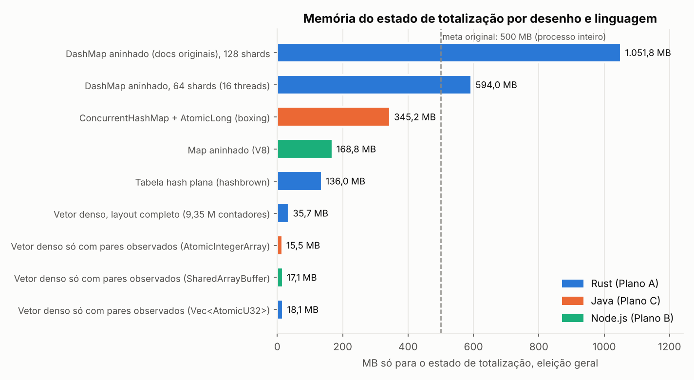
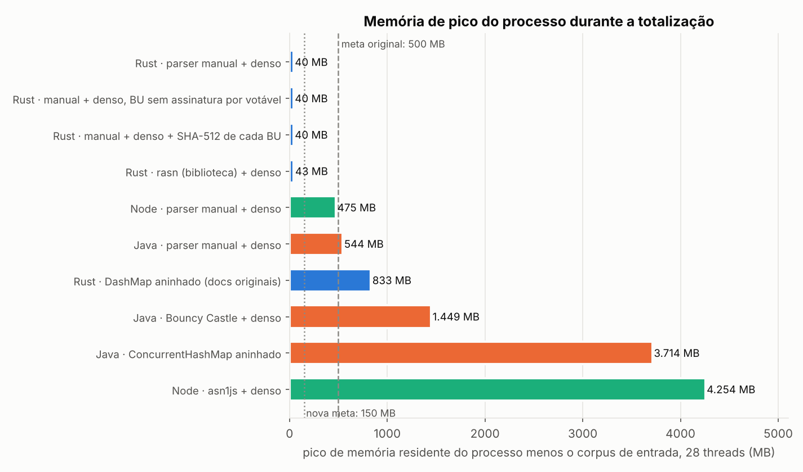
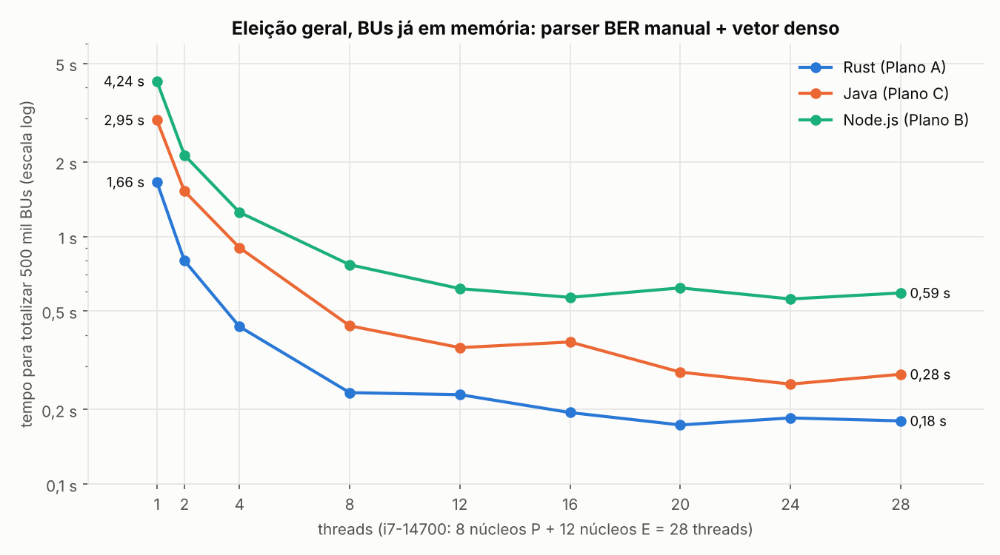
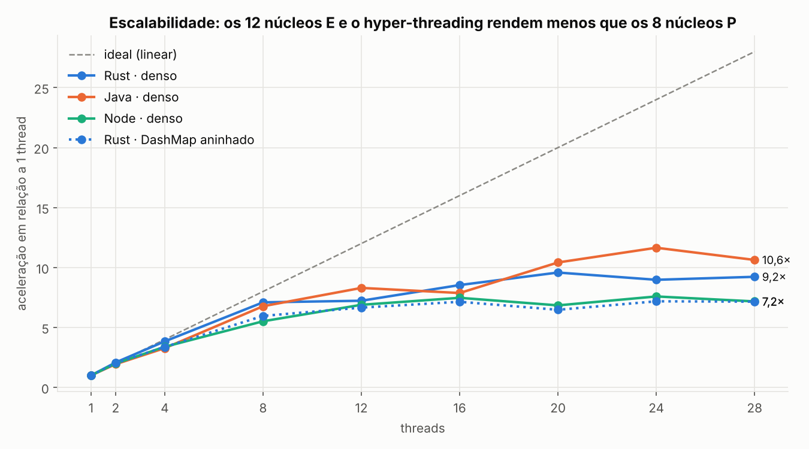
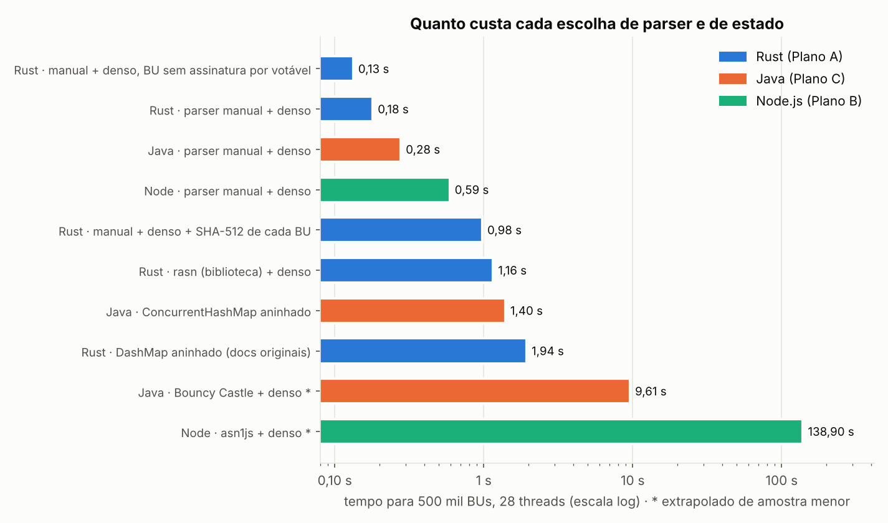

# Estimativas de Memória e Tempo de Totalização

* **Data das medições:** 11 de outubro de 2026
* **Máquina:** Intel Core i7-14700 (8 núcleos P + 12 núcleos E, 28 threads, L3 33 MB), 32 GB RAM, WSL2 Ubuntu 24.04 (kernel 6.18) com 28 CPUs e 15,5 GB visíveis
* **Runtimes:** Rust 1.97 (`lto = "fat"`, `codegen-units = 1`), OpenJDK 21.0.12 (G1 padrão), Node.js 24.21
* **Reprodução:** `./bench/benchmark.sh` (Linux/WSL2) ou `.\bench\benchmark.ps1` (Windows) — gera os BUs, verifica, mede e imprime o relatório; ≈ 7–10 minutos nessa máquina. Instruções em [bench/README.md](../../bench/README.md).
* **Termos técnicos:** [GLOSSARIO.md](GLOSSARIO.md)
* **Dados brutos:** [`bench/results/time.csv`](../../bench/results/time.csv), [`summary.csv`](../../bench/results/summary.csv), `mem_*.txt`, `machine.txt`

Este documento responde a duas perguntas: **quanta memória** o Urna Velox precisa em cada opção de linguagem e de desenho, e **quanto tempo** levaria para totalizar uma eleição real se todos os BUs estivessem disponíveis instantaneamente, sendo os recursos locais (CPU, threads, memória) o único limite.

## Resumo

| | Rust (Plano A) | Java (Plano C) | Node.js (Plano B) |
|---|---|---|---|
| **Eleição geral, 500 mil BUs, 28 threads** | **0,18 s** | 0,28 s | 0,59 s |
| Eleição geral, 500 mil BUs, 8 threads | 0,23 s | 0,44 s | 0,77 s |
| Eleição geral, 500 mil BUs, 1 thread | 1,66 s | 2,95 s | 4,24 s |
| Eleição municipal, 500 mil BUs, 28 threads | 0,06 s | 0,09 s | 0,26 s |
| Custo por BU numa thread (eleição geral) | 3,3 µs | 5,9 µs | 8,5 µs |
| Memória do estado (vetor denso) | 35,7 MB | 35,7 MB | 35,7 MB |
| Pico do processo, sem o corpus (28 threads) | **40 MB** | 544 MB¹ | 475 MB² |
| Mesmo trabalho com biblioteca ASN.1 (28 threads) | 1,16 s (`rasn`) | 9,6 s (Bouncy Castle) | 139 s (`asn1js`) |

¹ com `-Xmx3g` o G1 expande o heap livremente; um teto menor reduziria esse número (não medido).
² base do Node (~63 MB) + 28 workers × ~10,6 MB + heaps de JIT; o benchmark mantém duas cópias do corpus e as duas foram descontadas.

**Conclusões:**

1. **O tempo de CPU para totalizar uma eleição real é de frações de segundo nas três linguagens**, desde que o parser seja escrito à mão e o estado seja um vetor denso. A meta de "< 5 s" da versão 1 é folgada para o motor; o tempo real vai ser decidido pela leitura e descompressão dos pacotes do TSE (fora do escopo desta medição, ver §6).
2. **A escolha de biblioteca de parsing pesa mais que a linguagem.** `rasn` custa 9 × o parser manual; Bouncy Castle, 37 ×; `asn1js`, 186 × (comparando o custo por BU numa thread).
3. **O desenho de estado da versão 1 (`DashMap` aninhado) é o principal problema de memória**: 833 MB de pico no processo e 10,8 × mais lento que o vetor denso.
4. A vantagem do Rust é real, mas é de **1,5 a 3 ×**, não de "ordens de magnitude", e vem principalmente da memória do processo e da ausência de runtime.

---

## 1. Metodologia

### 1.1. Corpus sintético

Como os BUs reais não estavam disponíveis nesta sessão, o gerador `urnabench gen` (Rust) cria BUs sintéticos com estrutura **inspirada** no esquema público do TSE (`bu.asn1`): envelope genérico com o BU codificado num `OCTET STRING`; BU com cabeçalho, urna, identificação da seção, resultados por eleição → por cargo → lista de votáveis com `(tipo de voto, quantidade, partido, código, assinatura)`. Tudo em BER com tags de contexto implícitas, codificado pelo `rasn`.

| Parâmetro | Eleição geral (2026) | Eleição municipal |
|---|---|---|
| Seções | 500 mil (distribuídas por município com cauda pesada, Pareto α = 1,1) | 500 mil |
| Municípios | 5.570 (contagens reais por UF) | 5.570 |
| Eleições dentro do BU | 2 (federal: Presidente + Dep. Federal; estadual: Governador + Senador + Dep. Estadual/Distrital) | 1 |
| Candidatos | Dep. Federal = 20,7 × cadeiras da UF; Dep. Estadual = 15,3 × cadeiras; 11 a Presidente, 10 a Governador, 12 a Senador → ~27,4 mil | Prefeito 2–5 e Vereador 40–1.000 por município → ~557 mil |
| Votáveis por BU | 80–170 nominais por cargo proporcional + 25 legendas + brancos/nulos → **339 em média** | **116 em média** |
| Tamanho médio do BU | **17,1 KB** (6,5 KB sem o campo de assinatura por votável) | 6,0 KB |
| Senado | **2 vagas**: soma do cargo = 2 × comparecimento | — |

O corpus tem 20 mil BUs distintos (335 MB); a totalização de 500 mil BUs percorre o corpus ciclicamente, e cada iteração conta como uma seção distinta (ordinal próprio no bitset de deduplicação). Como o corpus é maior que o L3, os acessos à memória são realistas.

**Por premissa do pedido**, os BUs já estão na memória quando o cronômetro começa: não há leitura de disco nem descompressão. A medição cobre parsing + deduplicação + validação por cargo + agregação. A consolidação UF/Brasil é medida à parte (coluna `consolidate_ms`).

### 1.2. Variantes medidas

| Variante | Parser | Estado |
|---|---|---|
| `rust manual-dense` | BER manual sobre `&[u8]` | `Vec<AtomicU32>` denso, `fetch_add(Relaxed)` |
| `rust manual-dense-nosig` | idem, corpus sem assinatura por votável | idem |
| `rust manual-dense-sha512` | idem + SHA-512 de cada BU | idem |
| `rust rasn-dense` | `rasn` decodifica para structs | idem |
| `rust manual-dashmap` | BER manual | **desenho da versão 1**: `DashMap` aninhado em 3 níveis, propagação a cada voto |
| `java manual-dense` | BER manual sobre `byte[]` | `AtomicIntegerArray` |
| `java bc-dense` | Bouncy Castle 1.78.1 (árvore `ASN1Sequence`) | idem |
| `java manual-chm` | BER manual | `ConcurrentHashMap` aninhado em 3 níveis com `AtomicLong` |
| `node manual-dense` | BER manual sobre `Uint8Array` | `Uint32Array` em `SharedArrayBuffer` + `Atomics.add` |
| `node asn1js-dense` | `asn1js` 3 (árvore de objetos) | idem |

Em todas, as threads pegam blocos de 64 BUs de um contador atômico compartilhado. O *checksum* do vetor de totais é idêntico em todas as variantes densas das três linguagens (conferido automaticamente por `bench/scripts/verificar.sh` antes de cada medição), e nenhuma registrou BU inválido.

Repetições: 3 por ponto para `rust manual-dense`, 2 para `java/node manual-dense`, 1 para as demais; os gráficos usam a mediana. O Java descarta uma passada de aquecimento do JIT; no Node o aquecimento acontece dentro da medição (cada medição cria workers novos), o que penaliza o Node em algumas dezenas de milissegundos.

---

## 2. Memória: cálculo por componente

### 2.1. Estado de totalização (vetor denso, ADR-002)

```
contadores = Σ sobre (município, cargo) de [ candidatos(UF, cargo) + 31 legendas + branco + nulo + comparecimento ]
memória    = contadores × 4 bytes
```

| Eleição | Regiões (município × cargo) | Contadores | Memória |
|---|---|---|---|
| Geral 2026 | 27.855 | 9.352.247 | **35,7 MB** |
| Municipal | 11.142 | 935.599 | **3,6 MB** |

Cada região reserva espaço para todos os candidatos da UF, mesmo os sem voto no município. Na eleição geral, os pares com pelo menos um voto são ~4,5 M; um vetor só com eles ocuparia 18 MB, mas exigiria saber antes da apuração quem recebe voto onde.

### 2.2. Demais componentes do motor

| Componente | Cálculo | Geral | Municipal |
|---|---|---|---|
| Bitset de deduplicação | 500.000 bits | 0,06 MB | 0,06 MB |
| Hash curto por seção (ADR-006) | 500.000 × 8 B | 3,8 MB | 3,8 MB |
| Layout (`base`, `n_cand`) | regiões × 8 B | 0,2 MB | 0,1 MB |
| Índice número → candidato | tabelas por UF/cargo | < 2 MB | < 2 MB |
| Nomes e metadados | candidatos × ~60 B | ~2 MB | ~33 MB |
| Buffers de descompressão | threads × ~100 KB | ~3 MB | ~3 MB |
| **Total estimado (Rust)** | | **~47 MB** | **~46 MB** |
| **Medido (Rust, pico − corpus)** | sem nomes e sem descompressão | **40 MB** | **7 MB** |

### 2.3. Retenção por seção (modo opcional, ADR-009)

| Formato por votável | Bytes por BU (339 votáveis) | 500 mil seções |
|---|---|---|
| `u16` índice + `u16` votos | 1,36 KB | 0,68 GB |
| `u16` índice + votos em *varint* (~1 B) | 1,0 KB | 0,51 GB |
| índice em delta (~1 B) + votos em *varint* | 0,68 KB | 0,34 GB |

### 2.4. Estado medido por desenho e linguagem



| Desenho | Linguagem | Estado | Custo por combinação |
|---|---|---|---|
| `DashMap` aninhado, 128 partições/mapa (padrão numa máquina de 28 threads) | Rust | **1.051,8 MB** | ~234 B |
| `DashMap` aninhado, 64 partições/mapa (16 threads) | Rust | 594,0 MB | ~132 B |
| `DashMap` aninhado, 8 partições/mapa (2 threads) | Rust | 187,6 MB | ~42 B |
| `ConcurrentHashMap` + `AtomicLong` | Java | 345,2 MB | ~77 B |
| `ConcurrentHashMap` + `LongAdder` | Java | 379,0 MB | ~84 B |
| `Map` aninhado | Node (V8) | 168,8 MB | ~38 B |
| Tabela hash plana `u64 → u32` | Rust | 136,0 MB | ~30 B |
| **Vetor denso, layout completo** | qualquer | **35,7 MB** | 4 B por contador |
| Vetor denso, só pares observados | Rust / Java / Node | 18,1 / 15,5 / 17,1 MB | ~4 B |

Carga: 4.494.536 combinações (município, cargo, votável) em 27.850 pares (município, cargo). Medição: alocador contador em Rust; heap vivo após GC em Java e Node. Bun (medido à parte, numa máquina de 2 núcleos): `Map` aninhado 362 MB; vetor denso 17 MB.

**Por que o `DashMap` aninhado cresce com os núcleos:** cada `DashMap` cria `(threads × 4)` arredondado para potência de 2 partições, e cada partição ocupa ~130 bytes mesmo vazia. Com 55.700 mapas (dois por par município × cargo), só as partições vazias somam 438 MB a 64 partições/mapa.

### 2.5. Memória de pico do processo durante a totalização



Valores com 28 threads, eleição geral, descontando o corpus de entrada (335 MB). O pico inclui runtime, estado, buffers e lixo de GC ainda não coletado.

---

## 3. Tempo para totalizar uma eleição real

### 3.1. Parser manual + vetor denso, nas três linguagens



Tempo (s) para 500 mil BUs, eleição geral (mediana):

| Threads | 1 | 2 | 4 | 8 | 12 | 16 | 20 | 24 | 28 |
|---|---|---|---|---|---|---|---|---|---|
| **Rust** | 1,660 | 0,798 | 0,432 | 0,234 | 0,230 | 0,195 | 0,173 | 0,185 | 0,180 |
| **Java** | 2,952 | 1,524 | 0,901 | 0,436 | 0,356 | 0,375 | 0,283 | 0,253 | 0,278 |
| **Node** | 4,243 | 2,131 | 1,252 | 0,769 | 0,616 | 0,568 | 0,620 | 0,559 | 0,592 |

Eleição municipal (116 votáveis por BU):

| Threads | 1 | 2 | 4 | 8 | 12 | 16 | 20 | 24 | 28 |
|---|---|---|---|---|---|---|---|---|---|
| **Rust** | 0,544 | 0,286 | 0,146 | 0,116 | 0,067 | 0,061 | 0,054 | 0,051 | 0,057 |
| **Java** | 1,082 | 0,587 | 0,294 | 0,152 | 0,120 | 0,108 | 0,101 | 0,091 | 0,089 |
| **Node** | 1,460 | 0,744 | 0,443 | 0,250 | 0,234 | 0,249 | 0,265 | 0,248 | 0,255 |

Consolidação de UF e Brasil a partir dos municípios: **~5–6 ms** (Rust), ~20 ms (Java), ~12 ms (Node), numa thread.

### 3.2. Escalabilidade



* Até 8 threads a aceleração é quase linear (Rust: 7,1 × com 8 threads).
* Depois disso o ganho cai. Os 12 núcleos E são mais lentos que os P, o hyper-threading divide cada núcleo P entre duas threads, e a partir daí o tráfego de memória vira limite: com 28 threads o Rust lê ~47 GB/s do corpus e faz ~0,9 bilhão de incrementos atômicos por segundo em linhas de cache espalhadas.
* Evidência do limite de memória: o corpus sem assinatura por votável (6,5 KB/BU em vez de 17,1 KB) custa quase o mesmo numa thread (1,57 s contra 1,66 s), mas é 26% mais rápido com 28 threads (0,133 s contra 0,180 s).

### 3.3. Todas as variantes



| Variante | 1 thread | 28 threads | µs por BU (1 thread) | Pico − corpus (28 thr.) |
|---|---|---|---|---|
| Rust · manual + denso, BU sem assinatura por votável | 1,57 s | 0,13 s | 3,1 | 40 MB |
| **Rust · manual + denso** | **1,66 s** | **0,18 s** | **3,3** | **40 MB** |
| Java · manual + denso | 2,95 s | 0,28 s | 5,9 | 544 MB |
| Node · manual + denso | 4,24 s | 0,59 s | 8,5 | 475 MB |
| Rust · manual + denso + SHA-512 de cada BU | 11,75 s | 0,98 s | 23,5 | 40 MB |
| Rust · `rasn` + denso | 14,48 s | 1,16 s | 29,0 | 43 MB |
| Java · `ConcurrentHashMap` aninhado | 9,71 s | 1,40 s | 19,4 | 3.714 MB |
| Rust · `DashMap` aninhado (versão 1) | 13,88 s | 1,94 s | 27,8 | 833 MB |
| Java · Bouncy Castle + denso¹ | 110 s | 9,6 s | 220 | 1.449 MB |
| Node · `asn1js` + denso¹ | 790 s | 139 s | 1.579 | 4.254 MB |

¹ medido com 100 mil (Bouncy Castle) e 20 mil (`asn1js`) BUs e extrapolado linearmente para 500 mil.

### 3.4. Estimativa para outras máquinas

O custo por BU numa thread vale como unidade de trabalho. Para uma máquina com `n` núcleos físicos de desempenho parecido com um núcleo P do i7-14700:

```
tempo ≈ BUs × custo_por_BU / (n × eficiência),   eficiência ≈ 0,85–0,90 até 8 núcleos
```

| Máquina hipotética | Rust | Java | Node |
|---|---|---|---|
| 1 núcleo | ~1,7 s | ~3,0 s | ~4,2 s |
| Notebook, 4 núcleos | ~0,45 s | ~0,9 s | ~1,3 s |
| Desktop, 8 núcleos | ~0,25 s | ~0,45 s | ~0,8 s |
| Servidor, 32+ núcleos | limitado por banda de memória: ~0,1–0,2 s | ~0,2–0,3 s | ~0,5 s |

Núcleos de notebook antigos ou de baixo consumo podem ser 2–3 × mais lentos por thread; mesmo assim a totalização fica na casa de 1 segundo em Rust.

---

## 4. O que custa caro (além da linguagem)

| Escolha | Custo relativo ao Rust manual + denso (1 thread) |
|---|---|
| SHA-512 de cada BU | 7,1 × |
| Decodificar com `rasn` | 8,7 × |
| `DashMap` aninhado com propagação em 3 níveis | 8,4 × (e 10,8 × com 28 threads) |
| Java em vez de Rust (mesmo desenho) | 1,8 × |
| Node em vez de Rust (mesmo desenho) | 2,6 × |
| Bouncy Castle em vez de parser manual (Java) | 37 × |
| `asn1js` em vez de parser manual (Node) | 186 × |

---

## 5. Limitações e riscos das estimativas

* **Corpus sintético.** A estrutura segue o padrão do BU do TSE, mas não é o esquema oficial; o BU real tem campos adicionais (dados da urna, carga, correspondências, votos em trânsito etc.) e pode ter outros tamanhos. Como o custo do parser é dominado pela **quantidade de votáveis** e não pelos bytes (ver §3.2), o erro esperado é pequeno; ainda assim, os números devem ser refeitos com BUs reais na Fase 1.
* **Contagem de candidatos estimada** por cadeiras × razão média de 2022. O vetor denso cresce linearmente com ela.
* **WSL2**, não Windows nativo. O desempenho de CPU é equivalente; o sistema de arquivos não foi usado na medição.
* **Pico de RSS do Java** depende do teto de heap (`-Xmx3g` nos testes); não foi medido o mínimo viável.
* **Bun** não estava instalado na máquina de teste; aparece só nas medições de memória feitas à parte.

## 6. Fora do escopo: leitura e descompressão

Pela premissa do pedido, o tempo para obter cada BU foi desconsiderado. Na prática, para 500 mil BUs (~3–9 GB, conforme o tamanho real):

* Ler de pacotes `.zip` sequencialmente num SSD NVMe: ~1–3 s.
* Descomprimir *deflate* em paralelo: estimado em ~1 s com 20+ núcleos.
* Abrir 500 mil arquivos soltos no NTFS com antivírus ativo: dezenas de segundos a minutos — por isso o ADR-010 lê direto dos pacotes.

Ou seja: o motor totaliza em frações de segundo, e o tempo total observado pelo usuário será dominado pelo I/O.
