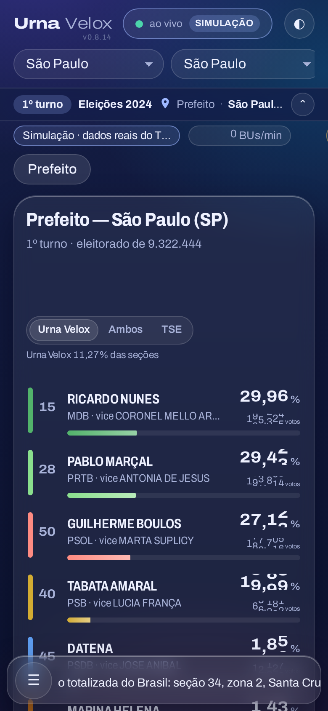
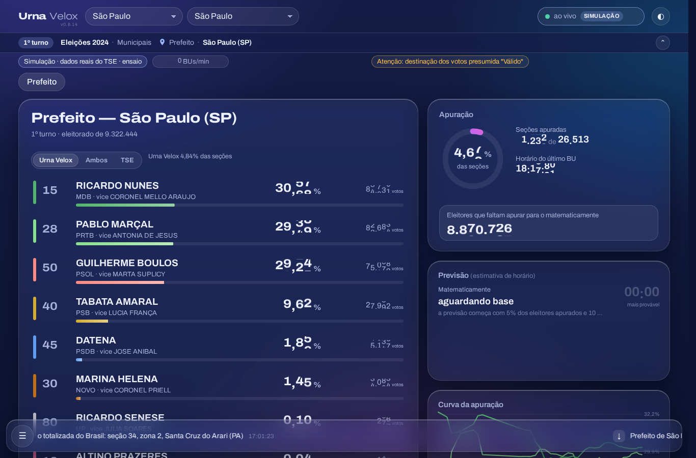
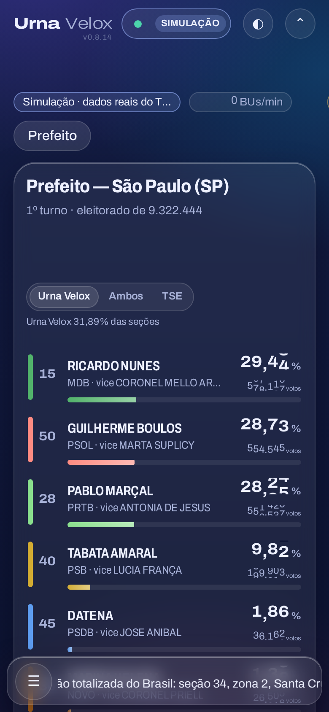
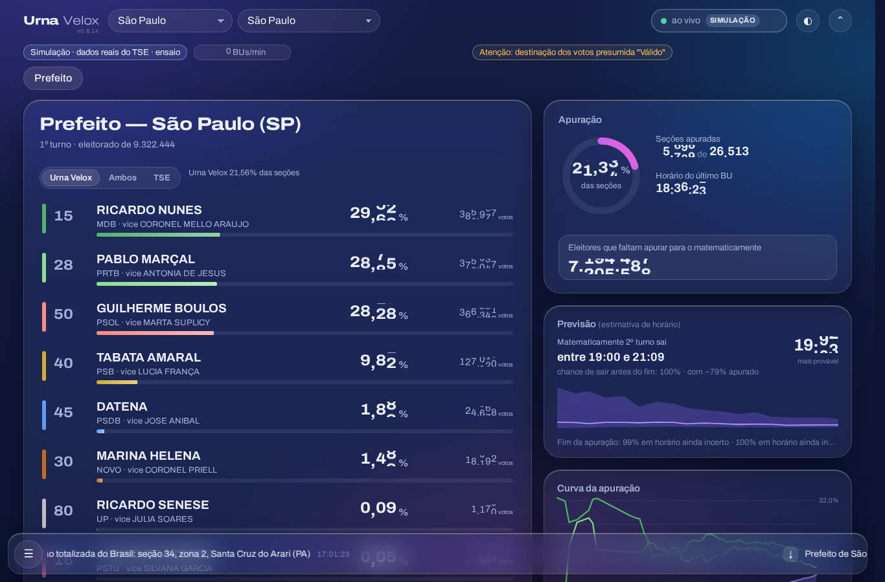
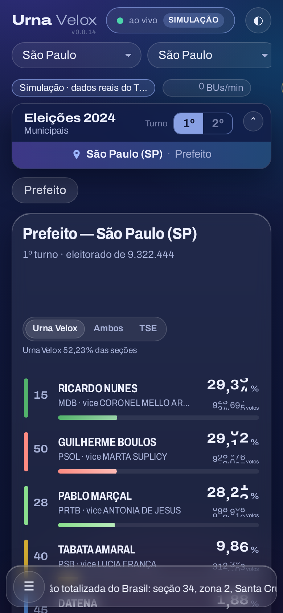
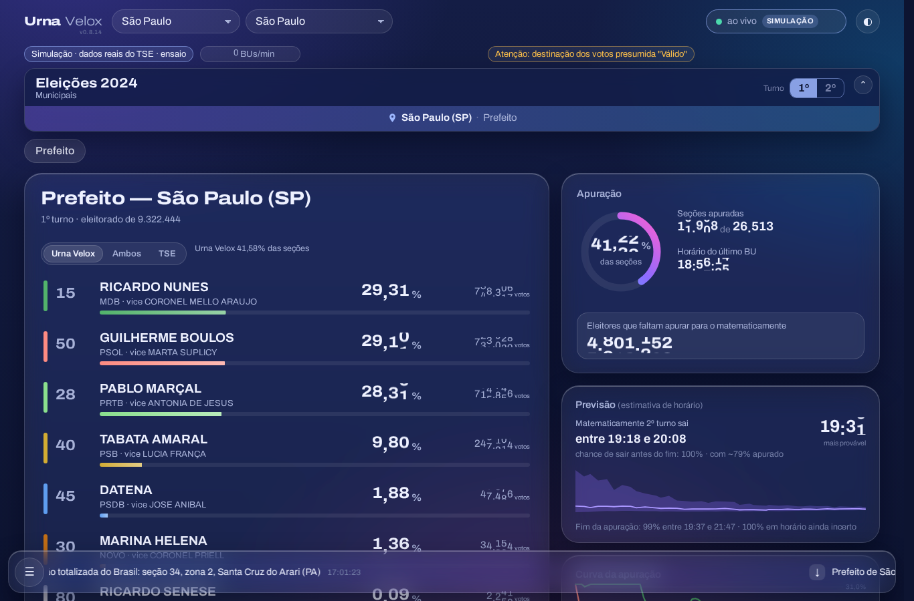

# M-001

[Lista de bugs e melhorias](../BUGS.md) · [Roadmap](../../ROADMAP.md)

## Registro em docs/BUGS.md (até 27/10/2026)

* **onde:** site público, topo da página
* **pedido:** **Identificação clara e permanente da eleição que está sendo vista.** Ele fica meio perdido ao olhar a página. Referência: o aplicativo oficial da Justiça Eleitoral deixa claro no topo qual é a eleição ("Eleições 2026 · Geral Ordinária"), a abrangência ("Anamã, AM") e o turno (1º/2º) — [captura](img/M-001-referencia-app-je.jpg). O que ele pediu: (1) eleição, abrangência e turno **nunca somem** ao rolar a tela; (2) a marca Urna Velox **pode sumir** ao rolar; (3) o usuário pode esconder essa faixa se quiser; (4) algo **simples, que ocupe pouco espaço e seja informativo**, sem perder a qualidade e a identidade visual atuais (que ele considera muito boas); (5) os controles do topo (incluindo o selo de simulado) estão muito bons, mas a disposição dessas informações e a identificação correta da eleição precisam melhorar.
* **estado:** feito
* **versão:** 0.8.16

## M-001 · identificação da eleição sempre à vista (0.8.16)

Três protótipos mostrados ao Luciano em capturas (a: faixa fina fixa; b: o topo fica fixo e troca a marca pela
identificação; c: cartão à moda do aplicativo da Justiça Eleitoral). Escolhida a **C**.

As capturas do topo (0.8.14, replay do 1º turno de 2024, Prefeito de São Paulo), guardadas em 30/10/2026 para a
melhoria do cabeçalho da `1.1` ([PROMPT_CABECALHO_1.1.md](../handoffs/PROMPT_CABECALHO_1.1.md)):

| | 390 px | 1366 px |
|---|---|---|
| a — faixa fina fixa |  |  |
| b — o topo fixo troca a marca pela identificação |  |  |
| c — cartão à moda do aplicativo da JE (escolhida) |  |  |

**Teste:** `UV_PLEITO=452 UV_TESTE_PAGINA=testes/identificacao.mjs bash aquisicao/scripts/ensaio_carga_pagina.sh 60
'#/sp71072/c0011'` (`site/testes/identificacao.mjs`, a 1366 e a 390 px, durante um replay): o cartão mostra eleição,
tipo, turno marcado, local e cargo; rolada a página, a identificação continua à vista presa no alto (topo ≤ 12 px, uma
linha ≤ 48 px) com turno e local; o botão recolhe, a escolha sobrevive a um recarregamento e o botão reabre; CLS < 0,01.

Antes (0.8.15, vermelho):

```
page.evaluate: TypeError: Cannot read properties of null (reading 'getBoundingClientRect')   (não há cartão)
```

Primeira versão (cartão que virava `position: fixed` ao rolar), também vermelha — a troca para `fixed` desloca o
próprio cartão na tela e conta como deslocamento de layout:

```
1366px: … rolado top 8 alt 40 · CLS 0.0082/0.2264/0.001
FALHOU — 1366px: CLS 0.0082 no topo, 0.2264 rolado; 390px: CLS 0 no topo, 0.0893 rolado
```

Correção: cartão estático no lugar reservado do `index.html` (88 px; 80 no celular; 40 recolhido) e, separada, uma
barra de uma linha sempre `position: fixed`, que entra por `transform`/opacidade quando o cartão sai da tela (não conta
no CLS). Texto do local alinhado à esquerda e "Gerais/Municipais" com lugar reservado, para nada andar ao preencher.
Recolhido: cartão e barra viram só o botão (lembrado no `localStorage`, aplicado ao carregar o módulo). O título da aba
também passa a dizer cargo, local e turno. `body` com `overflow-x: clip` (era `hidden`).

Depois (0.8.16, verde):

```
1366px: Eleições 2024 · Municipais · 1º turno · São Paulo (SP) · Prefeito · rolado top 8 alt 40 · CLS 0.0014/0.0014/0.001
390px: Eleições 2024 · Municipais · 1º turno · São Paulo (SP) · Prefeito · rolado top 8 alt 40 · CLS 0/0/0.0078
ok
```
