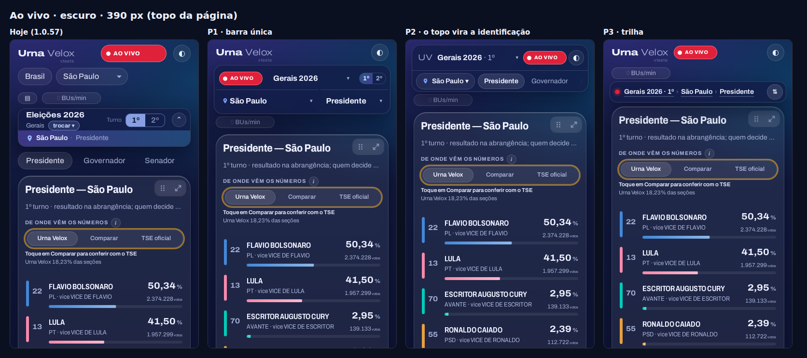
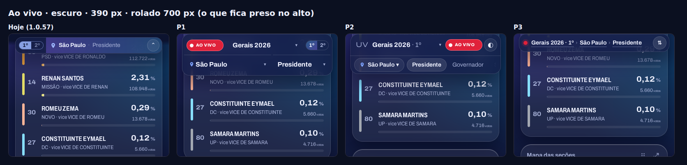
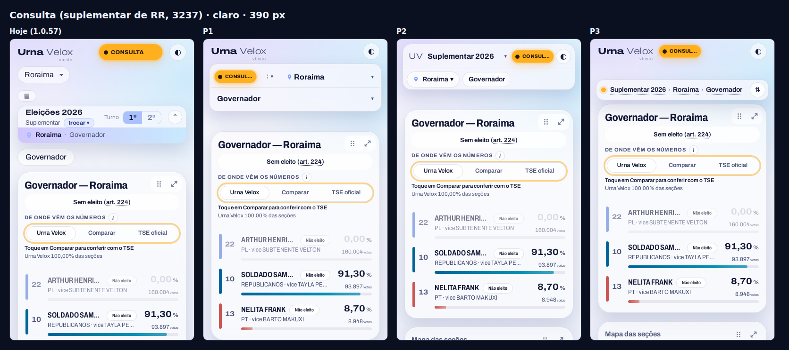
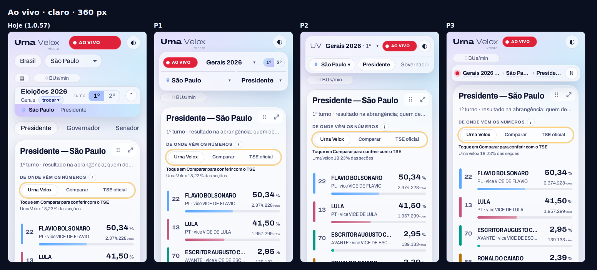
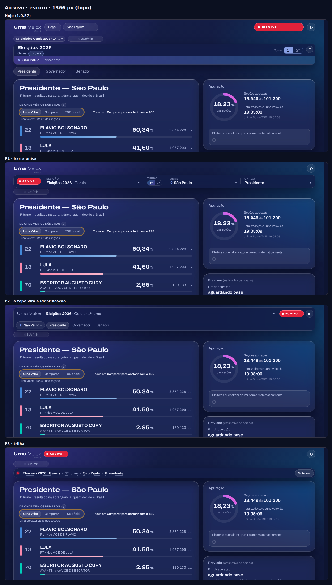
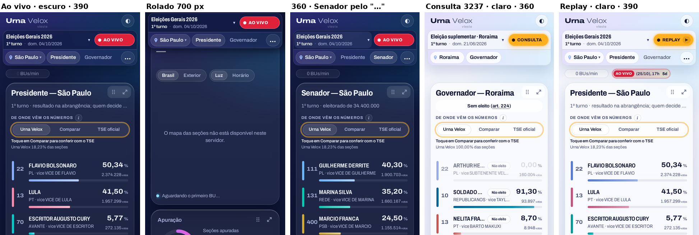
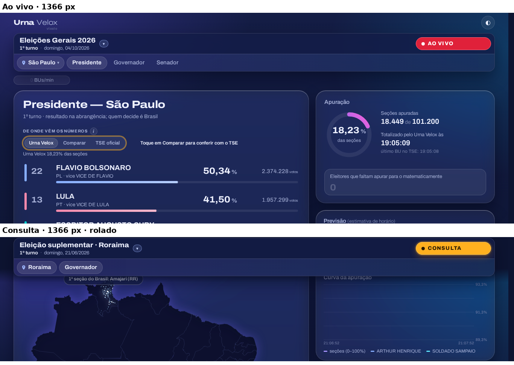

# M-025

[Lista de bugs e melhorias](../BUGS.md) · [Roadmap](../../ROADMAP.md)

## Registro

* **registrado em:** 30/10/2026
* **quem pediu:** Luciano ([PROMPT_CABECALHO_1.1.md](../handoffs/PROMPT_CABECALHO_1.1.md))
* **onde:** página, cabeçalho (topo, escolha da abrangência, faixa, cartão de identificação, pílulas de cargo)
* **roadmap:** `1.1` (multipleito; o seletor de pleito no topo é critério da `1.1.0`, §3.3 do
  [HANDOFF_1.1.0](../handoffs/HANDOFF_1.1.0.md))
* **pedido:** melhorar o cabeçalho: no celular ele ocupa cerca de um terço da tela antes do primeiro número, repete o
  pleito, o local e o cargo, o turno parece botão e não é, o seletor de pleito é pouco evidente e o selo do modo e a
  faixa disputam atenção com o resultado. Ponto de partida: **uma barra só** com a eleição, o turno, o local e o cargo
  (tocando em cada parte, escolhe-se aquilo) e o modo como um selo pequeno nela; a faixa só com o que muda na noite.
* **estado:** feito (escolhida a P2 em 30/10/2026, com os ajustes do Luciano; §3)
* **versão:** 1.0.62

## 1. Diagnóstico (1.0.57, sem mudar nada)

Medido com `site/testes/diag_cabecalho.mjs` (Playwright/Chromium, sem servidor; ao vivo e replay com os dados falsos do
1º turno de 2026 em `#/sp/c0001`, consulta com a série do 3237 em `#/p/3237`), a 360, 390, 768 e 1366 px, nos dois
temas. As alturas **não mudam** com o tema nem com o modo (tudo tem altura reservada): ao vivo, replay e consulta dão os
mesmos números. CLS ≤ 0,0002 em todos os 24 casos.

| largura | topo (marca, selo, tema; no celular + abrangência) | faixa | cartão de identificação | pílulas de cargo | fim do cabeçalho | 1º número (% do 1º candidato) |
|---|---|---|---|---|---|---|
| 360 / 390 px (tela de 844) | 104 (56 + abrangência 40 numa 2ª linha) | 34 | 80 (+4) | 46 (+6) | **y = 274 (32 %)** | y = 572 (68 %) |
| 768 px (tela de 1024) | 64 | 34 | 88 | 46 | y = 242 (24 %) | y = 564 (55 %) |
| 1366 px (tela de 900) | 64 | 34 | 88 | 46 | y = 242 (27 %) | y = 526 (58 %) |
| 390 px, cartão recolhido | 104 | 34 | 40 | 46 | y = 234 | y = 532 |

Entre o fim do cabeçalho e o primeiro número ainda vêm o título do cartão da corrida e o bloco "De onde vêm os números"
(≈ 290 px no celular): fora do escopo desta melhoria, mas é a outra metade do caminho até o número.

**Rolado** (700 px): fica presa só a barra de identificação (40 px, `top` 8). Somem o selo do modo, a faixa, a escolha
da abrangência e as pílulas de cargo (para trocar de cargo é preciso voltar ao topo). **No celular a barra presa não
diz a eleição** (só o turno, o local e o cargo).

**Informação repetida** (ao vivo, Presidente em SP):

| o quê | onde aparece |
|---|---|
| pleito | chip da faixa ("Eleições Gerais 2026 · 1º turno", no celular só "▤") e cartão ("Eleições 2026 · Gerais"), com textos diferentes; na consulta, "Eleição suplementar · Roraima" × "Eleições 2026 · Suplementar" |
| turno | chip da faixa, cartão (1º/2º), subtítulo da corrida ("1º turno · …") |
| local | escolha da abrangência ("Brasil", "São Paulo ▾"), cartão, título da corrida ("Presidente — São Paulo") |
| cargo | cartão, pílula selecionada, título da corrida |

**Parece clicável e não é:** o turno "1º 2º" do cartão (`span.id-seg`, com borda e fundo de controle segmentado,
cursor normal); o rótulo "Turno". Na consulta de um suplementar (turno único) o "2º" aparece mesmo assim.

**Controles só com símbolo:** o seletor de pleito no celular ("▤"), o tema ("◐"), recolher ("⌃"/"⌄"). Os três têm
`aria-label`, mas à vista não dizem o que fazem.

## 2. Propostas (protótipos)

Feitos com `site/testes/proto_cabecalho.mjs`: a página real de `dist/`, com o topo remontado no navegador (CSS e DOM
injetados; nada do `src/` mudou). Só capturas — nos protótipos nada abre. Em todas: some o cartão de identificação, a
escolha da abrangência e o chip do pleito da faixa; a faixa fica só com o que muda durante a noite (ritmo, "parado",
promo, avisos); o turno só aparece quando o pleito tem dois turnos (suplementar: some).

| proposta | cabeçalho até (390 / 1366 px) | 1º número (390 / 1366 px) |
|---|---|---|
| hoje | 274 / 242 | 572 / 526 |
| **P1 · barra única** | 188 / 142 | 486 / 426 |
| **P2 · o topo vira a identificação** | 142 / 142 | 440 / 426 |
| **P3 · trilha** | 130 / 130 | 428 / 414 |

* **P1 · barra única** (o ponto de partida do Luciano). Marca e tema numa linha que rola; abaixo, presa no alto, uma
  barra com o selo do modo (pequeno) e quatro partes rotuladas — **Eleição ▾ · Turno (1º 2º) · Onde ▾ · Cargo ▾** —,
  cada uma abrindo a sua escolha. No celular, duas linhas: selo + eleição + turno; local + cargo. *Some:* as pílulas de
  cargo (trocar de cargo passa a ser um toque a mais). *Junta:* pleito + turno + local + cargo + modo. *Ganho:* 86 px
  no celular, 100 px no computador.
* **P2 · o topo vira a identificação** (retoma a B da M-001). A linha da marca passa a ser a da eleição: marca
  encolhida ("UV" no celular), **Eleição · tipo · turno ▾**, selo, tema; segunda linha com **📍 local ▾** e as
  **pílulas de cargo** roláveis. As duas linhas ficam presas no alto. *Mantém* as pílulas (um toque para trocar de
  cargo) e o selo sempre à vista; *some* a marca grande. *Ganho:* 132 px no celular, 100 px no computador.
* **P3 · trilha** (retoma a A da M-001). Topo como hoje (marca, selo menor, tema) e uma linha fina presa:
  **● Gerais 2026 · 1º › São Paulo › Presidente** + "⇅ trocar"; cada trecho sublinhado abre uma folha única "o que
  ver" (eleição, turno, local, cargo). *Mais compacta* (144 px a menos no celular); *menos evidente* como seletor e
  depende da folha; o modo vira só um ponto colorido na trilha (o selo continua no topo, que rola).

Faltam nos protótipos, para a implementação: "Brasil" dentro da escolha do local; o painel "Escolha a eleição"
(`pleitos.js`) aberto pela parte da eleição; o selo continuar sendo o acesso à playlist (B-084: "CONSULTA" inteiro).

### Capturas

Ao vivo, escuro, 390 px:



Rolado 700 px (o que fica preso):



Consulta do 3237, claro, 390 px:



Ao vivo, claro, 360 px:



Ao vivo, escuro, 1366 px:



## 3. Implementação: P2 com os ajustes do Luciano (1.0.62)

Escolha do Luciano (30/10/2026, 14h31): "Implemente a p2. Se não couber no celular todos os cargos, apresente os
principais e o que não couber num botão '…' para o usuário selecionar outros cargos. Importante nessa barra ter a
identificação da eleição: eleições gerais 2026, eleição suplementar x, eleição municipais 2024, etc. e importante também
visualizar a data do pleito que está sendo visto. A barra de identificação, mais ao topo, deverá ser usada apenas coisas
gerais, independente da eleição."

* **Topo** (`header.topo`): só a marca e o tema (o que é geral, independente da eleição); rola e some.
* **Barra da eleição** (`#eleicao`, `site/src/identificacao.js`), presa no alto ao rolar (`position: sticky`), de altura
  fixa:
  * 1ª linha: o botão da eleição — o nome inteiro ("Eleições Gerais 2026", "Eleição suplementar · Roraima", "Eleições
    Municipais 2024": o título do pleito na lista dos pleitos, sem o turno) e, embaixo, o turno e a **data do pleito**
    ("1º turno · domingo, 04/10/2026"; no celular "dom. 04/10/2026") — que abre o painel "Escolha a eleição"; e o selo do
    modo (AO VIVO / REPLAY / CONSULTA / EM BREVE), menor, que continua abrindo o aviso com a playlist.
  * 2ª linha: o local (o texto à vista e um seletor nativo por cima: Brasil, os estados e os municípios do estado da tela)
    e as pílulas de cargo; **as que não cabem vão para o botão "…"** (também um seletor nativo), e a do cargo da tela fica
    sempre à vista.
  * Sem a lista dos pleitos: o nome pelo tipo e pelo ano (B-087) e a data pelo começo da série (consulta) ou pelo dia do
    último BU (ao vivo/replay, só depois das 8 h).
* **Saíram:** o cartão de identificação da M-001 (com o botão de recolher, que não faz mais sentido numa barra de duas
  linhas), a escolha da abrangência do topo, as pílulas soltas, o chip do pleito da faixa e o turno "1º 2º" que parecia
  botão. A faixa fica só com o que muda durante a noite (ritmo, "parado", promo, avisos).
* **Nada pula:** o local, o turno e o nome entram já com a tela (antes do primeiro resultado), os cargos são medidos
  depois do local, e o "▾" da eleição fica no canto do botão (não anda quando o nome muda).

| largura | fim do cabeçalho (antes → depois) | 1º número (antes → depois) |
|---|---|---|
| 360 / 390 px | y = 274 → **188** | y = 572 → **486** |
| 768 px | 242 → 196 | 564 → 518 |
| 1366 px | 242 → 196 | 526 → **480** |

### Teste

`site/testes/cabecalho.mjs` (sem servidor; ao vivo, replay e consulta do 3237; 360, 390, 768, 1366 e 1920 px; os dois
temas; `UV_MOTOR=webkit` para o WebKit): o topo só com a marca e o tema; a barra com o nome da eleição inteiro, o turno, a
data, o selo inteiro, o local e o cargo; todos os cargos à vista ou no "…"; presa no alto ao rolar; nada fora da tela nem
sobreposto; sem rolagem horizontal; CLS < 0,01; tocar na eleição abre a escolha; o "…" e o local trocam de tela; sem a
lista dos pleitos, nome e data pelo resultado.

Antes (1.0.61, vermelho):

```
aovivo-escuro-360        cabeçalho até y=138 · 1º número em y=572 · "null" · null · null · AO VIVO · null · cargos  · CLS 0.0000/0.0000
…
FALHOU (63):
aovivo-escuro-360: sem a barra da eleição (#eleicao)
aovivo-escuro-360 rolado: sem a barra da eleição (#eleicao)
…
```

Depois (1.0.62, verde):

```
aovivo-escuro-360        cabeçalho até y=188 · 1º número em y=486 · "Eleições Gerais 2026" · 1º turno · dom. 04/10/2026 · AO VIVO · São Paulo · cargos Presidente + … Governador/Senador · CLS 0.0000/0.0000
aovivo-escuro-1366       cabeçalho até y=196 · 1º número em y=480 · "Eleições Gerais 2026" · 1º turno · domingo, 04/10/2026 · AO VIVO · São Paulo · cargos Presidente/Governador/Senador · CLS 0.0000/0.0000
consulta-claro-360       cabeçalho até y=188 · 1º número em y=486 · "Eleição suplementar · Roraima" · 1º turno · dom. 21/06/2026 · CONSULTA · Roraima · cargos Governador · CLS 0.0000/0.0000
interação-360: Senador pelo "…" · cargos Presidente/Senador + … Governador
sem-pleitos-390: "Eleições Gerais 2026" · 1º turno · domingo, dom. 04/10/2026
ok
```

Testes ajustados à estrutura nova: `faixa_estavel.mjs` (a faixa começa pelo ritmo; a eleição da barra abre a lista),
`pleitos_pagina.mjs`, `consulta_pagina.mjs` (nome e data do 3237 na barra), `topo_anuncie.mjs`, `visual_pagina.mjs`
(B-040 com a barra nova), `validacao_1_1.mjs` (T1: o seletor é a eleição da barra, com a data) e `identificacao.mjs`
(o teste da M-001 contra um replay de verdade, agora sobre a barra). O `modo_pagina.mjs` pediu o selo um pouco mais
largo no celular (120 px: "EM BREVE ▶" e "REPLAY ▶" inteiros, dentro da margem de 16 px). O `promo_letreiro.mjs`
falhava desde o B-077 (`1.0.50`: supunha a promo antes do ritmo); passou a conferir só que os dois não se sobrepõem.

### Capturas (1.0.62)

Celular (ao vivo 390, rolado, Senador escolhido pelo "…" a 360, consulta do 3237 a 360, replay claro a 390):



Computador (1366 px; consulta rolada):


