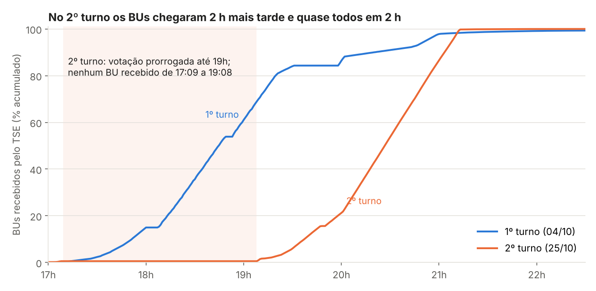
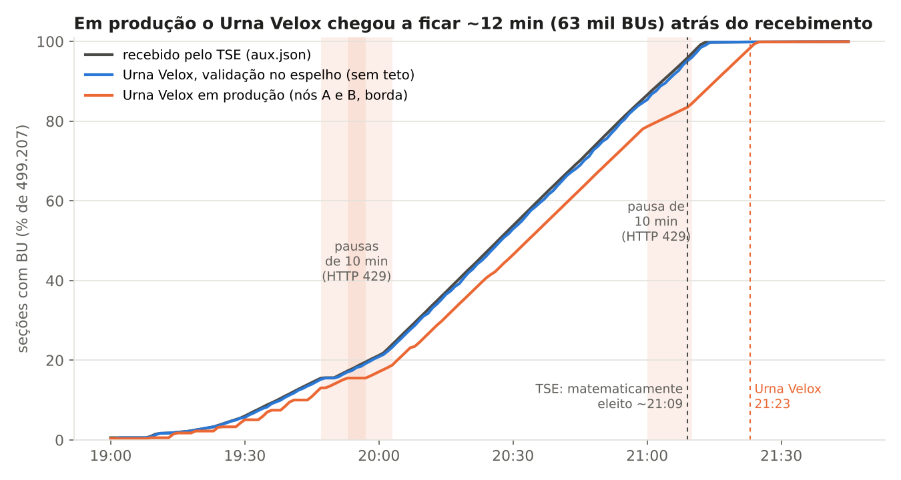
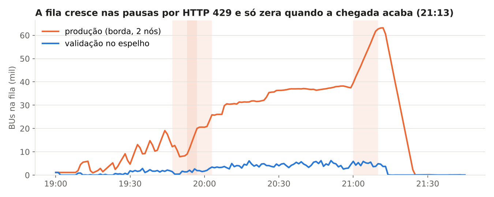

# Por que o Urna Velox ficou atrás do TSE em 25/10/2026 (2º turno)

Análise feita em 26/10/2026 com os dados dos dois nós de produção (backup completo do dia), a instância de validação
local e a linha do tempo do 1º turno. Fontes e scripts em [Como repetir](#9-como-repetir). Registro de bugs que saíram
daqui: B-066 e B-067 em [BUGS.md](../BUGS.md).

## 1. Resposta curta

**A chegada dos BUs foi diferente do costume, e o Urna Velox não teve folga para ela.**

1. **A votação foi prorrogada até as 19h, e os BUs chegaram ao TSE 2 h depois do costume.** Segundo a imprensa, uma
   decisão do ministro Cristiano Zanin (STF), tomada no fim da tarde de 25/10, prorrogou o recebimento de votos "por até
   duas horas, até às 19h, horário de Brasília", em todo o país ([O Povo](https://www.opovo.com.br/noticias/politica/2026/10/25/ministros-do-tse-se-reunem-a-portas-fechadas-apos-decisao-de-zanin.html)).
   Nos arquivos públicos isso aparece assim: de 17:09 a 19:08 nenhum BU teve recebimento registrado (no 1º turno, às
   19:00 já tinham chegado 60 %). Depois, 99 % das seções chegaram em pouco mais de 2 h, num ritmo constante de
   **~91 BUs/s durante 1 h** (pico de 96 BUs/s num minuto). A suspeita 1 se confirma, mas a causa não foi lentidão do
   TSE: foi o horário da votação.
2. **Esse ritmo é o teto do Urna Velox em produção.** Com 2 nós a 95 req/s e 2 requisições por BU (`aux.json` + BU),
   a federação baixa no máximo ~95 BUs/s. A chegada ocupou **96 % da capacidade por uma hora inteira**: não sobrou folga.
3. **Três HTTP 429 tiraram essa folga que não existia.** Cada 429 para o nó por 10 min (nó B às 19:47, nó A às 19:53 e
   às 21:00). A fila subiu para **63 mil BUs às 21:12** e só zerou quando a chegada acabou.
4. **Resultado:** a produção ficou, na mediana, **6,5 min** atrás do recebimento no TSE (p90: 12 min). O
   "matematicamente eleito" de Presidente saiu às **21:23**, contra **~21:09** no TSE.
5. **A mesma versão do Urna Velox, lendo um servidor espelho sem o teto de 100 req/s, acompanhou o TSE**: mediana de
   42 s depois do recebimento e "matematicamente" às 21:12. O gargalo foi a vazão pela borda pública, não o
   processamento.

> **O que é o "espelho" (ou "espelho sem teto").** Na noite de 25/10, além dos dois nós de produção, rodou uma
> terceira instância do Urna Velox, só para validação, sem aparecer no site. Ela lia os mesmos arquivos públicos de
> resultado (`cs.json`, `aux.json`, BUs), mas de um **servidor espelho**: uma cópia desses arquivos fora da borda
> pública (a CDN que atende o público), acessada em modo interno. Como o limite de 100 req/s vale só para a borda
> pública, essa instância rodou **sem esse teto** (300 req/s e, a partir das 20:47, 1.000 req/s). Mesmo código e
> mesmos BUs da produção; a única diferença relevante é a vazão permitida. Por isso ela serve de referência: mostra
> quanto do atraso é do Urna Velox em si e quanto vem do limite de requisições.

O que **não** explica o atraso: as implantações da noite (a última subiu às 18:39, antes de chegar qualquer BU), a
trava M-020 (só segura quando o Urna Velox está à frente; a fila do atraso não passou por ela) e a CPU dos nós.

## 2. A pergunta e as duas suspeitas

"Por que o Urna Velox ficou atrás do TSE nas totalizações de 25/10?" Suspeitas iniciais:

* **(1)** o TSE produziu os arquivos de BU mais devagar do que de costume;
* **(2)** o Urna Velox leu mais devagar do que o TSE produzia.

A análise separa o caminho de cada BU em três instantes que estão nos nossos próprios dados:

| instante | de onde vem | o que mede |
|---|---|---|
| recebido no TSE | `dr`/`hr` do `aux.json` (coluna `recebido` do `secoes.log`) | quando o TSE registrou o BU |
| disponível | `da`/`ha` da seção no `cs.json` (coluna `disponivel`) | na noite de 25/10, igual ao recebimento em mais de 99 % das seções |
| aplicado | `t_ms` da linha `aplicado` do `secoes.log` de cada instância | quando o Urna Velox totalizou e publicou o BU |

O arquivo público não diz quando o BU apareceu de fato na borda. A instância de validação (espelho, sem teto) serve de
limite: ela aplicou os BUs, na mediana, 42 s depois do recebimento, então no espelho a publicação levou no máximo isso.
Supondo que a borda pública recebe os arquivos junto com o espelho (não medido; ver §7), o resto do atraso da produção
é do Urna Velox.

## 3. Suspeita 1: os BUs chegaram ao TSE de forma diferente do 1º turno (votação até as 19h)



| | 1º turno (04/10, 3220) | 2º turno (25/10, 3221) |
|---|---:|---:|
| BUs com recebimento | 499.207 | 499.207 |
| recebidos até 19:00 | 60,0 % | 0,6 % |
| recebidos até 20:00 | 85,3 % | 20,7 % |
| recebidos até 21:00 | 97,6 % | 85,5 % |
| 50 % / 90 % / 99 % recebidos às | 18:45 / 20:21 / 21:49 | 20:27 / 21:04 / 21:12 |
| pico de 1 min | 6.534 BUs/min (109/s), 18:54 | 5.779 BUs/min (96/s), 21:11 |
| pico de 10 min (média) | 5.112 BUs/min (85/s) | 5.597 BUs/min (93/s) |
| **pico de 60 min (média)** | **4.526 BUs/min (75/s)** | **5.475 BUs/min (91/s)** |
| pausas de 3 min ou mais (17h–23h) | 17:00–17:07, 18:02–18:07, 18:50–18:52, 19:32–19:58 | **17:09–19:08 (120 min)** |

* **Por que 2 h sem BU: a votação foi prorrogada.** Segundo a imprensa, a decisão do ministro Cristiano Zanin (STF)
  estendeu o recebimento de votos até as 19h em todo o país; a votação tinha sido "encerrada oficialmente" às 17h em
  parte dos locais, e houve impasse sobre seções já fechadas e urnas desligadas
  ([O Povo, 25/10, 18h48](https://www.opovo.com.br/noticias/politica/2026/10/25/ministros-do-tse-se-reunem-a-portas-fechadas-apos-decisao-de-zanin.html)).
  Isso bate com os dados: o primeiro BU depois da pausa foi registrado às 19:09, e daí em diante a noite seguiu o
  padrão de sempre, só que 2 h mais tarde e mais concentrada.
* **A pausa de 2 h também valeu para a publicação.** Os 1.986 BUs recebidos entre 17:00 e 17:09 só ficaram visíveis
  por volta das 19:00: entre recebimento e aplicação passaram, na mediana, 2 h (7.229 s na produção e 6.794 s no
  espelho). É o mesmo silêncio que levou ao aviso "TSE sem novos BUs desde 17h11" (M-019).
* **Quem compara só o pico de 1 minuto se engana.** O pico de 1 minuto do 1º turno foi maior, mas durou pouco e veio
  depois de pausas. O que pesa para uma fila é a chegada sustentada: no 2º turno ela ficou perto de 91 BUs/s por uma
  hora inteira, contra 75 BUs/s no 1º turno.
* **Lição para a capacidade:** depois da prorrogação, a chegada sustentada foi de 91 BUs/s, contra 75 BUs/s no 1º
  turno. Noites fora do padrão acontecem; a folga de capacidade (§6) precisa cobrir casos assim.

## 4. Suspeita 2: o Urna Velox em produção não deu conta do ritmo





**Capacidade.** Cada nó coleta a até 95 req/s pela borda pública. Cada BU custa 2 requisições (`aux.json` + BU), então
um nó baixa ~47,5 BUs/s e os dois juntos ~95 BUs/s (5.700 BUs/min). A maior vazão medida num minuto foi de 5.594
BUs/min (nó A, 20:49). A chegada sustentada de 5.475 BUs/min é 96 % disso.

**As pausas por HTTP 429.** Depois de um 429, o nó para todas as requisições por 10 min (regra do projeto). Na noite:

| nó | 429 às | pausa até | 429 acumulados |
|---|---|---|---:|
| B | 19:47:57 | 19:57:56 | 18 |
| A | 19:53:50 | 20:03:48 | 26 |
| A | 21:00:11 | 21:10:10 | 32 |

Cada pausa tira ~28 mil BUs da capacidade (47,5 BUs/s × 600 s), ~85 mil nas três. Com a chegada já no teto, essa
perda não tem como ser recuperada enquanto os BUs continuam chegando. A fila só cai depois das 21:13, quando a chegada
termina, e zera às 21:25.

**Atraso entre o recebimento no TSE e a aplicação, por janela de recebimento** (segundos, p50 / p90):

| recebidos entre | BUs | produção (borda, 2 nós) | validação no espelho (sem teto) |
|---|---:|---:|---:|
| 19:00–19:30 | 24.728 | 248 / 327 | 27 / 42 |
| 19:30–20:00 | 75.740 | 337 / 482 | 35 / 59 |
| 20:00–20:30 | 159.723 | 353 / 492 | 40 / 66 |
| 20:30–21:00 | 163.928 | 437 / 753 | 50 / 78 |
| 21:00–21:30 | 71.519 | 693 / 855 | 47 / 80 |
| **noite toda (17h–24h)** | **498.429** | **389 / 717** (p99 1.011) | **42 / 72** (p99 106) |

Os nós A e B dão o mesmo resultado (cada um aplica todos os BUs, os seus e os do par).

**Marcos.** 50 % das seções: recebimento 20:27, espelho 20:28, produção 20:34. 95 %: 21:09, 21:09 e 21:20.
"Matematicamente eleito" (Presidente, Brasil): TSE ~21:09, espelho 21:12:16, produção 21:23:11.

**Um sinal antes do primeiro 429.** Entre 19:10 e 19:47 a chegada não passou de ~2.900 BUs/min, metade da capacidade,
e mesmo assim a fila da produção oscilou entre 1 mil e 19 mil BUs, em dentes de serra de ~5 min. O espelho não teve
isso. A causa está em aberto (§7).

## 5. O que não causou o atraso

| hipótese | o que os dados mostram |
|---|---|
| implantações durante a apuração | os reinícios da noite foram às 17:54–17:55, 18:07–18:09 e 18:57–18:59, todos dentro da pausa do TSE, sem nenhum BU novo para baixar |
| trava M-020 (`TRAVA_PP=10`) | ela só segura BU quando o Urna Velox está mais de 10 pontos à frente do TSE. No fim, `retidos` = 0 e 497.623 soltos; a produção esteve atrás o tempo todo do pico |
| `cs.json` atrasado (B-065) | o B-065 era do exterior. No Brasil o `disponivel` do `cs.json` coincide com o recebimento, e o espelho (mesmo código, mesma leitura do `cs.json`) acompanhou o TSE |
| CPU ou totalização | o M-002 mediu ~1 ms de CPU por BU nos nós (o par aplica ~1.100 BUs/s, mais de 10× a chegada); o espelho, com o mesmo código, aplicou até 8.104 BUs/min (20:48) |

## 6. Evoluções propostas para a próxima vez

Em ordem de impacto estimado. Nenhuma foi feita: a escolha e a ordem são do Luciano.

1. **Folga de capacidade de pelo menos 1,5×.** A noite de 25/10 pediu 91 BUs/s por uma hora; a federação tinha 95.
   Caminhos já mapeados no [M-002](RELATORIO_M002_VAZAO.md): **1 requisição por BU** (opção C: achar o BU sem o
   `aux.json`, o que dobra a vazão sem máquina nova) e **um 3º nó de outro órgão** (opção B: +50 % e N+1 contra a queda
   de um nó). Com qualquer uma das duas, a chegada de 25/10 ficaria abaixo de 2/3 da capacidade.
2. **Nó em pausa por 429 sai da partição.** A curva da produção indica que as seções do nó em pausa esperaram os 10 min
   (a vazão caiu à metade nas três pausas), mas isso precisa ser confirmado no código e no `servico.log`. Se for assim,
   tirar o nó da partição durante a pausa (como um nó caído) faz o par assumir essas seções dentro da própria cota.
3. **Achar a causa dos 429 abaixo de 95 req/s (B-067).** Conferir se todas as requisições contam no mesmo teto
   (comparação com o TSE, trava, sondagem, reforço do exterior) e se a sequência de 404 da sondagem no pico basta para
   provocar o 429. Depois, decidir entre baixar o teto no pico, segurar a sondagem enquanto houver fila e reservar parte
   da cota para o essencial.
4. **Medir a vazão real por segundo durante a noite.** O backup dos nós não tem série de req/s da noite de 25/10 (o
   `saude.json` guarda só o último estado; a telemetria de 15 s é a do ciclo diário). Sem essa série não dá para ver o
   req/s nos minutos antes de cada 429 nem explicar o dente de serra das 19:10–19:47.
5. **Manter o replay de 25/10 no ciclo diário.** A noite de 25/10 é o pior caso conhecido para a vazão: chegada
   comprimida e sustentada. Ela vira o ensaio de referência para medir cada evolução acima (atraso p50/p90, fila máxima,
   hora do "matematicamente").
6. **Não implantar durante a apuração.** Nada indica que as implantações da noite atrasaram BUs (todas antes da
   chegada), mas cada troca deixa a federação com um nó só por ~1 min. Num pico como o de 25/10, isso custaria mais fila.

## 7. Perguntas em aberto

1. **Por que houve 429 com o teto em 95 req/s?** (B-067). Faltam os req/s por segundo nos minutos antes de cada 429.
2. **O que causou o dente de serra da fila entre 19:10 e 19:47**, com a chegada na metade da capacidade? Candidatos: o
   ritmo de leitura do `cs.json` saindo do modo ocioso, a distribuição das seções entre os nós e a troca de lotes da
   federação.
3. **A borda pública recebe os arquivos junto com o espelho?** A análise supõe que sim (§2). Uma forma de medir na
   próxima noite: registrar, para uma amostra de seções, o primeiro 200 na borda e no espelho.
4. ~~Por que o TSE ficou 2 h sem registrar recebimentos?~~ Respondida (26/10, 19h13, pelo Luciano): a votação foi
   prorrogada até as 19h por decisão do ministro Cristiano Zanin (§3).

## 8. Conferência e dados

* Os nós A e B e o espelho aplicaram 499.207, 499.207 e 498.872 BUs (o espelho foi encerrado às 21:44, antes dos
  últimos BUs da madrugada).
* A conferência automática do fim da apuração (23:53) deu Presidente 29/29 idêntico ao oficial e 5 divergências em
  outros cargos, registradas como B-066 (só o sintoma).
* A análise não mexe em totalização nem resultado.

## 9. Como repetir

Os dados ficam em `D:\dados\urna-velox\pleitos\2026-10-25-3221\` (nós A e B, espelho e a análise) e a linha do tempo
do 1º turno em `D:\dados\urna-velox\pleitos\2026-10-04-3220\linha-do-tempo.csv`. Scripts em
[`aquisicao/scripts/analise_noite/`](../../aquisicao/scripts/analise_noite):

```bash
P=/mnt/d/dados/urna-velox/pleitos
python3 aquisicao/scripts/analise_noite/curvas.py --pleito $P/2026-10-25-3221    # minuto a minuto, percentis, marcos
python3 aquisicao/scripts/analise_noite/fila.py   --pleito $P/2026-10-25-3221    # fila e picos
python3 aquisicao/scripts/analise_noite/turnos.py --pleito $P/2026-10-25-3221 --anterior $P/2026-10-04-3220
python3 aquisicao/scripts/analise_noite/graficos.py --pleito $P/2026-10-25-3221 --saida docs/img
```
